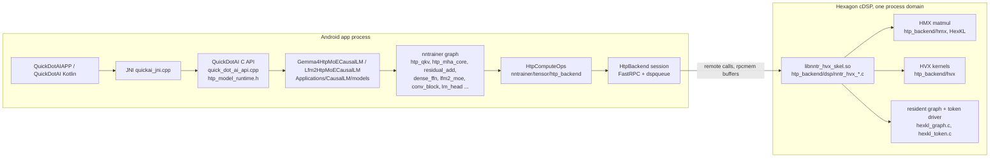
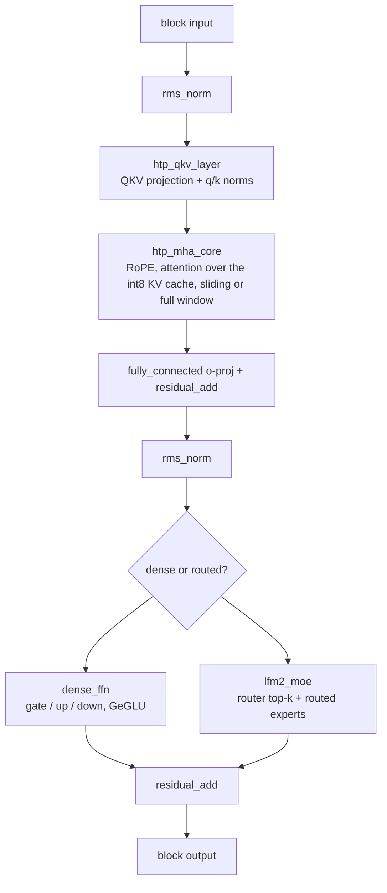

# HTP backend architecture

This page explains how nntrainer runs a decoder-only language model on the
Hexagon HTP (the NPU of Snapdragon SoCs), for people who want to read, debug
or extend that code. It names files and symbols; `git grep` them for the
details. If you only want to build and run a model, start with the
[Quick.AI documentation](../quickai/README.md) instead.

Two models use this backend today: Gemma4 26B-A4B (`Gemma4HtpMoECausalLM`,
`Applications/CausalLM/models/gemma4/`) and LFM2 24B-A2B
(`Lfm2HtpMoECausalLM`, `Applications/CausalLM/models/lfm2_moe/`). They share
the backend, the routed-expert layer and the attention path; the LFM2 model
adds the short-convolution block of its hybrid architecture.

## 1. The shape of the system

Three address spaces matter:

- **Host DDR** holds the tokenizer, the embedding table, staging buffers and
  whatever of the model file the kernel page cache keeps when the default
  loader is used (`htp.page_cache=-1`).
- **rpcmem (ION) buffers** are shared between the ARM and the DSP. The
  weights the DSP reads live in an **arena** of such buffers; the expert
  cache, the KV cache and the activations between layers are rpcmem too.
- **VTCM** is the DSP's local scratch, a few MB. Kernels DMA weight tiles in,
  run HMX or HVX on them and DMA the results out. Two-bit and ternary experts
  are expanded to int4 inside VTCM for the HMX during prefill.

The same `libnntrainer` serves the CPU and GPU models. The HTP backend is
one more `ComputeOps` table (`htp_compute_ops.cpp`) that a layer picks when
its `engine` property says `htp`. A model that does not ask for the HTP
never touches it.

## 2. Weight formats

| Format | Used for | Record layout | Defined in |
|---|---|---|---|
| `QS4CX` | dense projections (QKV, O, gate / up / down of the dense FFN) | row-major int4 nibbles, one FP32 scale per output column | `nntrainer/tensor/qs4cx_tensor.h` |
| `QS4CX_WH` | the same values, pre-arranged for the HMX | nibbles in the HMX WH tile order, then the scales, then one FP32 column sum per column | `qs4cx_tensor.h` (`QS4CX_WH_Tensor`), `htp_wh_layout.h` (the tile formula) |
| `QS2CX_WH` | 2-bit palette experts | 2-bit codes in WH tile order, a 4-byte palette of int4 levels, the scales, the column sums | `qs4cx_tensor.h` (`QS2CX_WH_Tensor`), `htp_wh_palette.h`, `hvx/hvx_expand_i2i4.c` |
| `TL2CX_WH` | native ternary experts | `ceil(N/128) * ceil(K/24) * 640` packed bytes, then N FP32 scales and N FP32 signed-weight column sums; levels are -1, 0, 1 with no palette | `htp_tl2_codec.h` / `.c` (packing), `htp_tl2_opts.h` (arena slots), `hvx/hvx_gemv_u8tl2.c` (decode GEMV) |
| `QS4CX_WH_AFFINE` | affine int4 projections, untied head, 4-bit expert layers of mixed packs | `K*N/2` WH int4 bytes, N FP32 scales, N FP32 code column sums, N INT32 channel offsets; `w = scale * (q + offset)` | `hmx/hexkl_wh_affine.h` |
| `Q4_0` | embedding table, and the head when it is tied | GGML Q4_0 blocks | existing CPU format; the HTP reads it through `htp_q4_0_convert.cpp` |
| `DW3_INT4` | LFM2 short convolutions | three int4 taps per channel | `hmx/hexkl_conv_block.c` |
| int8 KV | the attention cache | per-dimension fixed scales, int8 keys and values in HMX tiles | `hmx/hexkl_kv_q.c`, `cpu_backend/cpu_kv_q_attention.h` (the CPU mirror) |

No CPU kernel reads a WH tensor: `FloatTensor::dot` throws a named error, so
a model that carries them must route those layers to the HTP. Packing is
done offline by the converters described in
[Model packs](../quickai/model-packs.md); the loaders
(`htp_weight_preparation.cpp`, shared by both models) validate the
manifest and hand each tensor to the backend without re-packing. Changing a dtype name in
`nntr_config.json` does not convert the binary.

Native TL2 expert slots in the arena hold the packed payload and metadata
without padding; file payload offsets and arena capacity are distinct
layouts. A four-bit container can hold ternary values, but its slot size
follows the four-bit format, so mixed-format packs can use more arena memory
than an all-TL2 pack at the same `moe.cache_experts`.

## 3. Building the model graph

`Applications/CausalLM/models/model_registry.cpp` returns the default CPU/GPU
Gemma4 model unless `nntr_config.json` says
`gemma4_execution_profile = htp_fused`; a pack that names HTP engines
without that profile is rejected rather than half-run (`factory.h`). The
LFM2 MoE model is HTP-only.

`Gemma4HtpTransformer::constructModel` (`gemma4_htp_causallm.cpp`) builds one
decoder block per layer:

- `qkv_layer.cpp` implements the fused projections. `HtpMHACoreLayer`
  selects `MHACoreLayer`'s `Fp16Attention` implementation; its
  `HtpAttentionState` (`htp_attention_state.cpp`) owns the DSP cache handles
  and the int8 scale calibration and dispatches through
  `ComputeOps::sdpa_q_kvcache`. A declined call falls back to the CPU
  (`HtpMhaCoreDispatch` pins that contract).
- `lfm2_moe_layer.cpp` is the routed MoE block shared by both models: the
  router runs on the DSP (`router_logits_f32`), the selected experts are
  served from the expert cache, and `htp_expert_pool.h` decides which
  experts stay resident (`moe.cache_experts`).
- `nntrainer/layers/llm/` holds `lm_head`, `logit_softcapping` and the tied
  head. A tied Q4_0 head is split: the DSP computes the argmax of the logits
  it holds during decode and the CPU evaluates the prefill's last row. An
  untied `QS4CX` or affine head is bound to the decode graph's `LM_HEAD` op
  as WH column slices (`bindLmHeadWh` in `htp_compute_ops.cpp`), and the
  prefill's last row runs on the same slices through the skel entry
  `lm_head_wh_f32`, so no CPU copy of the head stays resident. A `QS4CX`
  head is converted to slices on first load and cached beside the model
  file as `<model file>.lmhead_wh`; an affine head is registered directly
  from its WH tile rows and needs no cache file.
- The Gemma4 per-layer-embedding path (`per_layer_slice`,
  `per_layer_input_sum`, `scalar_multiply`) is built from standard layers.
- `Gemma4HtpCausalLM::allocateAndBindKVCache` binds the per-layer cache
  placeholders; the sliding layers get a windowed cache, the global layers a
  full one (`layer_types`, `global_head_dim` and
  `num_global_key_value_heads` from `config.json`).
- `Gemma4HtpMoECausalLM::load_weight` builds the decode graph after the
  weights are registered.

The LFM2 model (`lfm2_htp_moe_causallm.cpp`) follows the same pattern with
`conv_block_layer.cpp` (three-tap convolution, gates and continuation
state) in place of attention on its convolution layers, and keeps the
checkpoint's two expert rotations (`conversion_report.json`).

## 4. Prefill and decode are two different paths

**Prefill** (the prompt) runs the graph layer by layer. Each HTP layer
stages its input rows into rpcmem, calls one skel entry (for example
`nntr_hvx_mm_u8i4_layer_norm_ld` for a projection with its norm folded in,
`nntr_hvx_attn_q2_prefill` for attention, `nntr_hvx_mm_u8i4_moe_layer_norm`
for a MoE block) and reads the result back as the next layer's input. The DSP
keeps the KV cache it wrote. Prompts longer than `init_seq_len` are fed in
chunks of that size (`chunkLongPrompts`). For the affine
262,144-entry head, prefill evaluates only the final input row, in 64 slices
of 4,096 outputs.

**Decode** (one token at a time) does not go through the layers once the
first token is out. The backend compiles the whole decode step into a
resident DSP graph (`graph_init`) whose op kinds are `RMSNORM`, `FC`,
`CONV1D_GATE`, `QK_NORM`, `ROPE`, `ATTN_M1`, `ADD`, `ROUTER_TOPK`, `MOE`,
`DENSE_FFN` and `LM_HEAD` (`htp_graph_desc.h`), and starts the **token
driver** (`token_driver_start`). From then on each token is one mailbox
message: the ARM posts the position, the DSP runs the graph, writes the
argmax id and posts it back. `CausalLM::generate` asks `htpDecodeTokenId`
first and skips the CPU logits path entirely when greedy decoding is in
effect (`nntr_htp_decode_hook.h`, `causal_lm.cpp`). Banned words and the
want-logits switch travel through the same hook, so sampling, repetition
penalties and logits processors still work by asking the DSP for the logits.

The decode loop's cost is almost entirely weight bandwidth: every token
reads its routed experts (8 of 128 per layer for Gemma4) plus the dense
projections. Keeping a bounded number of experts per layer resident in the
arena (`moe.cache_experts`), preloading experts at start
(`moe.preload_experts`) and predicting the next layer's experts from the
router (`htp_router_predict.h`, `htp_expert_prefetch.h`) are configured in
the `moe` object of `nntr_config.json`; see the
[configuration reference](../quickai/configuration.md).

Before decode, `ComputeOps::release_prefill_scratch` publishes any held
outputs and releases backend staging. QKV and dense-FFN CPU fallback
buffers are allocated only if the fallback runs. Native TL2 decode consumes
dense u8 activations directly; prefill expands the panels for the HMX.
`HtpExpertReadPool` serves small demand-read batches without waking the
whole compute pool. `HtpTokenPollState` prevents a server from polling the
same token twice. With `moe.server_done=true`, a token-number/complement
pair in the mailbox lets the server park before the dspqueue reception;
stale or torn records are rejected and older skels keep the fallback path.

## 5. The ARM side: `nntrainer/tensor/htp_backend/`

| File | Role |
|---|---|
| `htp_runtime_config.cpp/.h` | the typed `htp` and `moe` schema, defaults, validation, and the configuration's lifetime (fixed while a session is open, reset at teardown) |
| `htp_backend.cpp/.h` | opens the FastRPC session to the cDSP (one process domain), loads `libnntr_hvx_skel.so` from `ADSP_LIBRARY_PATH`, owns the dspqueue |
| `htp_compute_ops.cpp` | the `ComputeOps` table: weight registration (WH, palette, TL2, affine, Q4_0 arena), the per-layer prefill calls, the KV cache calls, `moe_experts`, graph init, the token driver and the decode hook |
| `htp_rpcmem.h` | rpcmem allocation, the arena and the staging pools |
| `htp_graph_desc.h` | the op kinds and the words that describe the resident graph to the DSP (`HTP_GRAPH_VERSION`, `HTP_GRAPH_MAX_PARTS`) |
| `htp_dspq_wire.h` | the dspqueue message format shared with `nntr_hvx_dspq.c` |
| `htp_moe_opts.h`, `htp_expert_pool.h`, `htp_expert_prefetch.h`, `htp_router_predict.h` | expert cache sizing and residency, prefetch and prediction |
| `htp_expert_read_pool.h`, `htp_prefill_readers.h`, `htp_token_completion.h` | demand-read and prefill reader ownership, the optional completion hint |
| `htp_tl2_codec.c/.h`, `htp_tl2_opts.h`, `htp_prepared_tl2.h`, `htp_prepared_qs2.h` | native TL2 packing and validation, arena slot options, prepared artifacts |
| `htp_static_quant.h`, `htp_act_quant.cpp` | static and dynamic activation quantization for the linear inputs |
| `htp_attention_state.cpp/.h`, `attention_quant_utils.h` | DSP KV cache handles and int8 scale calibration |
| `htp_weight_io.h`, `htp_weight_registry.h`, `htp_staging.h` | checked weight reads, registered-weight bookkeeping, staging; the file I/O mode itself (`htp.page_cache`: default loader, direct or cached reads) is `nntrainer/utils/weight_file_reader.cpp`, shared with the CPU models |
| `nntrainer/htp_context.cpp` | `htp_prepare_runtime` / `htp_release_runtime`, the process-wide handle the C API and the CLI share |

The CPU op table (`cpu_backend/cpu_ops_table.h`) carries the counterparts
the HTP path still needs on the ARM: the Q4_0 row-range GEMV for the CPU
half of a tied head, and the int8 KV attention so a model with
`attention_kv_dtype=q8` computes the same thing on either engine.

The configuration is process-wide: one HTP runtime exists per process, and
a CPU model loaded while an HTP model is active inherits the `htp.page_cache`
and `htp.load_prefetch` I/O policies through the shared loader utilities.
Reconfiguring an open session with different values is rejected; teardown
resets the configuration before another model loads.

## 6. The DSP side: `htp_backend/{dsp,hvx,hmx}/`

`dsp/nntr_hvx.idl` declares every remote entry point. `generate_stub.sh`
turns it into the ARM stub, and `dsp/build.sh` compiles the skel with the
Hexagon toolchain and links HexKL. Production `nntr_hvx_*.c` files and
`nntr_hvx_session.h` live in `dsp/`; diagnostic probes remain under
`test/htp/` and are compiled in only with the build option
`NNTR_HTP_DIAGNOSTICS=1`, their IDL ordinals otherwise kept by
`AEE_EUNSUPPORTED` stubs. The entry points fall into groups:

| Group | Entry points (prefix `nntr_hvx_`) | Implemented in |
|---|---|---|
| session and memory | `session_info`, `arena_attach`, `arena_probe`, `mem_probe_*` | `nntr_hvx_session.h`, `nntr_hvx_small_ops.c` |
| weights | `weight_register_u8i4_arena`, `weight_register_u2i4_arena`, `weight_swap_batch_*` (u8i4, u2i4, TL2 stable and compact), `weights_tl2`, `weight_set_offsets_batch`, `weight_set_static_quant`, `expand_i2i4` | `nntr_hvx_mm_u8i4.c`, `hmx/hexkl_mm_u8i4_dma.c`, `hvx/hvx_expand_i2i4.c` |
| projections and FFN | `mm_u8i4_layer*` (`_norm`, `_norm_ld`, `_res_add`, `_fused`, `_u8in`), `mm_u8i4_gate_up_swiglu`, `mm_u8i4_conv_block`, `fc_q4m1_f32`, `lm_head_q4m1_f32`, `lm_head_wh_f32` | `nntr_hvx_mm_u8i4.c`, `nntr_hvx_fc_q4.c`, `hmx/hexkl_mm_u8i4.c`, `hmx/hexkl_conv_block.c` |
| MoE | `router_logits_f32`, `router_topk_det_f32`, `mm_u8i4_moe_layer*` | `hmx/hexkl_mm_u8i4_moe.c`, `hvx/hvx_router_rows_f32.c` |
| attention | `attn_q2_prefill`, `attn_q2_step*`, `kv_register_q`, `kv_append_q`, `attn_m1_*` (decode), `attn_f16_*` (FP16 path) | `nntr_hvx_attn_q.c`, `nntr_hvx_attn_m1.c`, `nntr_hvx_attn_f16.c`, `hmx/hexkl_attn_q2.c`, `hmx/hexkl_kv_q.c` |
| small ops | `rmsnorm_det_f32`, `rmsnorm_add_f32`, `rope64_det_f32`, `softmax_*`, `swiglu_*`, `argmax_f32`, `q8_quant_f32` | `nntr_hvx_small_ops.c`, `hvx/hvx_*_rows_f32.c` |
| resident decode | `graph_init`, `graph_set_param`, `graph_share_param`, `forward`, `token_driver_start/stop`, `mailbox_run`, `dspq_start/stop` | `nntr_hvx_graph.c`, `nntr_hvx_token.c`, `nntr_hvx_mailbox.c`, `nntr_hvx_dspq.c`, `hmx/hexkl_graph.c`, `hmx/hexkl_token.c` |
| probes and benches (diagnostic builds) | `dma_probe`, `dspq_bench_*`, `probe_*`, `vlut_probe`, `tl2_gemv_probe` | `nntr_hvx_dma_probe.c`, `nntr_hvx_dspq_bench.c`, `nntr_hvx_*_probe.c` |

Inside a kernel the pattern is always the same: a worker pool
(`hvx/hvx_worker_pool.c`) runs one lane per HVX thread, a DMA ring
(`hmx/hexkl_dma_ring.c`) streams weight tiles from the arena into VTCM ahead
of the HMX, and the HMX matmul (`hmx/hexkl_hmx_mm.h` over HexKL) accumulates
int32 that `hvx/hvx_dequant_i32.c` turns back into FP32 with the scales and
column sums. An affine weight corrects the accumulator with
`offset[n] * sum_k(u8[k] - zero_point)` before dequantization. The scalar
references of the same arithmetic live next to the kernels (`*_det.h` under
`nntrainer/tensor/`) and are what the host checks compare against.

The ARM library, the generated IDL stub and the DSP skel describe one wire
contract (`HTP_GRAPH_VERSION`, the compact TL2 registration, the affine
registration, the `lm_head_wh_f32` entry). Rebuild and stage all three
together; a skel built for an older contract refuses a newer graph with
`HTP_GRAPH_E_UNSUPPORTED` instead of misreading it.

## 7. Online rotation and static activation quantization

Pre-rotated checkpoints need the runtime to rotate the expert input and the
input of the down projection with the same Hadamard basis and the same
per-coordinate signs as the checkpoint (`moe.hadamard`, `moe.hadamard_scope`,
`moe_hadamard_signs` pointing at a `nntr_hadamard_signs_v1` JSON). The
supported convention applies the normalized Sylvester transform (or the
Paley-I basis for `both_paley`) and then the output-coordinate signs,
`(x H) * signs` (`hvx/hvx_hadamard_f32.c`, `hmx/hexkl_mm_u8i4_moe.c`).
Scope `2bit` rotates only 2-bit expert containers; `all` rotates every
routed expert layer and never the dense FFN. Rotation stays off for an
unrotated checkpoint.

Linear activation quantization is dynamic by default. A checkpoint that
ships input encodings (`static_activation_file`, or `htp.static_linear`)
has its Q/K/V, output projections, dense gate/up/down, routed experts,
router input and head quantized on the supplied unsigned 8-bit grids in
both prefill and decode (`htp_static_quant.h`). Missing, extra or invalid
encodings fail loading. These sidecars cover the linear inputs only; the
attention cache keeps the backend's own int8 scales.

## 8. Tests, and what each one proves

| Test | Runs on | Proves |
|---|---|---|
| `bash test/htp/host/run_host_checks.sh` | x86, no SDK | the DSP sources compiled on scalar stand-ins (`standin/`, `hvx_emu/`, `stub/`): expert routing and prefetch ownership, DMA ring reuse, worker pool lanes, mailbox and token driver protocol, attention M=1 phases, RMSNorm / RoPE / router / softcap / GeGLU rows, FC and conv blocks, 2-bit expansion, TL2 packing, static grids, weight swap; each against the `*_det.h` references. It does not verify the hardware's arithmetic |
| `unittest_hexkl_*`, `unittest_hvx_softmax_q`, `unittest_cpu_kv_q_attention` | x86 (meson) | the attention plans, KV tile registries, the integer softmax and the CPU mirror of the int8 KV attention |
| `unittest_causallm_models` (`Gemma4HtpDifferential`, `Gemma4HtpContract`, `HtpMhaCoreDispatch`) | x86 (meson) | the fused FP32 tiny model matches its pinned reference; packs without the explicit profile, with unsupported dtypes or truncated weights are rejected before inference; attention dispatch and fallback |
| `generators/check_gemma4_htp_converter.py` | x86 (python) | the production converter reproduces the independent tiny serializer byte for byte |
| `python3 test/htp/host/lfm2_conversion_check.py` | x86 (python) | the SR15 converter's records and rotation offsets |
| `unittest_hvx_add` (`test/jni/Android.mk`, ndk-build with `HEXAGON_SDK_ROOT`) | device | HVX bring-up; the other `test/unittest/unittest_hvx_*.cpp` kernel tests have no ndk-build module yet |
| `tools/tl2_device_check.cpp`, `wh_affine_device_check.cpp`, `tl2_swap_device_check.cpp`, `gemma4_prefill_device_check.cpp` | device, compiled ad hoc (no build target in the tree) | TL2 and affine kernels at the model's shapes, slot swapping, prefill parity |
| `htp_continuation_check` (`-Denable-htp-device-check=true`) | device | resident continuation against single-row feeding |
| `quick_dot_ai_test` with `QDA_HTP_LIFECYCLE=1` | device | the C API lifecycle: load, parity across repeats, cancellation, unload, reload, invalid packs |
| `HtpAppLifecycleTest` | device (instrumentation) | the app's controls and prompt format, with token traces per step |
| `-Denable-htp=true -Dhtp-inproc=true` | x86 (meson) | the DSP sources and the ARM path compile together on the host; a compile gate only |

Device parity means parity with the recorded nntrainer runtime and pack. It
is not a perplexity result or a proof of equivalence to an external
reference implementation.

## 9. Reading order and how to extend

If you are new to the code, read in this order:

1. `Applications/CausalLM/res/gemma4/htp_chat/nntr_config.json`: every
   switch a pack exposes.
2. `Applications/CausalLM/models/gemma4/gemma4_htp_causallm.cpp`:
   `constructModel` and `createTransformerDecoderBlock`, to see the graph.
3. `nntrainer/layers/llm/fp16_attention.cpp` and
   `nntrainer/tensor/htp_backend/htp_attention_state.cpp`: attention
   arithmetic, CPU fallback and DSP cache ownership.
4. `nntrainer/tensor/htp_backend/htp_compute_ops.cpp`: search for
   `graph_init` and `token_driver_start` to see the decode path, and for
   `weight_register` to see how weights reach the arena.
5. `nntrainer/tensor/htp_backend/dsp/nntr_hvx.idl`, then
   `dsp/nntr_hvx_graph.c` and `hmx/hexkl_graph.c`: the DSP side of the same
   path.
6. `test/htp/host/graph_host_check.c`: the resident graph exercised on the
   host, the fastest place to put a breakpoint.

To add a DSP operation: declare it in `nntr_hvx.idl`, implement it in a
`nntr_hvx_*.c` skel source (and the HVX / HMX kernel under `htp_backend/`),
add it to the `SRCS` list in `dsp/dsp_sources.sh` and to
`htp_backend/meson.build` so the host twin compiles it, give it a scalar
reference and a host check under `test/htp/host/`, and call it from
`htp_compute_ops.cpp`. If it belongs to the decode step, add its op kind to
`htp_graph_desc.h` (append, never reorder) and teach `hexkl_graph.c` to run
it.

To support another model on this path: reuse the HTP layers through a new
`*CausalLM` subclass (most of the Gemma4 one is the graph description), add
its weight layout to a converter and to loader validation in the style of
`htp_weight_preparation.cpp`, and start from a tiny-reference test so that
correctness is pinned before the first device run. Runtime policy belongs in
the `htp` / `moe` schema (`htp_runtime_config.h`), never in environment
variables: the parser rejects unknown keys, so a new knob is added to the
X-macro list with its default and its validation rule.
