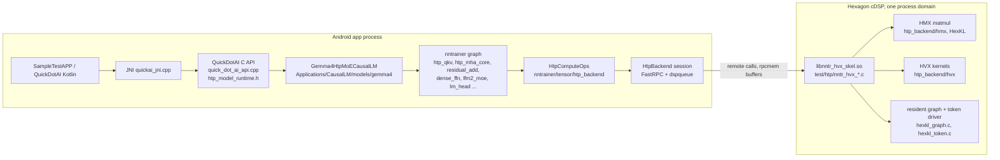
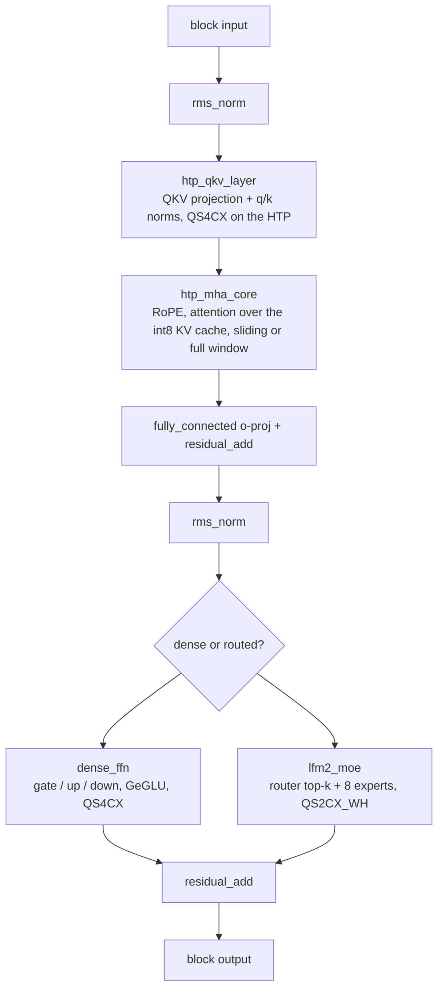

# Gemma4 on the Hexagon HTP: code guide

This document explains how the HTP (Hexagon NPU) path of nntrainer is put
together, so that someone who can build and run it (see the
[user guide](gemma4-htp-user-guide.md)) can also read, debug and extend it.
It names files and symbols; `git grep` them for the details. The format
examples below describe the original QS2/Q4 integration; see the
[TL2 guide](gemma4-htp-tl2-guide.md) for native ternary, affine WH and
rotation, and the [LFM2 guide](lfm2-htp-user-guide.md) for the hybrid model.

Updated 2026-10-18: native TL2 slots use compact registration/rebinding;
prefill staging and unused fallback scratch are reclaimed; decode uses a
dedicated demand-read pool with an optional completion hint. The
[dated validation record](gemma4-htp-tl2-guide.md#decode-optimization-2026-10-15)
separates the speed experiment, memory audit and combined-runtime checks.

## 1. The shape of the system

Three address spaces matter:

- **Host DDR** holds the tokenizer, embedding and staging buffers, and the
  model mapping when mmap loading is selected. Head residency depends on the
  pack: the native affine WH head is registered on the DSP without a second
  CPU weight copy.
- **rpcmem (ION) buffers** are shared between the ARM and the DSP. Weights the
  DSP reads live in an **arena** of such buffers; the expert cache, the KV
  cache and the activations between layers are rpcmem too.
- **VTCM** is the DSP's local scratch (a few MB). Kernels DMA tiles in, run
  HMX / HVX on them, and DMA results out. The 2-bit experts are expanded to
  int4 inside VTCM.

The same libnntrainer serves the CPU and GPU models; the HTP backend is one
more `ComputeOps` table (`htp_compute_ops.cpp`) that a layer picks when its
`engine` property says `htp`.

## 2. Weight formats

| Format | Used for | Record layout | Defined in |
|---|---|---|---|
| `QS4CX` | dense projections (QKV, O, gate / up / down of the dense FFN) | row-major int4 nibbles, one fp32 scale per output column | `nntrainer/tensor/qs4cx_tensor.h` |
| `QS4CX_WH` | the same values, pre-arranged for the HMX | nibbles in the HMX WH tile order, then the scales, then one fp32 column sum per column | `qs4cx_tensor.h` (`QS4CX_WH_Tensor`), `htp_wh_layout.h` (the tile formula) |
| `QS2CX_WH` | the 128 routed experts | 2-bit codes in WH tile order, a 4-byte palette of int4 levels, the scales, the column sums | `qs4cx_tensor.h` (`QS2CX_WH_Tensor`), `htp_wh_palette.h` (palette fit), `hvx/hvx_expand_i2i4.c` (expansion on the DSP) |
| `TL2CX_WH` | native ternary experts | packed ternary codes, FP32 scales and signed-weight column sums; compact arena slots | `htp_tl2_opts.h`, `hvx/hvx_gemv_u8tl2.c` |
| `QS4CX_WH_AFFINE` | affine projections and untied head; mixed-format experts | WH int4 codes, FP32 scales and code sums, INT32 channel offsets | `hmx/hexkl_wh_affine.h` |
| `Q4_0` | embedding table and the language-model head | GGML Q4_0 blocks | existing CPU format; the HTP reads it through `htp_q4_0_convert.cpp` |
| int8 KV | the attention cache | per-dimension fixed scales, int8 keys and values in HMX tiles | `hmx/hexkl_kv_q.c`, `cpu_backend/cpu_kv_q_attention.h` (the CPU mirror) |

No CPU kernel reads a WH tensor: `FloatTensor::dot` throws a named error, so
a model that carries them must route those layers to the HTP. The offline
packing is done by `Applications/CausalLM/res/gemma4/htp_weight_converter.py`;
`gemma4_htp_weights.cpp` validates the `htp_fused_v1` manifest and hands each
tensor to the backend without re-packing.

## 3. Building the model

`Applications/CausalLM/models/model_registry.cpp` keeps the main Gemma4
factory as the default and returns `Gemma4HtpMoECausalLM` only when
`nntr_config.json` says `gemma4_execution_profile = htp_fused`; a pack that
mentions HTP engines without the profile is rejected rather than half-run.

`Gemma4HtpTransformer::constructModel` (`gemma4_htp_causallm.cpp`) builds one
decoder block per layer:

- `htp_qkv_layer.cpp` and `htp_mha_core.cpp` are the attention of the fused
  graph. `HtpMHACoreLayer` keeps the KV cache mirrored on both sides, asks
  `ComputeOps::sdpa_q_kvcache` to run the attention on the DSP, and falls
  back to the CPU reference when the backend declines (the unit test
  `HtpMhaCoreDispatch` pins that contract).
- `lfm2_moe_layer.cpp` is the routed MoE block shared with the LFM2 models:
  the router runs on the DSP (`router_logits_f32`), the selected experts are
  served from the expert cache, and `lfm2_moe_pool_layer.cpp` / `expert_lru.h`
  decide which experts stay resident (`moe_cache_experts`).
- `nntrainer/layers/llm/` holds `lm_head`, `logit_softcapping` and the HTP
  tied-embedding head; the head is split so the DSP computes the argmax of
  the logits it holds and the CPU only sees logits when sampling needs them.
  An untied `QS4CX` head is bound to the decode list's `LM_HEAD` op as WH
  slices (`HTP_GRAPH_FEED_WH`, the FC's M = 1 kernel into the logits) and
  the prefill's last row runs on the same slices (`lm_head_shared_fp32`,
  skel entry `lm_head_wh_f32`), so no CPU copy of the head stays resident.
- The per-layer-embedding path of Gemma4 (`per_layer_slice`,
  `per_layer_input_sum`, `scalar_multiply`) is built from standard layers.

`Gemma4HtpCausalLM::allocateAndBindKVCache` binds the per-layer cache
placeholders (25 sliding layers with 8 KV heads of 256, 5 full layers with 2
KV heads of 512 on the 26B model) and `Gemma4HtpMoECausalLM::load_weight`
builds the decode list after the weights are registered.

## 4. Prefill and decode are two different paths

**Prefill** (the prompt) runs the graph layer by layer. Each HTP layer stages
its input rows into rpcmem, calls one skel entry (for example
`nntr_hvx_mm_u8i4_layer_norm_ld` for a projection with its norm folded in,
`nntr_hvx_attn_q2_prefill` for attention, `nntr_hvx_mm_u8i4_moe_layer_norm`
for a MoE block) and reads the result back as the next layer's input. The DSP
keeps the KV cache it wrote. Prefill of 1,028 tokens takes about 1.8 s on
the S26 Ultra.

**Decode** (one token at a time) does not go through the layers at all once
the first token is out. The backend compiles the whole
decode step into a resident DSP graph (`graph_init`, 542 ops for the 26B
model: `RMSNORM`, `FC`, `QK_NORM`, `ROPE`, `ATTN_M1`, `ADD`, `ROUTER_TOPK`,
`MOE`, `DENSE_FFN`, `LM_HEAD`) and starts the **token driver**
(`token_driver_start`). From then on each token is one mailbox message: the
ARM posts the position, the DSP runs the graph, writes the argmax id and
posts it back. `CausalLM::generate` asks `htpDecodeTokenId` first and skips
the CPU logits path entirely when greedy decoding is in effect
(`nntr_htp_decode_hook.h`, `causal_lm.cpp`). Banned words and the
want-logits switch travel through the same hook, so sampling, repetition
penalties and logits processors still work by asking the DSP for the logits.

The decode loop's cost is almost entirely weight bandwidth: 128 experts per
layer at 2 bits, of which 8 are read per token, plus the dense projections.
Keeping 16 experts per layer resident in the arena (`moe_cache_experts`) and
predicting the next layer's experts from the router (`htp_router_predict.h`,
`htp_expert_prefetch.h`) is what the `NNTR_MOE_*` options tune.

Before decode, `ComputeOps::release_prefill_scratch` publishes any held
outputs and releases backend staging after the relevant work completes.
QKV and dense-FFN CPU fallback buffers are allocated only if fallback runs.
The contiguous inference planner can reuse gaps without increasing the
allocation relative to its old layout. Native TL2 decode consumes dense u8
activations directly; prefill still expands panels for HMX.

`HtpExpertReadPool` handles small demand-read batches without waking the
whole compute pool. `HtpTokenPollState` prevents a server from polling the
same token twice. With `NNTR_MOE_SERVER_DONE=1`, a token-number/complement
pair in the existing mailbox lets the server park before DSPQ reception.
The hint does not establish success or replace DSPQ output/status checks;
stale/torn records are rejected and older skeletons keep the fallback path.

## 5. The ARM side: `nntrainer/tensor/htp_backend/`

| File | Role |
|---|---|
| `htp_backend.cpp/.h` | opens the FastRPC session to the cDSP (one process domain), loads `libnntr_hvx_skel.so` from `ADSP_LIBRARY_PATH`, owns the dspqueue |
| `htp_compute_ops.cpp` | the `ComputeOps` table: weight registration (WH / palette / Q4_0 arena), the per-layer prefill calls, the KV cache calls, `moe_experts`, graph init and the token driver, the decode hook |
| `htp_rpcmem.h` | rpcmem allocation, the arena and the staging pools |
| `htp_graph_desc.h` | the op kinds and the words that describe the resident graph to the DSP |
| `htp_dspq_wire.h` | the dspqueue message format shared with `nntr_hvx_dspq.c` |
| `htp_moe_opts.h`, `htp_expert_prefetch.h`, `htp_router_predict.h` | MoE cache sizing, prefetch and prediction |
| `htp_expert_read_pool.h`, `htp_token_completion.h` | demand-read worker ownership and optional token-completion hint |
| `htp_prepared_fc.h`, `htp_prepared_qs2.h`, `htp_prepared_tl2.h`, `htp_qs2_lut_layout.h` | how each weight format is laid out in the arena |
| `nntrainer/htp_context.cpp` | `htp_prepare_runtime` / `htp_release_runtime`, the process-wide handle the C API and the CLI share |

The CPU op table (`cpu_backend/cpu_ops_table.h`) carries the counterparts the
HTP path still needs on the ARM: the Q4_0 row-range GEMV for the CPU half of
the head, and the int8 KV attention so a model with `attention_kv_dtype=q8`
computes the same thing on either engine.

## 6. The DSP side: `test/htp/` and `htp_backend/{hvx,hmx}/`

`test/htp/nntr_hvx.idl` declares every remote entry point; `generate_stub.sh`
turns it into the ARM stub, `test/htp/build.sh` compiles the skel with the
Hexagon toolchain and links HexKL. The entry points fall into groups:

| Group | Entry points (prefix `nntr_hvx_`) | Implemented in |
|---|---|---|
| session and memory | `session_info`, `arena_attach`, `arena_probe`, `mem_probe_*` | `nntr_hvx_session.h`, `nntr_hvx_small_ops.c` |
| weights | `weight_register_u8i4_arena`, `weight_register_u2i4_arena`, `weight_swap_batch_*`, `weights_tl2`, `expand_i2i4` | `nntr_hvx_mm_u8i4.c`, `hmx/hexkl_mm_u8i4_dma.c`, `hvx/hvx_expand_i2i4.c` |
| projections and FFN | `mm_u8i4_layer*` (`_norm`, `_norm_ld`, `_res_add`, `_fused`, `_gate_up_swiglu`), `mm_u8i4_conv_block`, `fc_q4m1_f32`, `lm_head_q4m1_f32` | `nntr_hvx_mm_u8i4.c`, `nntr_hvx_fc_q4.c`, `hmx/hexkl_mm_u8i4.c`, `hmx/hexkl_conv_block.c` |
| MoE | `router_logits_f32`, `router_topk_det_f32`, `mm_u8i4_moe_layer*` | `hmx/hexkl_mm_u8i4_moe.c`, `hvx/hvx_router_rows_f32.c` |
| attention | `attn_q2_prefill`, `attn_q2_step*`, `kv_register_q`, `kv_append_q`, `attn_m1_*` (decode), `attn_f16_*` (fp16 path) | `nntr_hvx_attn_q.c`, `nntr_hvx_attn_m1.c`, `nntr_hvx_attn_f16.c`, `hmx/hexkl_attn_q2.c`, `hmx/hexkl_kv_q.c` |
| small ops | `rmsnorm_det_f32`, `rmsnorm_add_f32`, `rope64_det_f32`, `softmax_*`, `swiglu_*`, `argmax_f32`, `q8_quant_f32` | `nntr_hvx_small_ops.c`, `hvx/hvx_*_rows_f32.c` |
| resident decode | `graph_init`, `graph_set_param`, `graph_share_param`, `forward`, `token_driver_start/stop`, `mailbox_run`, `dspq_start/stop` | `nntr_hvx_graph.c`, `nntr_hvx_token.c`, `nntr_hvx_mailbox.c`, `nntr_hvx_dspq.c`, `hmx/hexkl_graph.c`, `hmx/hexkl_token.c` |
| probes and benches | `dma_probe`, `dspq_bench_*`, `probe_*`, `vlut_probe`, `tl2_gemv_probe` | `nntr_hvx_dma_probe.c`, `nntr_hvx_dspq_bench.c`, `nntr_hvx_*_probe.c` |

Inside a kernel the pattern is always the same: a worker pool
(`hvx/hvx_worker_pool.c`) runs one lane per HVX thread, a DMA ring
(`hmx/hexkl_dma_ring.c`) streams weight tiles from the arena into VTCM ahead
of the HMX, and the HMX matmul (`hmx/hexkl_hmx_mm.h` over HexKL) accumulates
int32 that `hvx/hvx_dequant_i32.c` turns back into fp32 with the scales and
column sums. The scalar references of the same arithmetic live next to the
kernels (`*_det.h` under `nntrainer/tensor/`) and are what the host checks
compare against.

## 7. Runtime configuration and options

The configuration the model was validated with is built into the library,
in `nntrainer/tensor/htp_fixed_opts.h`; neither the app nor the CLI sets
it, and it is not an option any more:

| Setting | Value | Effect |
|---|---|---|
| `htp_fixed::E2E` | on | compile the decode step into the resident DSP graph and run the token driver |
| `htp_fixed::MOE_CACHE_EXPERTS` | 16 | experts kept resident per layer in the arena (a model's `moe_cache_experts` still names its own count) |
| `htp_fixed::E2E_FREE_KVQ` | on | free the host copies of the quantized KV caches once the DSP holds them |
| `htp_fixed::KV_DROP_CPU` | on | drop the CPU KV cache mirror after prefill |
| `htp_fixed::DROP_HOST_FC` | on | unmap the host copy of the dense projections once registered in the arena |
| `htp_fixed::ATTN_M1_Q8` | 2 | decode attention over the int8 KV cache with fixed per-dimension scales, on every layer |
| `htp_fixed::FC_IN_ARENA` | on | dense projections live in the DSP arena, not in staging buffers |
| `htp_fixed::MOE_DMA_QUEUES` | 4 | the M = 1 MoE feed splits each expert matrix over four DMA queues |
| `htp_fixed::PREDICT` | 2 | the ARM predicts the next MoE layer's experts from the router's input row (Gemma's softmax routers only; `NNTR_HTP_PREDICT=0` turns it off) |
| `htp_fixed::PREFETCH_READERS` / `PREFETCH_SLOTS` / `PREFETCH_RESIDUAL` | 4 / 32 / 0.5 | the predicted experts are read into spare DMA slots ahead of their layer |
| `htp_fixed::RELEASE_PREFILL_SCRATCH` | on | the CPU prefill scratch is discarded once the first token is out |
| `htp_fixed::MOE_POOL_TARGET` | 34 | after the first token the expert pool grows towards 34 experts a layer, as far as the PD's 3840 MiB mapping ceiling (minus a 256 MiB margin) allows; `NNTR_MOE_CACHE_GROW=<n>` names the growth itself, 0 for none |

The C API (`Applications/CausalLM/api/htp_model_runtime.h`) sets
`ADSP_LIBRARY_PATH` for the DSP skel. Environment controls still include
page-cache policy, preload, cache growth and optional completion hints:

| Variable | Effect |
|---|---|
| `NNTR_HTP_PAGE_CACHE=0` or `1` | read the weight file through the bounded reader instead of mmap: 0 bypasses the page cache (direct IO), 1 bounds it; unset keeps the mmap loader |
| `NNTR_MOE_PRELOAD_EXPERTS=128` | default startup preload; distinct from total expert-cache capacity |
| `NNTR_MOE_CACHE_GROW=0` | keep capacity fixed for the C16 measurement preset |
| `NNTR_MOE_DEMAND_POOL=0` | disable the dedicated demand-read pool; it is enabled by default |
| `NNTR_MOE_SERVER_DONE=1` | opt into the mailbox completion hint; default off |

Diagnostics that are safe to set from the outside:

| Variable | Effect |
|---|---|
| `NNTR_HTP_TOKEN_TRACE=<path>` | write the input and output token ids of a run as JSON |
| `NNTR_HTP_PROFILE=1` | per-op timing from the DSP |
| `NNTR_HTP_DUMP=<dir>` | dump layer inputs and outputs for comparison with the CPU |
| `NNTR_HTP_ATTN_F32_CHECK=1` | compare the DSP attention with an fp32 CPU reference |
| `NNTR_MOE_TRACE=1` | log expert hits and misses per layer |
| `NNTR_HTP_RELEASE_PREFILL_SCRATCH=1` | drop the CPU prefill scratch once the resident decode graph owns the step |
| `NNTR_GENERATED_IDS=<path>` | write the generated token ids, one per line, without asking the DSP for logits |
| `NNTR_HTP_ATTN_DSP_CALIB=0` | calibrate the int8 attention scales on the CPU instead of inside the DSP step |
| `NNTR_MOE_CACHE_GROW=<n>` | grow the expert pool by exactly n slots per layer after the first token instead of the built-in bounded growth to 34 (0 = none); S26 Ultra, page cache off, C16: +18 takes the decode from 10.1 to 13.9 tok/s for about 1 GB of arena |

The rest of the `NNTR_HTP_*` and `NNTR_MOE_*` variables (about sixty) are
tuning knobs for experiments; their readers are in `htp_compute_ops.cpp`,
`htp_moe_opts.h` and the HTP layers, and
[`docs/ENV_FLAGS.md`](ENV_FLAGS.md) explains the rule for documenting them.

## 8. Tests, and what each one proves

| Test | Runs on | Proves |
|---|---|---|
| `test/htp/host/run_host_checks.sh` | x86, no SDK | the DSP sources, compiled on scalar stand-ins (`standin/`, `hvx_emu/`, `stub/`): expert routing and prefetch ownership, DMA ring reuse, worker pool lanes, mailbox and token driver protocol, attention M=1 phases, RMSNorm / RoPE / router / softcap / GeGLU rows, FC and conv blocks, 2-bit expansion, weight swap; each against the `*_det.h` references |
| `unittest_hexkl_*`, `unittest_hvx_softmax_q`, `unittest_cpu_kv_q_attention` | x86 (meson) | the attention plans, KV tile registries, the integer softmax and the CPU mirror of the int8 KV attention |
| `unittest_causallm_models` (`Gemma4HtpDifferential`, `Gemma4HtpContract`, `HtpMhaCoreDispatch`) | x86 (meson) | the fused FP32 tiny model matches its pinned reference; packs without the explicit profile, with unsupported dtypes or truncated weights are rejected before inference; attention dispatch and fallback |
| `generators/check_gemma4_htp_converter.py` | x86 (python) | the production converter reproduces the independent tiny serializer byte for byte |
| `unittest_hvx_attn`, `_attn_f16`, `_attn_q`, `_fc`, `_mm_u8i4`, `_softmax` | device (ndk-build via `test/htp/run_u8i4_layer_on_device.sh`) | the HVX / HMX kernels against CPU references on silicon |
| `quick_dot_ai_test ... QDA_HTP_LIFECYCLE=1` | device | the C API lifecycle: load, parity across repeats, cancellation, unload, reload, invalid packs |
| `HtpAppLifecycleTest` (two methods) | device (instrumentation) | the app's controls and prompt format, with token traces per step |
| `-Denable-htp=true -Dhtp-inproc=true` | x86 (meson) | the DSP sources and the ARM path compile together on the host (a compile gate; nothing it prints is a device number) |

## 9. Reading order and how to extend

If you are new to the code, read in this order:

1. `Applications/CausalLM/res/gemma4/htp_chat/nntr_config.json`: every switch
   the model exposes.
2. `Applications/CausalLM/models/gemma4/gemma4_htp_causallm.cpp`:
   `constructModel` and `createTransformerDecoderBlock`, to see the graph.
3. `Applications/CausalLM/layers/htp_mha_core.cpp`: one HTP layer end to end,
   including the CPU fallback.
4. `nntrainer/tensor/htp_backend/htp_compute_ops.cpp`: search for
   `graph_init` and `token_driver_start` to see the decode path, and for
   `weight_register` to see how weights reach the arena.
5. `test/htp/nntr_hvx.idl`, then `test/htp/nntr_hvx_graph.c` and
   `nntrainer/tensor/htp_backend/hmx/hexkl_graph.c`: the DSP side of the same
   path.
6. `test/htp/host/graph_host_check.c`: the resident graph exercised on the
   host, which is the fastest place to put a breakpoint.

To add a DSP operation: declare it in `nntr_hvx.idl`, implement it in a
`nntr_hvx_*.c` skel source (and the HVX / HMX kernel under `htp_backend/`),
add it to the `SRCS` list in `test/htp/build.sh` and to
`nntrainer/tensor/htp_backend/meson.build` so the host twin compiles it, give
it a scalar reference and a host check under `test/htp/host/`, and call it
from `htp_compute_ops.cpp`. If it belongs to the decode step, add its op kind
to `htp_graph_desc.h` and teach `hexkl_graph.c` to run it.

To support another model on this path: reuse the HTP layers through a new
`*CausalLM` subclass (the Gemma4 one is 1,100 lines, most of it the graph
description), add its weight layout to the converter and to
`gemma4_htp_weights.cpp`-style validation, and start from the tiny-reference
test so that correctness is pinned before the first device run.
