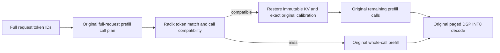

# Gemma4 radix prefixes with unchanged optimized q8 attention

This version preserves the original whole-call q8/Q2 attention calibration,
Q16/K8/V8 kernels, encoded U16 context, folded O projection, and the original
projection/FFN/MoE prefill batches. It removes the 256-query calibration policy.
The Q2 host dispatch functions and DSP attention/O-projection sources match
the revision immediately before that policy was introduced. Older prefix-only
row-quantized dispatch and head-width overrides are also removed. Prefix mode
requires the existing Q2/U16 configuration; it cannot select another numerical
attention route.

## Reuse contract

A radix token match is necessary but is not sufficient. The saved computation
must have the same prefill call boundaries as independent inference on the new
request. This matters because whole-call quantization scales depend on all
query/KV values in that call, including tokens beyond a proposed token prefix.

The index publishes completed **original prefill calls**. A newly computed
request retains its last completed full native call boundary and its final multi-row
prefill endpoint. Earlier sliding windows are not retained: preserving them
would add copies to later prefill compactions. Each retained frame stores its
call start/end, activation plane, chunk size, exact calibration, and FP16 KV.
The lookup checks the original full request's call plan before adopting a state.
It never changes attention batching or calibration to manufacture a cache hit.
Physical DSP decode pages remain 64 rows; reusable prefill units follow the
existing model's much larger call boundaries (4096 rows in the validation pack).
The final partial call is reusable only when the target has that same prefill
endpoint. The final prompt token still runs through the original DSP decode.

Examples with `init_seq_len=4096` and `skip_prefill=true`:

| Source / new request | Behavior |
| --- | --- |
| 4608-token source; new input shares 4096 tokens and has a new suffix | Reuse the original first 4096-token call; run the suffix with original calls |
| Same 2080-token input again | Reuse its complete 2079-token prefill, then run the last input token normally |
| 3072-token source; new 2080-token input shares 2048 tokens | Miss: 2048 is inside the source's original whole-call calibration |
| 1024-token source; new input shares 768 tokens | Miss: an interior crop would change the original numerical computation |

A hit can leave one, two, or more input tokens. A native one-row prefill tail
uses the existing M1 operation; its original KV window is initialized before
seeding instead of after prefill. Once that row transfers ownership to DSP,
the application continues with the resident state. This also fixes the original
seed-twice failure for a 4098-token input on a 4096-row plane. Such a source
retains its preceding 4096-token host checkpoint; the M1 row is already DSP-owned.
Non-default repetition penalties and the debug `NNTR_RESUME_BLOCK=0` mode
fall back to recomputation because their call/processor state is not restored.
Prefixes below 64 tokens are not retained. Unsupported matches are ordinary
misses and execute the original route.



## Ownership and memory

Completed calls retain shared RPC slabs as immutable FP16 page views instead of
copying the full KV payload. The last full native-block snapshot is taken after
its original compaction. The final host window is then represented by a read-only
row offset: it has the same live bytes and dropped-row maxima as the original
compaction, without its memmove or a second copy to protect an earlier snapshot.
The first DSP seed reads that exact view and subsequent decode tokens use the
ordinary entry. Host checks compare its bytes and maxima with original compaction.

Global prefixes share unchanged rows. The generic snapshot API freezes pinned
pages before mutating compaction, restore or reset, but the native retention
policy avoids preserving windows across later writing prefill blocks.
No attention values, scale rules, kernel precision or prefill call sizes change.

DSP INT8 session pages and their COW forks remain a separate ownership domain.
Radix entries use host-only IDs and release callbacks. They do not create an
unused DSP decode checkpoint or force its tail pages through COW. Native DSP
checkpoints are retained only for actual session switches/forks.
Selecting a resident session does not reconstruct its history on the CPU.
Flash snapshots retain DSP INT8 state; the host FP16 radix index is not persisted.

Retention is limited by prefix count/LRU, not by a byte budget. A view pins its
entire underlying RPC allocation, including reserved unused capacity.
`getDeviceKVPrefixBytes()` counts unique pinned slabs and copied pages, rather
than just the live rows. This memory cost must be included in deployment sizing.
After the first DSP seed, the tensor owner releases the original allocation
base, including when seeding an interior row view. Radix pins keep the slabs
alive until their last reference is released. Clearing the index reduces logical
prefix ownership to zero; immediate OS memory recovery depends on RPC/DMA
allocator and driver behavior, so it is not asserted from global MemAvailable.

## Enable and reproduce

Use the existing fully resident `htp_fused` Gemma4 26B A4B pack:

```json
{
  "attention_kv_dtype": "q8",
  "skip_prefill": true,
  "init_seq_len": 4096,
  "htp": {
    "attn_q2": true,
    "oproj_u16": true,
    "kv_seed_q": false,
    "kv_session": true,
    "kv_paged": true,
    "kv_prefix_cache": true,
    "kv_request_reserve": true
  }
}
```

Build and deploy matching ARM libraries, application, and DSP skeleton. The
original O-projection RPC encoding format is restored; there is no per-domain
encoding extension. A complete native input is passed to the existing C++
request/session interface. `kv_prefix_cache=false` disables prefix retention;
both modes use the same original q8 numerical policy. The optional
`htp.kv_seed_q=true` direct quantized-seed mode keeps its original computation
and disables prefix retention: its quantized V seed state is not in the current
host checkpoint format. OFF/ON CLI output IDs and positions match in that mode.

## Validation

Current results and complete input/output IDs are recorded in
[the 2026-11-05 evidence](validation/gemma4-htp-native-radix-20261105.json).
The earlier 2026-11-04 causal-domain evidence is historical and does not describe
this implementation. Its 768/2048-token interior hits, quality regression and
18.6% calibration slowdown must not be attributed to the current policy.

Validation compares independent inference before enabling retention, cold
retention, exact repeated inputs, original 4096-token boundary branches, unsafe
interior misses, and short suffixes. Resident sessions/forks/Flash are checked
against independent references. Cold timings use `htp_prefix_cold_bench`: one loaded native model, unchanged
runtime numerical configuration, and a test-only storage-retention toggle.
Each sample clears the index and must have zero hits. Two full warm references
precede eight balanced OFF/ON rounds, four samples per mode per length.
External first-delta timing includes clear/reset. Model load is excluded;
CPU/DSP frequencies are not locked.

An earlier separate-process comparison is retained in the evidence, including
a +2.36% mean 2K TTFT result. The final same-model storage-only comparison measured +0.99% at 2080 tokens
and +0.37% at 4608 tokens; the user accepted these small differences as within
measurement variation. Neither result is hidden or relabelled as a cache hit. These experiments do not prove zero cost across every workload
or sustained decode TPS.
Exact output-ID checks are stronger than textual similarity for these cases,
but are not a proof over all prompts, configurations or operating conditions.

Final Android TTFT in ms (four cold samples per mode):

| Input tokens | Cold OFF | Cold ON | Difference |
| --- | ---: | ---: | ---: |
| 2080 | 4333.0 | 4375.7 | +0.99% |
| 4608 | 9466.6 | 9501.8 | +0.37% |

Prefix-hit TTFT, independently computed reference versus reuse:

| Input / reused tokens | Recompute ms | Hit ms |
| --- | ---: | ---: |
| 2080 / 2079 (exact input) | 3959.6 | 316.8 |
| 4128 / 4096 (new suffix) | 8728.2 | 2116.9 |
| 8224 / 8192 (new suffix) | 15848.4 | 2224.6 |

All 11 branch cases, five source repeats, parent continuations, six A/B turns,
forks and Flash restore checks passed their output-ID/position assertions.
The previous long RUBY failure matches the old working legacy IDs again.
Ubuntu's 36 KV unit tests and Android/Ubuntu page/view/calibration checks passed.

Reproduce the cold comparison with a fixture containing `warmup` and `prompts`:

```sh
./htp_prefix_cold_bench pack paired-fixture.json paired-result.json
```

The benchmark subclass changes only `device_prefill_capture_`; it does not
change quantization, attention dispatch, weights, prefill sizes, or processors.
Both modes call the same `Gemma4HtpMoECausalLM::run()` implementation.
