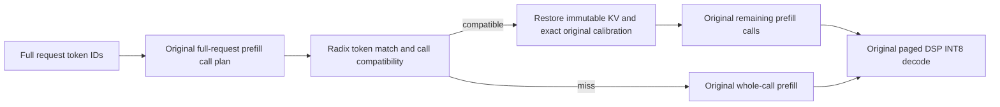

# Gemma4 radix prefixes with unchanged optimized q8 attention

This version preserves the original whole-call q8/Q2 attention calibration,
Q16/K8/V8 kernels, encoded U16 context, folded O projection, and the original
projection/FFN/MoE prefill batches. It removes the 256-query calibration policy.
The Q2 host dispatch functions and DSP attention/O-projection sources match
the revision immediately before that policy was introduced. Older prefix-only
row-quantized dispatch and head-width overrides are also removed. Prefix mode
requires the existing Q2/U16 configuration; it cannot select another numerical
attention route.

## Reuse contract

A radix token match is necessary but is not sufficient. The saved computation
must have the same prefill call boundaries as independent inference on the new
request. This matters because whole-call quantization scales depend on all
query/KV values in that call, including tokens beyond a proposed token prefix.

The index publishes completed **original prefill calls**. A newly computed
request retains its last completed full native call boundary and its final multi-row
prefill endpoint in DRAM. With optional asynchronous prefix Flash backing, earlier
completed native boundaries are also retained within staging/file budgets. Without
that option, earlier sliding windows are not retained. Each retained frame stores its
call start/end, activation plane, chunk size, exact calibration, and FP16 KV.
The lookup checks the original full request's call plan before adopting a state.
It never changes attention batching or calibration to manufacture a cache hit.
Physical DSP decode pages remain 64 rows; reusable prefill units follow the
existing model's much larger call boundaries (4096 rows in the validation pack).
The final partial call is reusable only when the target has that same prefill
endpoint. The final prompt token still runs through the original DSP decode.

Examples with `init_seq_len=4096` and `skip_prefill=true`:

| Source / new request | Behavior |
| --- | --- |
| 4608-token source; new input shares 4096 tokens and has a new suffix | Reuse the original first 4096-token call; run the suffix with original calls |
| 8704-token source; new input shares 4096 tokens | With prefix Flash enabled, restore the older 4096-token boundary; without it, miss unless another cached source supplies that state |
| Same 2080-token input again | Reuse its complete 2079-token prefill, then run the last input token normally |
| 3072-token source; new 2080-token input shares 2048 tokens | Miss: 2048 is inside the source's original whole-call calibration |
| 1024-token source; new input shares 768 tokens | Miss: an interior crop would change the original numerical computation |

A hit can leave one, two, or more input tokens. A native one-row prefill tail
uses the existing M1 operation; its original KV window is initialized before
seeding instead of after prefill. Once that row transfers ownership to DSP,
the application continues with the resident state. This also fixes the original
seed-twice failure for a 4098-token input on a 4096-row plane. Such a source
retains its preceding 4096-token host checkpoint; the M1 row is already DSP-owned.
Non-default repetition penalties and the debug `NNTR_RESUME_BLOCK=0` mode
fall back to recomputation because their call/processor state is not restored.
Prefixes below 64 tokens are not retained. Unsupported matches are ordinary
misses and execute the original route.



## Ownership and memory

Completed calls retain shared RPC slabs as immutable FP16 page views instead of
copying the full KV payload. The last full native-block snapshot is taken after
its original compaction. The final host window is then represented by a read-only
row offset: it has the same live bytes and dropped-row maxima as the original
compaction, without its memmove or a second copy to protect an earlier snapshot.
The first DSP seed reads that exact view and subsequent decode tokens use the
ordinary entry. Host checks compare its bytes and maxima with original compaction.

Global prefixes share unchanged rows. The generic snapshot API freezes pinned
pages before mutating compaction, restore or reset, but the native retention
policy avoids preserving windows across later writing prefill blocks.
No attention values, scale rules, kernel precision or prefill call sizes change.

DSP INT8 session pages and their COW forks remain a separate ownership domain.
Radix entries use host-only IDs and release callbacks. They do not create an
unused DSP decode checkpoint or force its tail pages through COW. Native DSP
checkpoints are retained only for actual session switches/forks.
Selecting a resident session does not reconstruct its history on the CPU.
Flash snapshots retain DSP INT8 state; the host FP16 radix index is not persisted.

Retention is limited by prefix count/LRU, not by a byte budget. A view pins its
entire underlying RPC allocation, including reserved unused capacity.
`getDeviceKVPrefixBytes()` counts unique pinned slabs and copied pages, rather
than just the live rows. This memory cost must be included in deployment sizing.
After the first DSP seed, the tensor owner releases the original allocation
base, including when seeding an interior row view. Radix pins keep the slabs
alive until their last reference is released. Clearing the index reduces logical
prefix ownership to zero; immediate OS memory recovery depends on RPC/DMA
allocator and driver behavior, so it is not asserted from global MemAvailable.

## Enable and reproduce

Use the existing fully resident `htp_fused` Gemma4 26B A4B pack:

```json
{
  "attention_kv_dtype": "q8",
  "skip_prefill": true,
  "init_seq_len": 4096,
  "htp": {
    "attn_q2": true,
    "oproj_u16": true,
    "kv_seed_q": false,
    "kv_session": true,
    "kv_paged": true,
    "kv_prefix_cache": true,
    "kv_request_reserve": true
  }
}
```

Build and deploy matching ARM libraries, application, and DSP skeleton. The
original O-projection RPC encoding format is restored; there is no per-domain
encoding extension. A complete native input is passed to the existing C++
request/session interface. `kv_prefix_cache=false` disables prefix retention;
both modes use the same original q8 numerical policy. The optional
`htp.kv_seed_q=true` direct quantized-seed mode keeps its original computation
and disables prefix retention: its quantized V seed state is not in the current
host checkpoint format. OFF/ON CLI output IDs and positions match in that mode.

## Validation

Current results and complete input/output IDs are recorded in
[the 2026-11-05 evidence](validation/gemma4-htp-native-radix-20261105.json).
The earlier 2026-11-04 causal-domain evidence is historical and does not describe
this implementation. Its 768/2048-token interior hits, quality regression and
18.6% calibration slowdown must not be attributed to the current policy.

Validation compares independent inference before enabling retention, cold
retention, exact repeated inputs, original 4096-token boundary branches, unsafe
interior misses, and short suffixes. Resident sessions/forks/Flash are checked
against independent references. Cold timings use `htp_prefix_cold_bench`: one loaded native model, unchanged
runtime numerical configuration, and a test-only storage-retention toggle.
Each sample clears the index and must have zero hits. Two full warm references
precede eight balanced OFF/ON rounds, four samples per mode per length.
External first-delta timing includes clear/reset. Model load is excluded;
CPU/DSP frequencies are not locked.

An earlier separate-process comparison is retained in the evidence, including
a +2.36% mean 2K TTFT result. The final same-model storage-only comparison measured +0.99% at 2080 tokens
and +0.37% at 4608 tokens; the user accepted these small differences as within
measurement variation. Neither result is hidden or relabelled as a cache hit. These experiments do not prove zero cost across every workload
or sustained decode TPS.
Exact output-ID checks are stronger than textual similarity for these cases,
but are not a proof over all prompts, configurations or operating conditions.

Final Android TTFT in ms (four cold samples per mode):

| Input tokens | Cold OFF | Cold ON | Difference |
| --- | ---: | ---: | ---: |
| 2080 | 4333.0 | 4375.7 | +0.99% |
| 4608 | 9466.6 | 9501.8 | +0.37% |

Prefix-hit TTFT, independently computed reference versus reuse:

| Input / reused tokens | Recompute ms | Hit ms |
| --- | ---: | ---: |
| 2080 / 2079 (exact input) | 3959.6 | 316.8 |
| 4128 / 4096 (new suffix) | 8728.2 | 2116.9 |
| 8224 / 8192 (new suffix) | 15848.4 | 2224.6 |

All 11 branch cases, five source repeats, parent continuations, six A/B turns,
forks and Flash restore checks passed their output-ID/position assertions.
The previous long RUBY failure matches the old working legacy IDs again.
Ubuntu's 36 KV unit tests and Android/Ubuntu page/view/calibration checks passed.

Reproduce the cold comparison with a fixture containing `warmup` and `prompts`:

```sh
./htp_prefix_cold_bench pack paired-fixture.json paired-result.json
```

For the original retention comparison the benchmark subclass toggles
`device_prefill_capture_`; for the Flash comparison below it keeps native
retention enabled and toggles only earlier-boundary backup. Neither mode
changes quantization, attention dispatch, weights, prefill sizes, or processors.
Both modes call the same `Gemma4HtpMoECausalLM::run()` implementation.

## Asynchronous backing of earlier native boundaries

The opt-in backing added in `f2e43d820` preserves earlier native boundaries that
would otherwise disappear as sliding prefill buffers advance. The original
attention/calibration/call plan is unchanged. It writes the complete live restore
payload: global KV through the boundary and that boundary's sliding windows.
Exact calibration, dropped maxima, layout and token identity remain in the
model-local radix metadata. This is distinct from the existing DSP INT8 session
Flash snapshot API.

At each earlier native endpoint, the inference thread copies only valid KV rows
into owned immutable staging. A single worker checksums and writes them; it never
reads live inference buffers or makes DSP calls. After completion, staging is
released and the radix entry points to file backing. The latest native boundary
and final endpoint retain their existing shared-DRAM path. A hit still in flight
uses its immutable staging bytes; a completed hit reads/checks the file first.
Only then does the model restore original KV/calibration and process the suffix.

Both staging and file reservations have byte budgets. Full staging skips that
boundary's backup instead of waiting for I/O. Ready files use LRU, and files being
read are protected. Missing, evicted or corrupt backing falls back to an earlier
compatible radix boundary or ordinary recomputation. Prefix clear/LRU release
and normal model destruction remove associated files; destruction drains the
worker before freeing its state. The backing is process-local: an application
must clean private cache directories left by abrupt termination before reuse of
its cache area. No cross-process token/calibration index is loaded.

Enable through the existing native request sequence CLI by adding a top-level
`kv_prefix_flash` object to `nntr_config.json` (alongside the existing `htp` object):

```json
"kv_prefix_flash": {
  "directory": "/data/local/tmp/nntr-prefix-cache",
  "budget_bytes": 1073741824,
  "staging_bytes": 536870912
}
```

Requests must use `device_session` names to enable the native device manager.
Run `nntr_causallm MODEL_DIR --requests requests.json` with the existing q8/Q2,
paged/session/prefix configuration. Results expose `device_kv_prefix_flash`
submission/completion/hit/eviction/failure counters, pending/reserved bytes and
staging/write/read durations. C++ callers use:

```cpp
causal->enableDeviceKVManager(8, 8);
causal->enableDeviceKVPrefixFlash(directory, 1073741824, 536870912);
```

`drainDeviceKVPrefixFlash()` is an explicit diagnostic/shutdown helper, never a
foreground inference step. `getDeviceKVPrefixBytes()` counts resident prefix
payload; `deviceKVPrefixFlashStats()` separately reports in-flight staging and
reserved file bytes. These budgets do not bound the existing latest-prefix RPC
slabs or total model DRAM. This first implementation does not deduplicate global
pages across backing files. A 4096-token boundary in the tested pack occupies
280 MiB of live payload plus 48 bytes of framing; scales/layout stay in memory.

Android validation (SM-S948N, SM8850 v81, original Gemma4 26B A4B weights):

| Experiment | Reference | Prefix Flash | Result |
| --- | ---: | ---: | --- |
| 8704-token cold TTFT, four balanced samples per mode | 17.204 s | 17.272 s | +0.39%; identical output IDs/positions |
| Named A→B: 8704-token A, then 4123-token B sharing 4096 tokens | 8.453 s recompute | 3.223 s restore + suffix | All 11 output IDs and position match; both answer `RUBY-456` |

In the cold ON samples, staging took 107.9 ms on average; background checksum,
write and synchronization took 971.4 ms. Every write had completed by request
end, with zero failures/skips and no post-request drain wait. File synchronization
runs on the worker (`fdatasync` on Linux/Android); clean file-cache eviction is
requested with `POSIX_FADV_DONTNEED`. It is advisory, not proof of a fully cold
storage device. The semantic A→B file read/checksum took 985.3 ms; session switch
was 7.8 ms, reported separately from application TTFT.

The synthetic 4128-token branch test also passed: first Flash hit TTFT 2.429 s
versus 8.550 s recompute, with a 438.6 ms read/checksum. Its independent baseline
itself emits EOS, so the separate RUBY case above supplies meaningful answer
validation. Later branch hits may use a newly published DRAM boundary.

Original 8192-token DRAM hits, A/B sessions, forks and DSP Flash snapshot restore
also passed. Ubuntu's 36 KV tests, owned-staging/view checks, and Android/Ubuntu
storage budget/LRU/corruption/cancellation/failed-write checks passed. ASan/UBSan
passed with `detect_leaks=0` (LeakSanitizer is unavailable under the execution
tracer). Frequencies were not locked. These short generation checks are not a
sustained decode TPS or sustained write-saturation claim.

[Complete inputs, output IDs, timings and binary manifests](validation/gemma4-htp-prefix-flash-20261105.json).

## Extended feature/results report through 20K

[Current core feature matrix and the 4K–20K measurements](kv-cache-manager-feature-results.md)
record two paired comparisons per tier/length, exact IDs and meaningful RUBY
answers. At 20K the DRAM pair measured 53.349 → 2.752 s and the Flash pair
46.906 → 5.325 s. Each uses its own corresponding recomputation control.

The longer 20,992-token cold backup comparison observed +4.29% TTFT
(57.819 → 60.300 s), despite writes finishing before request end. Keep this
cost visible alongside the earlier 8704-token +0.39% result: neither establishes
zero overhead on arbitrary workloads. Thermal state and frequency were not
fixed. The new benchmark changes no production inference/manager code.
