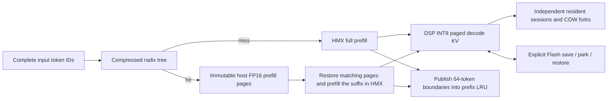

# Gemma4 HTP radix prefix reuse

The NPU MoE path can reuse a partial prompt prefix while preserving the greedy
output IDs and final token position of a fresh run **under the same prefill
policy**. The Android validation uses Gemma4 26B A4B, SM8850/v81, Android 16,
eight ARM threads, and unmodified greedy generation.

## Cache ownership and execution



DSP sessions retain their native INT8 pages, scales, positions and pending
feedback token. Prefix caching independently retains FP16 prefill pages and
boundary metadata. Prefix pages are shared across boundaries and forks; there
is no full-payload copy per radix terminal. Session retention does not pin host
prefill pages indefinitely: those pins belong to the prefix LRU. Clearing the
prefix index releases its host payload while preserving active DSP KV.

For example, one 1024-token prefill supplies a 768-token hit without separately
running or capturing a complete 768-token inference. The index selects twelve
64-token pages; only the unmatched suffix is forwarded. A 750-token common
prefix selects 704 tokens and recomputes the remaining 46 shared tokens with
the divergent suffix. At least one input token remains for fresh logits.

Global and sliding attention retain their existing layouts. Prefix metadata
preserves host cache bases and dropped-row maxima. Only boundaries whose
required sliding rows are actually available are indexed; older retained
prefixes can preserve earlier windows. DSP decode retains its separate
window compaction and native page management.

## Why decode snapshots alone were insufficient

The earlier path cut the first pages out of an existing INT8 decode snapshot
and continued the suffix using M1 decode. Its KV and quantizer could depend on
rows after the common prefix. A fresh request instead ran HMX prefill with a
different calibration and reduction geometry. Encoded-page isolation passed,
but complete-model greedy IDs differed.

The new mode uses the existing `q8_row` prefill quantization: each K/V row has
its own scale. Attention uses fixed query groups (`Br = 64 / GQA`) and a fixed
256-key reduction tile, including the 512-dimensional global layers. Projection
and FFN still process wide prefill blocks. The suffix resumes through that same
HMX path, and the resulting FP16 KV seeds DSP decode as on the fresh reference.
An incompatible configuration or attention fallback raises an error.

This changes the prefill quantization policy relative to `attention_kv_dtype=q8`.
It is opt-in. The validation does not assert bit equality or task accuracy
equivalence between those two policies. No tokens, logits, EOS decisions or
channel markers are edited to make equality checks pass.

## Enable and inspect

Keep the pack's existing model/weights settings and use a fully resident HTP
graph for attention, projections, FFN, MoE and LM head:

```json
{
  "attention_kv_dtype": "q8_row",
  "skip_prefill": true,
  "init_seq_len": 4096,
  "htp": {
    "kv_session": true,
    "kv_paged": true,
    "kv_prefix_cache": true,
    "kv_request_reserve": true
  }
}
```

The prefill plane must be a positive multiple of 64; supported query group
counts divide 64. The tested model has GQA 2 for sliding and 8 for global.
Build and deploy matching ARM engine/application libraries. This path uses
existing DSP append/prefill RPCs; no new wire method is required.

```cpp
causal->enableDeviceKVManager(/*sessions=*/8, /*prefixes=*/8);
const auto original = causal->activeDeviceKVSession();
model->run(full_prompt_a, false);
const auto branch = causal->createDeviceKVSession();
causal->selectDeviceKVSession(branch);
model->run(full_prompt_b, false); // automatic longest-prefix lookup
causal->selectDeviceKVSession(original);
model->run(new_turn_a, false);   // resident continuation
```

With `kv_prefix_cache=false`, use `enableDeviceKVManager(8, 0)` for sessions
without prefix retention. The `--requests` CLI chooses this automatically;
named `device_session` requests use eight retained prefixes when the flag is
enabled. It reports `device_kv_manager`, `output_ids`, `device_kv_bytes`, and
`device_kv_prefix_host_bytes`. This is the native C++/request-sequence path.

`deviceKVManagerStats()` reports hits, reused tokens and radix nodes.
`getDeviceKVPrefixBytes()` deduplicates the retained host K/V pages;
`getDeviceKVCacheBytes()` reports active DSP INT8 payload. Neither includes
all scratch or all device states. Prefix/session limits bound handle counts,
not a DRAM byte budget. Host prefix pages and the radix token index are not
part of the DSP Flash snapshot format; Flash restore supports resident
continuation without publishing unknown token history into the radix tree.

## Validation and timing

Full inputs, output IDs, positions, configuration, timings and binary hashes
are retained in [the validation record](validation/gemma4-htp-radix-20261104.json).
It separates the length matrix, the final guarded build, and a diagnostic hash
run. Hash-run timings must not be used as performance measurements.

The checks compare each reused input to independent full-history prefill.
Resident A/B continuation is compared to its own independent resident
reference, and Flash restore to the corresponding saved-state continuation.
These references cannot be substituted for one another.

Some fresh reference outputs contain EOS immediately or stop at the generation
limit. Their reused IDs must still match exactly. `quality_checks_passed` is
recorded separately: it is false when a fresh reference itself fails the code
recall task. Numerical cache parity does not establish general model quality.

| Input tokens | Reused tokens | Fresh `q8_row` TTFT (ms) | Radix hit TTFT (ms) | Same-policy ratio | Legacy `q8` fresh TTFT (ms) |
| ---: | ---: | ---: | ---: | ---: | ---: |
| 800 | 768 | 4014 | 2507 | 1.60× | 2821 |
| 2080 | 2048 | 9029 | 3263 | 2.77× | 4779 |

The ratios compare identical outputs under the new policy. The legacy column
uses a different policy; its output IDs can differ. In particular the long
RUBY fixture recalls the code on legacy `q8` but repeats channel markers to the
generation cap on `q8_row`. This is an observed task regression, even though
fresh/reused IDs within `q8_row` match. General quality parity is unverified.

The final retained host prefix payload was **206.25 MiB** for the 1024-token
source and **646.25 MiB** for the 3072-token source. Clearing prefixes reduced
both to zero and preserved active DSP KV. On these source inputs, adding
prefix capture increased cold TTFT from 4811→5002 ms and 12798→13215 ms,
respectively. These individual samples do not establish a fixed overhead.

All twelve branch comparisons in the six-length matrix passed; the final
guarded build rechecked four branches, two-conversation switching, forks and
Flash restore. The final CLI also passed four A/B/A/B ID/position comparisons.
The first 768 K/V rows matched source/fresh/reused hashes in
all thirty layers. Five nontrivial resident switches in the final session
check took 5.54–15.93 ms (median 12.37 ms).

Timings include request setup, KV restoration, suffix prefill and first-token
delivery, as measured by the native checker. These are sequential integration
runs without frequency locking or randomized interleaving; expert-cache I/O,
page-cache warmth and thermal state can affect them. Short or zero steady
decode samples do not establish a TPS improvement or zero decode overhead.

## Reproduce

After building/installing the Android HTP engine with the existing SDK setup:

```sh
meson configure builddir_app/htp -Denable-htp-device-check=true
ninja -C builddir_app/htp nntr_causallm htp_page_prefix_check \
  htp_sessions_check htp_prefill_check htp_calibration_check
```

Deploy the matching libraries, DSP skeleton/provider, check executables, model
pack and fixtures. The fixtures are embedded in the validation JSON. On-device:

```sh
export LD_LIBRARY_PATH=.:/system/lib64:/vendor/lib64
export ADSP_LIBRARY_PATH=$PWD
export NNTR_NUM_THREADS=8 NNTR_HTP_KV_MANAGER=1
./htp_prefill_check
./htp_calibration_check
./htp_page_prefix_check pack fixture-768.json result.json
./htp_sessions_check pack sessions-fixture.json sessions.json
```

Host page/session/Flash checks, including ASan/UBSan:

```sh
CC=gcc-12 test/htp/host/run_device_kv_checks.sh
CC=gcc-12 SANITIZE=1 ASAN_OPTIONS=detect_leaks=0 \
  test/htp/host/run_device_kv_checks.sh
```

The Ubuntu app KV-cache unit suite and the native prefill/calibration checks
also run against the CPU build. No model or DSP is needed for those checks.

Earlier failed INT8-slicing experiments remain recorded in
[the historical session document](gemma4-htp-paged-sessions.md) and its linked
validation files.
