# Gemma4 radix prefixes on the optimized q8 backend

The Gemma4 26B A4B NPU path uses the existing optimized **q8/Q2 attention and
encoded U16 context → folded O projection**. `q8_row` is no longer the radix
policy. Projection, FFN and MoE keep their original large prefill batches.
The earlier 9-second `q8_row` result is a superseded implementation, not an
appropriate baseline for the optimized backend.

## Cache and quantization contract

Whole-request calibration depends on tokens after a proposed common prefix.
Cropping an old decode snapshot cannot reproduce a fresh shorter request.
The optimized Q2 kernels now expose **256-query calibration domains** when
`htp.kv_prefix_cache=true`. Each domain considers the causal KV prefix and
preserves its exact K/V scales, running maxima, Q/output encoding and window
metadata. These are the existing Q16/K8/V8 computations, not a switch to
row-quantized attention or a lower-precision query kernel.

The calibration grouping differs from the legacy whole-call grouping. Thus
fresh/reused parity is checked under the same cache-compatible q8 policy;
bit equality with the old whole-call policy is **not** claimed. With prefix
mode disabled, the original whole-call q8 path remains in use.

Host FP16 prefill pages are immutable and shared between prefix boundaries.
Physical DSP pages remain 64 tokens, while independently reusable prefill
boundaries are 256 tokens. A 1024-token source supplies a 768-token hit without
running a separate 768-token inference or copying a complete KV image per
terminal. A 750-token common prefix supplies 512 tokens, not 704. The radix
index publishes only boundaries whose payload and calibration are available.

At least three input tokens are left after a hit: `skip_prefill` reserves the
last for decode and the remaining prefill must enter the same block graph as
the independent reference. A shorter suffix falls back to an earlier safe
boundary. Prefixes smaller than one calibration domain are recomputed.

```mermaid
flowchart LR
  I[Complete token IDs] --> R[Radix safe-prefix lookup]
  R --> P[Restore immutable FP16 pages and calibration]
  P --> Q[Existing Q2 attention on the suffix]
  Q --> U[Gather encoded U16 domains]
  U --> O[Existing folded O projection: one wide RPC]
  O --> M[Existing batched FFN / MoE]
  M --> D[Native DSP INT8 paged decode]
  D --> S[Sessions / COW forks / Flash snapshots]
```



O projection receives per-domain encodings in the existing variable-length RPC
argument and consumes the entire activation batch in one call. Its existing
kernel runs the encoded domains internally. Q and KV input staging carries
only each live span, avoiding repeated cache maintenance of the full reserved
FP16 slabs. Partial Q views validate their parent ION generation; they must
not read the host tensor's sampled-only copy.

## Enable

Keep the optimized pack's weights and engine settings. Use fully resident HTP
attention, projections, FFN, MoE and LM head:

```json
{
  "attention_kv_dtype": "q8",
  "skip_prefill": true,
  "init_seq_len": 4096,
  "htp": {
    "kv_session": true,
    "kv_paged": true,
    "kv_prefix_cache": true,
    "kv_request_reserve": true
  }
}
```

The prefill plane must be a positive multiple of 256. Deploy matching ARM
engine/application libraries **and the updated DSP skeleton**: the U16
O-projection RPC accepts either one legacy encoding or one per 256 rows.
The wire method and existing arithmetic kernels are unchanged. An older
skeleton rejects the expanded encoding argument; it must not silently fall
back to another attention implementation.

```cpp
causal->enableDeviceKVManager(8, 8);
const auto a = causal->activeDeviceKVSession();
model->run(full_prompt_a, false);
const auto b = causal->createDeviceKVSession();
causal->selectDeviceKVSession(b);
model->run(full_prompt_b, false); // automatic safe radix reuse
causal->selectDeviceKVSession(a);
model->run(new_turn_a, false);   // native resident continuation
```

For sessions without prefix retention use `kv_prefix_cache=false` and
`enableDeviceKVManager(8, 0)`. Named `--requests` sessions select these limits
automatically. Results include token IDs, radix hits/reused tokens,
`device_kv_bytes`, and `device_kv_prefix_host_bytes`.

## Measurement and validation

[Current raw results](validation/gemma4-htp-q8-radix-20261104.json) retain the
configuration, complete IDs, positions, fixtures, binary hashes and comparison
methods. They separate **prefill time** from **TTFT**; the old 9-second result
was TTFT in the discarded q8_row implementation.

Android SM8850/v81; milliseconds, two branch means. Fresh and reuse rows
use the same causal q8 calibration policy. The 64-token case safely misses:
its timing difference is run variation, not a reuse gain.

| Input / common prefix | Reused | Fresh prefill | Reuse prefill | Fresh TTFT | Reuse TTFT |
| --- | ---: | ---: | ---: | ---: | ---: |
| 96 / 64 | 0 | 1718 | 1696 | 2112 | 2071 |
| 288 / 256 | 256 | 1772 | 1532 | 2152 | 1932 |
| 782 / 750 | 512 | 2130 | 1702 | 2546 | 2129 |
| 800 / 768 | 768 | 2036 | 1582 | 2423 | 1955 |
| 992 / 960 | 768 | 2507 | 1775 | 3032 | 2293 |
| 2080 / 2048 | 2048 | 4364 | 1538 | 4793 | 2015 |

A separate native CLI comparison used the same final binaries, one short warmup
and four independent 2080-token requests per policy, without prefix retention:

| q8 policy | Mean prefill | Prefill TPS | Mean TTFT |
| --- | ---: | ---: | ---: |
| Existing whole-call calibration | 3800 ms | 547 | 4217 ms |
| Causal 256-query domains | 4506 ms | 462 | 4999 ms |

The final comparison has **18.6% additional cold prefill time**. An earlier
run of the same final radix binary measured 4181–4425 ms, so this is not a
frequency-controlled estimate. Removing q8_row restored the optimized kernels,
but has not achieved zero cold overhead. The prefix-hit table and the CLI
policy comparison are separate experiments.

Android checks passed all 15 prefix/safe-suffix ID and position comparisons,
six A/B resident turns, fork continuation, Flash restore and four named CLI
requests. Source/fresh/reused FP16 K/V hashes match in all 30 layers for the
first 768 tokens; the diagnostic hash run is excluded from timings. Clearing
prefixes releases the retained host K/V pages while preserving active DSP KV.
Typical retained host payload is 165 MiB for the 1024-token source and 605 MiB
for the 3072-token source. Divergent recomputed domains can retain more pages.

Runs are sequential and the phone's frequency is not locked. These timings
establish neither zero overhead nor a steady decode TPS improvement. Some
references emit EOS or stop at the generation limit; those outputs are kept
verbatim. Code recall/task quality is recorded separately from cache parity.
The long RUBY input can differ from the legacy whole-call q8 output, so
legacy task-quality equivalence and corpus/perplexity parity remain unverified.

Comparisons use the same input IDs and unmodified greedy generation. Prefix
hits are compared with independent full-history prefill; resident A/B turns
with independent resident references; Flash restore with the corresponding
saved-state continuation. They are different reference scenarios.

The host checks cover encoded-slice preservation, parent ION ownership,
radix eligibility, COW/Flash and window behavior. Ubuntu also runs the existing
36 KV-manager unit tests. ASan/UBSan uses `detect_leaks=0` because LeakSanitizer
is unavailable in the sandbox's ptrace environment.

## Limits and reproduction

Prefix retention uses LRU and count limits, not a DRAM byte budget. It keeps
additional FP16 prefill pages; DSP sessions retain separate INT8 state.
`getDeviceKVPrefixBytes()` deduplicates host K/V page payload only;
`getDeviceKVCacheBytes()` reports active DSP payload. Neither includes all
metadata/scratch or the union of every DSP session. Clearing prefixes releases
host page pins and preserves active DSP KV.

DSP Flash snapshots preserve resident continuation, not the host prefill radix
index or token history. Automatic NPU Flash demotion is not added by this work.

```sh
# Build/install the Android HTP engine and matching v81 skeleton first.
meson configure builddir_app/htp -Denable-htp-device-check=true
ninja -C builddir_app/htp nntr_causallm htp_page_prefix_check \
  htp_sessions_check htp_prefill_check htp_calibration_check

# In the deployed Android runtime directory:
export LD_LIBRARY_PATH=.:/system/lib64:/vendor/lib64
export ADSP_LIBRARY_PATH=$PWD
export NNTR_NUM_THREADS=8 NNTR_HTP_KV_MANAGER=1
./htp_page_prefix_check pack fixture-768.json result.json
./htp_sessions_check pack sessions-fixture.json sessions.json
```

`NNTR_HTP_PREFIX_HASH` is diagnostic only; its run timings are excluded.
Historical q8_row and INT8-cropping measurements remain in their original
validation files and are not current performance claims.
