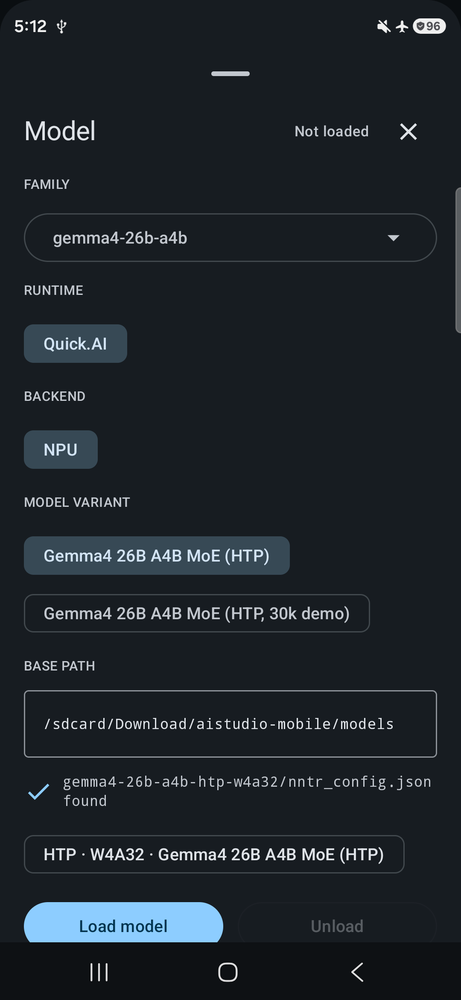
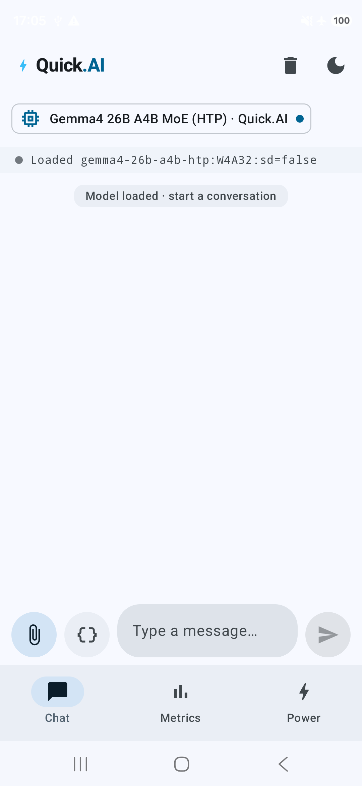
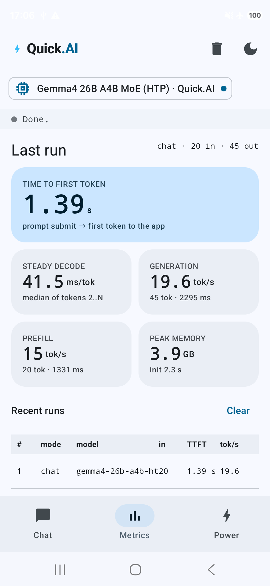

# Hexagon NPU에서 Gemma4-MoE 실행하기

이 가이드는 Linux PC와 Android 휴대전화에서 도구를 준비하고, 명령줄 또는
Quick.AI Android 앱으로 Gemma4 26B-A4B의 첫 응답을 생성하는 과정을 설명합니다.
툴체인 설치, nntrainer 빌드, 런타임 설치, 모델 팩 복사, 실제 NPU 실행 여부 확인까지
순서대로 진행합니다.

**기준 소스:** [PR #4480](https://github.com/nntrainer/nntrainer/pull/4480)의
커밋 [`fa078c94d1d73609c5584e948931384d69f9364c`](https://github.com/nntrainer/nntrainer/tree/fa078c94d1d73609c5584e948931384d69f9364c).
2026-11-04에 내용을 검토했습니다. 아래 명령은 QuickDotAIAPP과 HTP 빌드 스크립트가
포함된 이 리비전을 기준으로 합니다. 다른 체크아웃에서는 명령이 달라지거나 해당 기능이
아직 없을 수 있습니다.

> 별도로 제공되는 실행 가능한 **Gemma4 HTP 모델 팩**이 필요합니다.
> 이 저장소와 APK에는 가중치가 포함되어 있지 않습니다. 이 PR에는 제공용 모델 팩의
> 공개 다운로드 URL이 안내되어 있지 않습니다. 추론을 시작하기 전에 모델 제공자로부터
> 팩과 그에 맞는 설정을 받아야 합니다. 일반 Hugging Face 체크포인트를 다운로드하는
> 것만으로 이 단계를 대체할 수는 없습니다.

`bash` 코드 블록은 `adb`로 시작하는 명령을 포함해 모두 **Linux PC의 Bash**에서
실행합니다. `sh` 블록은 **휴대전화의 `adb shell` 안에서** 실행합니다.
예제 경로는 실제 절대 경로로 바꾸세요. 내보낸 환경 변수가 유지되도록 같은 호스트
터미널에서 계속 진행하세요. 오류가 발생하면 해결한 다음 단계로 넘어가세요.
명령, 옵션, 로그, 앱의 UI 이름은 실제 화면과 대조할 수 있도록 원문을 유지합니다.

## 1. 실행 환경 확인

| 구성 요소 | 이 가이드의 버전 및 요구 사항 |
| --- | --- |
| 빌드 PC | Ubuntu 24.04, x86-64. 도구와 빌드용으로 약 60 GB, 모델 팩과 압축 파일용 공간은 별도로 확보 |
| 휴대전화 | PR 문서의 기준 기기: Galaxy S26 Ultra, Snapdragon SM8850, Hexagon **v81**, 메모리 페이지 크기가 **4 KB**인 Android 16 |
| NPU 호환성 | `HEX_ARCH=v81` 필수. Qualcomm NPU 탑재만으로 호환성이 보장되지는 않으며, 다른 DSP 세대와 16 KB 페이지 기기는 검증 범위 밖 |
| Android 최소 버전 | 앱 설치 최소 API는 **33(Android 13)**. NPU 실행 검증 기준은 위 휴대전화 환경 |
| Hexagon SDK | **6.4.0.1**, **Hexagon Tools 19.0.04** 포함 |
| Hexagon Kernel Library(HexKL) | **1.0 beta2**, 이 패키지의 **`lib/6.4.0.2`** 라이브러리 사용 |
| Android NDK | **r30**, 패키지 리비전 **30.0.16248370** |
| Android 앱 도구 | **JDK 17**, SDK 플랫폼 **36**, build-tools **36.0.0**, SDK CMake **3.22.1**, platform-tools |
| 네이티브 빌드 도구 | GCC/G++, Meson, Ninja, CMake, Python 3, Rust/Cargo, Git |
| 모델 | 가중치와 설정이 같은 배포본에 속하는 완전한 Gemma4 26B-A4B HTP 팩 |
| 휴대전화 저장 공간 | 벤치마크에 사용한 TL2 가중치는 **6.60 GB**(6,604,561,848바이트), 팔레트 가중치는 **7.54 GB**(7,540,724,856바이트). 선택한 팩의 나머지 파일과 런타임 캐시 공간도 별도로 확보 |
| 실행 메모리(RAM) | 저장 공간과 별개이며 컨텍스트 길이·expert 캐시 설정에 따라 사용량이 달라짐. 첫 실행은 제공자가 기기에서 확인한 설정을 사용하고 메모리를 많이 쓰는 다른 앱은 종료 |

### 각 구성 요소의 역할

- **Android NDK:** 휴대전화 CPU에서 실행할 ARM64 코드를 컴파일합니다.
- **Hexagon SDK와 Tools:** DSP/NPU 코드를 컴파일하고 FastRPC를 통해 연결합니다.
- **HexKL:** nntrainer에서 **HTP**라고 부르는 Hexagon 백엔드에 커널을 제공합니다.
- **`libnntr_hvx_skel.so`:** 이 PR에서 빌드하는 nntrainer의 DSP 프로그램입니다. 같은 빌드의 ARM 측 라이브러리와 짝이 맞아야 합니다.
- **QuickDotAI / Quick.AI:** 각각 재사용 가능한 Android 라이브러리(AAR)와 예제 앱(APK)입니다.

이 가이드는 `--htp`를 사용하며 QNN SDK가 필요하지 않습니다. 최신 스크립트는
`--qnn --htp` 통합 패키지도 지원하지만, 이 경우 QNN 의존성도 추가로 필요합니다.
OpenCL은 기본으로 켜져 있습니다. OpenCL/GPU 백엔드를 제외하려면 빌드·설치 명령에
`--disable-opencl`을 일관되게 사용하세요.

## 2. Linux 및 Android 도구 설치

### Linux 빌드 의존성

```bash
sudo apt update
sudo apt install -y \
  build-essential git curl wget unzip zip file pkg-config \
  python3 python3-pip python3-venv meson ninja-build cmake \
  openjdk-17-jdk autoconf automake libtool

export JAVA_HOME=/usr/lib/jvm/java-17-openjdk-amd64
export PATH="$JAVA_HOME/bin:$PATH"
java -version
python3 --version
meson --version
ninja --version
cmake --version
```

`java -version` 결과가 Java 17이어야 합니다. 위 명령은 호스트 빌드 도구를 설치하며,
Android용 컴파일러는 NDK가 제공합니다. 아래의 Android 빌드 대신 호스트용
nntrainer 패키지를 설치하면 안 됩니다.

[공식 rustup 설치 프로그램](https://rustup.rs/)으로 Rust를 설치합니다.
설치 방식이 표시되면 기본 설치를 선택하세요.

```bash
curl --proto '=https' --tlsv1.2 -sSf https://sh.rustup.rs -o /tmp/nntr-rustup-init.sh
sh /tmp/nntr-rustup-init.sh
source "$HOME/.cargo/env"
rustup target add aarch64-linux-android
rustc --version
cargo --version
```

Rust는 저장소의 토크나이저 라이브러리를 빌드하는 데 사용합니다. 빌드 스크립트가
이 라이브러리의 Android C/C++ 컴파일러 설정을 처리하므로 별도의 토크나이저
체크아웃이나 `cargo-ndk` 설치는 필요하지 않습니다.

### Android SDK와 NDK

[Android Studio 다운로드 페이지](https://developer.android.com/studio#command-tools)에서
**Command line tools only → Linux**를 다운로드합니다. 임시 디렉터리에 압축을 풀고,
Google의 [SDK Manager 안내](https://developer.android.com/tools/sdkmanager)에 따라
SDK Manager가 `$HOME/Android/Sdk/cmdline-tools/latest/bin/sdkmanager`에 위치하도록
배치합니다. 아래 예제의 압축 파일 이름을 실제 다운로드한 이름으로 바꾸세요.

```bash
export ANDROID_HOME="$HOME/Android/Sdk"
export NNTR_ANDROID_TOOLS_ZIP="$HOME/Downloads/commandlinetools-linux-REPLACE_ME_latest.zip"
NNTR_ANDROID_TOOLS_TMP=$(mktemp -d)
unzip "$NNTR_ANDROID_TOOLS_ZIP" -d "$NNTR_ANDROID_TOOLS_TMP"
mkdir -p "$ANDROID_HOME/cmdline-tools/latest"
cp -a "$NNTR_ANDROID_TOOLS_TMP/cmdline-tools/." "$ANDROID_HOME/cmdline-tools/latest/"
export PATH="$ANDROID_HOME/cmdline-tools/latest/bin:$ANDROID_HOME/platform-tools:$PATH"
sdkmanager --version
```

Android Studio에서 SDK를 이미 설치했다면 해당 SDK 경로를 사용하고, SDK Manager에서
**Android SDK Command-line Tools**를 설치하세요. `ANDROID_HOME`과 기존
`ANDROID_SDK_ROOT`가 있다면 둘 다 같은 디렉터리를 가리키게 합니다.
여기서는 command-line tools 패키지에 포함된 SDK Manager를 사용합니다.

지정된 버전의 패키지를 설치하고 Android 라이선스를 검토한 뒤 동의합니다.

```bash
sdkmanager --sdk_root="$ANDROID_HOME" --licenses
sdkmanager --sdk_root="$ANDROID_HOME" \
  "platform-tools" "platforms;android-36" "build-tools;36.0.0" \
  "cmake;3.22.1" "ndk;30.0.16248370"

export ANDROID_NDK="$ANDROID_HOME/ndk/30.0.16248370"
cat "$ANDROID_NDK/source.properties"
"$ANDROID_NDK/toolchains/llvm/prebuilt/linux-x86_64/bin/clang" --version
adb version
```

NDK 리비전은 [NDK r30](https://developer.android.com/ndk/downloads)에 해당하는
`30.0.16248370`이어야 합니다. 별도의 `android-ndk-r30-linux.zip`을 사용한다면
압축을 풀고 생성된 `android-ndk-r30` 디렉터리를 `ANDROID_NDK`로 지정하세요.
앱 빌드는 네이티브 빌드와 같은 NDK 경로를 사용합니다. 저장소가 Gradle wrapper를
제공하므로 시스템 Gradle을 따로 설치할 필요는 없습니다.

## 3. Hexagon SDK와 HexKL beta2 설치

### Qualcomm 패키지 받기

공식 [Qualcomm Software Center의 Hexagon SDK 카탈로그](https://softwarecenter.qualcomm.com/catalog/item/Hexagon_SDK)와
[Qualcomm Package Manager](https://qpm.qualcomm.com/)를 이용합니다.
로그인이 필요하면 Qualcomm 계정으로 로그인하세요. Linux용 **Hexagon SDK 6.4.0.1**을
선택하고 **Hexagon Tools 19.0.04** 구성 요소를 설치합니다. 설치 프로그램에 표시된
설치 경로를 사용하세요. 아래 예제에서는 `$HOME/Qualcomm/Hexagon_SDK/6.4.0.1`을
사용합니다.

포털에서 Linux용 Package Manager 앱을 요구한다면 Debian 패키지를 내려받아 설치한
다음 앱을 열고 로그인합니다.

```bash
# Replace the filename with the package you actually downloaded.
sudo apt install "$HOME/Downloads/QualcommPackageManager3.3.0.133.0.Linux-x86.deb"
```

Qualcomm 카탈로그에서 **Hexagon Kernel Library(HexKL)**도 찾아 **1.0 beta2**를
선택합니다. HexKL은 SDK와 별도로 배포됩니다.
[Qualcomm AI Stack 카탈로그](https://softwarecenter.qualcomm.com/catalog/catalog-suite/Qualcomm%C2%AE%20AI%20Stack)에서도
해당 패키지를 찾을 수 있습니다. 포털 화면과 사용할 수 있는 버전은 계정에 따라
달라집니다. 필요한 버전이 없다면 Qualcomm이나 패키지 제공자에게 접근 권한을
요청하세요. 확인 없이 다른 릴리스로 대체하지 마세요. 이 가이드는 익명으로 접근할 수
있는 패키지 다운로드 URL을 전제로 하지 않습니다.

제공받은 beta2 ZIP을 풉니다. 아래 예제는 최상위 디렉터리가 `hexkl_addon`인
`hexkl-1.0-beta.2.zip`을 사용합니다.

```bash
mkdir -p "$HOME/Qualcomm/HexKL/1.0-beta2"
unzip "$HOME/Downloads/hexkl-1.0-beta.2.zip" -d "$HOME/Qualcomm/HexKL/1.0-beta2"
export HEXKL_ROOT="$HOME/Qualcomm/HexKL/1.0-beta2/hexkl_addon"
head -n 8 "$HEXKL_ROOT/README.md"
```

README에 **1.0 Beta.2**가 표시되어야 합니다. 다운로드 파일이 한 번 더 압축되어
있다면 바깥 압축부터 풀고, 실제 `include/`와 `lib/`가 들어 있는 디렉터리를
`HEXKL_ROOT`로 지정하세요.

### 환경 변수 설정

**호스트 PC**에서 설치된 SDK의 환경 스크립트를 먼저 불러온 뒤, Android와 HexKL
경로를 명시적으로 설정합니다.

```bash
source "$HOME/Qualcomm/Hexagon_SDK/6.4.0.1/setup_sdk_env.source"

export HEXKL_ROOT="$HOME/Qualcomm/HexKL/1.0-beta2/hexkl_addon"
export HEXKL_SDK_VER=6.4.0.2
export HEXKL_TOOLS_VARIANT=toolv19
export HEXKL_ARCH=armv8_android26
export HEX_ARCH=v81
export ANDROID_HOME="$HOME/Android/Sdk"
export ANDROID_NDK="$ANDROID_HOME/ndk/30.0.16248370"
export JAVA_HOME=/usr/lib/jvm/java-17-openjdk-amd64
export PATH="$JAVA_HOME/bin:$HOME/.cargo/bin:$ANDROID_HOME/cmdline-tools/latest/bin:$ANDROID_HOME/platform-tools:$PATH"
```

`setup_sdk_env.source`가 `HEXAGON_SDK_ROOT`와 `DEFAULT_HEXAGON_TOOLS_ROOT`를
설정합니다. SDK를 다른 곳에 설치했다면 `source` 경로를 바꾸세요. 새 터미널을
열 때마다 이 블록을 다시 실행하거나, 소스 체크아웃 밖의 셸 파일에 저장해 불러오세요.

> **이 값은 PR에 기록된 빌드 구성을 재현하는 설정입니다.**
> Hexagon SDK **6.4.0.1**은 컴파일러와 SDK 환경을 제공합니다.
> `HEXKL_SDK_VER=6.4.0.2`는 HexKL beta2의 `lib/6.4.0.2` 라이브러리를 선택하며,
> 설치된 SDK 버전을 바꾸지 않습니다. 그 아래 `armv8_android26/libsdkl.so`는
> Android 런타임으로 배포되고, `hexagon_toolv19_v81/libhexkl_micro.a`는 DSP 빌드에
> 링크됩니다. 이 설명은 PR의 빌드 설정에 대한 것으로, 서로 다른 모든 SDK 버전의
> 호환성을 보장하는 의미는 아닙니다. 패키지의 디렉터리 이름은 바꾸지 마세요.

빌드 전에 경로를 확인합니다.

```bash
printf 'SDK: %s\nTools: %s\nHexKL: %s\n' \
  "$HEXAGON_SDK_ROOT" "$DEFAULT_HEXAGON_TOOLS_ROOT" "$HEXKL_ROOT"

ls "$HEXAGON_SDK_ROOT/setup_sdk_env.source" \
   "$HEXAGON_SDK_ROOT/rtos/qurt/computev81/include/qurt" \
   "$HEXKL_ROOT/include/hexkl_micro.h" \
   "$HEXKL_ROOT/lib/$HEXKL_SDK_VER/armv8_android26/libsdkl.so" \
   "$HEXKL_ROOT/lib/$HEXKL_SDK_VER/hexagon_toolv19_v81/libhexkl_micro.a"

"$DEFAULT_HEXAGON_TOOLS_ROOT/Tools/bin/hexagon-clang" --version
```

모든 경로가 존재해야 하며 컴파일러는 Tools 19.0.04에 포함된 것이어야 합니다.
`DEFAULT_HEXAGON_TOOLS_ROOT`는 `Tools/bin`이 아니라 **`Tools/`의 상위 디렉터리**를
가리킵니다. HexKL은 미리 빌드된 라이브러리를 제공하므로 nntrainer를 위해 모든
HexKL 예제를 빌드할 필요는 없습니다. 일반 `libhexkl_skel.so`는 nntrainer의
`libnntr_hvx_skel.so`를 대체할 수 없습니다.

## 4. PR 소스 준비 및 휴대전화 연결

### 별도 디렉터리에 체크아웃

**호스트 PC**에서 기존 프로젝트를 덮어쓰지 않도록 새 디렉터리를 사용합니다.

```bash
mkdir -p "$HOME/workspace"
cd "$HOME/workspace"
git clone https://github.com/nntrainer/nntrainer.git nntrainer-gemma4-pr4480
cd nntrainer-gemma4-pr4480
git fetch origin pull/4480/head
git switch --detach fa078c94d1d73609c5584e948931384d69f9364c
git submodule sync --recursive
git submodule update --init --recursive --depth 1
export NNTR_ROOT="$PWD"
git rev-parse HEAD
```

출력 해시가 가이드 상단의 기준 소스와 일치해야 합니다. PR이 이후 변경되더라도
이 절차는 지정된 리비전을 사용합니다. 서브모듈은 빌드에 필요하며, 초기화하는 것은
벤더 소스를 수정하는 것과 다릅니다. 첫 토크나이저 및 Gradle 빌드에서도 다운로드가
발생하므로 인터넷 연결을 유지하세요.

### ADB 연결 승인

**휴대전화**에서 **빌드 번호(Build number)**를 일곱 번 눌러 개발자 옵션을 켭니다.
삼성 기기는 설정 → 휴대전화 정보 → 소프트웨어 정보에 있습니다. 개발자 옵션에서
**USB 디버깅**을 켜고 데이터 전송이 가능한 USB 케이블을 연결하세요. 잠금을 해제한
휴대전화에서 디버깅 허용 요청을 승인합니다.

**호스트 PC**에서 실행합니다.

```bash
adb devices -l
```

기기가 `unauthorized`나 `offline`이 아닌 `device` 상태여야 합니다.
여러 기기나 에뮬레이터가 연결되어 있다면 출력에 표시된 시리얼을 지정합니다.

```bash
# Replace this value with the serial from adb devices -l.
export ANDROID_SERIAL=REPLACE_WITH_DEVICE_SERIAL
adb get-state
adb shell getprop ro.product.model
adb shell getprop ro.soc.model
adb shell getprop ro.build.version.release
adb shell getconf PAGE_SIZE
adb shell df -h /sdcard
```

기기가 하나뿐이면 `ANDROID_SERIAL`을 설정하지 않아도 됩니다. 기준 환경은
S26 Ultra / SM8850, Android 16, 페이지 크기 **4096**입니다.
빌드와 런타임 호환성은 펌웨어 및 FastRPC 지원에도 영향을 받으므로 이 속성만으로
NPU 실행을 입증할 수는 없습니다. 이 절차에서 `adb root`는 필요하지 않습니다.

## 5. 네이티브 런타임 빌드 및 설치

### 먼저 빌드하기

**호스트 PC**에서 실행합니다.

```bash
cd "$NNTR_ROOT/Applications/CausalLM"
set -o pipefail
./build_android.sh --htp 2>&1 | tee "$NNTR_ROOT/gemma4-htp-build.log"
```

스크립트는 FastRPC stub 생성, v81 DSP 이미지 빌드, Android 엔진과 토크나이저 빌드,
CausalLM 도구 빌드를 순서대로 수행합니다. DSP 빌드는 심볼과 아키텍처를 확인하며,
성공하면 `ARCH OK (V81)`이 출력됩니다. 마지막에는 산출물 디렉터리와 함께
`Done (native htp build)`가 표시되어야 합니다. `pipefail`을 켰으므로 `tee`로 로그를
저장하더라도 앞선 빌드 명령의 실패가 가려지지 않습니다.

| 산출물 | `NNTR_ROOT` 기준 위치 | 용도 |
| --- | --- | --- |
| `nntr_causallm` | `builddir_app/htp/` | 모델 팩을 직접 실행하는 CLI |
| `quick_dot_ai_test` | `builddir_app/htp/` | C API 실행 및 선택적 수명 주기 테스트 |
| `libcausallm.so`, `libquick_dot_ai_api.so` | `builddir_app/htp/` | 모델 런타임과 공개 API |
| `libnntrainer.so`, `libccapi-nntrainer.so` | `builddir/android_build_result/lib/arm64-v8a/` | nntrainer 엔진 |
| `libnntr_hvx_skel.so` | `nntrainer/tensor/htp_backend/dsp/build/` | v81 DSP 프로그램 |
| `nntr_quantize`, `nntr_safetensors_info` | `builddir_app/htp/` | 추가 도구. 이 양자화 도구로 해당 HTP 팩을 생성할 수는 없음 |

주요 실행 파일 두 개와 DSP 이미지를 확인합니다.

```bash
cd "$NNTR_ROOT"
ls -lh builddir_app/htp/nntr_causallm \
  builddir_app/htp/quick_dot_ai_test \
  nntrainer/tensor/htp_backend/dsp/build/libnntr_hvx_skel.so
file builddir_app/htp/nntr_causallm
```

CLI는 **ARM aarch64** 실행 파일입니다. x86-64 PC에서 직접 실행하지 말고
휴대전화에서 실행하세요.

### 휴대전화에 설치하기

ADB 승인이 완료된 휴대전화를 연결하고 **호스트 PC**에서 실행합니다.

```bash
cd "$NNTR_ROOT/Applications/CausalLM"
./build_android.sh --htp --cache --install
adb shell ls -lh /data/local/tmp/Quick.AI
```

`--cache`는 호환되는 엔진 빌드를 재사용하지만 나머지 빌드 단계는 수행합니다.
`--install`은 실행 파일과 런타임 라이브러리를 `/data/local/tmp/Quick.AI`에 배포하고,
이 경로에서 스크립트가 관리하는 런타임 파일을 교체합니다. `run_causallm.sh`와
`run_test.sh` 실행 래퍼도 생성합니다. **모델 팩은 복사하지 않습니다.**

런타임에는 HexKL의 `libsdkl.so`와 NDK의 `libc++_shared.so`가 포함됩니다.
`libcdsprpc.so`는 휴대전화의 vendor 파티션에서 제공합니다. ARM 라이브러리, stub,
DSP 이미지는 함께 빌드하고 배포하세요. 새 빌드에 오래된 DSP 이미지만 복사하면
서로 사용하는 프로토콜이 맞지 않을 수 있습니다.

`--clean`은 선택한 CausalLM 네이티브 빌드 디렉터리를 다시 만듭니다.
모든 엔진 및 Gradle 캐시까지 지운다는 의미는 아닙니다. HTP의 기본 CPU 스레드 수는
8이며 첫 실행에서는 그대로 사용하세요.

최신 스크립트의 `--stage`는 공개 네이티브 파일을
`builddir_app_stage/public/htp/`에 모으고 옆에 `.manifest.json` 보고서를 만듭니다.
`--stage=DIR`로 지정한 전용 디렉터리는 실행할 때마다 다시 생성됩니다. 라이브러리를
다른 앱에 통합할 때 사용하는 옵션이며, 일반 앱 빌드는 자체적으로 파일을 준비합니다.
`--cache`는 OpenCL 설정도 확인하여 호환되는 엔진만 재사용합니다.

## 6. 모델 팩 준비 및 복사

모델 제공자에게 **이 PR과 호환되고 채팅 실행이 가능한 Gemma4 26B-A4B HTP 팩**을
요청하세요. 제공된 가중치, 회전 정보, 토크나이저, 설정 파일은 한 세트로 유지합니다.
이 가이드에서는 가중치를 생성하거나 양자화하지 않습니다.

최신 카탈로그에는 Gemma4 HTP 항목이 세 가지 있습니다. 이 가이드의 명령은 첫 번째
항목을 사용하며, 다른 항목은 그에 맞는 팩을 제공받았을 때 선택하세요.

| 카탈로그 ID | 앱 FAMILY / MODEL VARIANT | BASE PATH 아래 디렉터리 |
| --- | --- | --- |
| `gemma4-26b-a4b-htp` | `gemma4-26b-a4b` / `Gemma4 26B A4B MoE (HTP)` | `gemma4-26b-a4b-htp-w4a32/` |
| `gemma4-26b-a4b-htp-long` | `gemma4-26b-a4b` / `Gemma4 26B A4B MoE (HTP, 30k demo)` | `gemma4-26b-a4b-htp-long-w4a32/` |
| `gemma4-26b-a4b-htp-2bit-4bit` | `gemma4-26b-a4b-2bit-4bit` / `Gemma4 26B A4B MoE (HTP, rotated 2/4-bit)` | `gemma4-26b-a4b-2bit-4bit/` |

30k demo를 선택한다고 일반 팩의 컨텍스트가 늘어나거나 기기의 RAM이 충분하다는
뜻은 아닙니다. 제공받은 팩에 맞는 설정을 유지하세요.

앱은 휴대전화에 다음 디렉터리 구조가 있다고 가정합니다.

```text
/sdcard/Download/aistudio-mobile/models/       ← model base path
└── gemma4-26b-a4b-htp-w4a32/                 ← model pack directory
    ├── nntr_config.json
    ├── config.json
    ├── tokenizer.json
    ├── chat_template.jinja
    ├── generation_config.json
    ├── <weight file named by model_file_name>
    └── <any sidecars named in nntr_config.json>
```

`config.json`에는 텍스트 모델 설정이 최상위에 있어야 합니다. `text_config`만을
담은 래퍼 구조이면 안 됩니다. 제공자의 `nntr_config.json`에서 `htp_fused` /
`htp_fused_v1`, 각 연산의 실행 엔진, 실제 가중치 형식을 지정합니다.

이 PR에는 두 계열의 Gemma4 팩이 있습니다.

| 팩 | Expert 형식 | Projection / head |
| --- | --- | --- |
| 제공되는 팔레트 팩 | `QS2CX_WH` | `QS4CX` projection, CPU에서 실행하는 임베딩 공유 `Q4_0` head |
| 네이티브 삼진 팩 | `TL2CX_WH`, 일부 affine expert 레이어가 섞일 수 있음 | `QS4CX_WH_AFFINE` projection과 임베딩을 공유하지 않는 HTP head |

앱의 `W4A32`는 카탈로그 선택값이며 모든 텐서의 가중치가 4비트라는 뜻은 아닙니다.
이 표시에 맞추려고 dtype 이름을 변경하지 마세요. 특히 TL2 팩의 `nntr_config.json`을
`Applications/CausalLM/res/gemma4/htp_chat/`의 팔레트 프리셋으로 덮어쓰면 안 됩니다.
팔레트 팩에 채팅 프리셋이 필요하다면 설정 파일을 교체하기 전에 제공자에게 가중치와
프리셋의 호환 여부를 확인하세요. 형식과 선택적 보조 파일(sidecar)은 PR의
[모델 팩 규약](https://github.com/nntrainer/nntrainer/blob/fa078c94d1d73609c5584e948931384d69f9364c/docs/quickai/model-packs.md)에
자세히 설명되어 있습니다.

**호스트 PC**에서 제공받은 팩의 디렉터리를 설정하고 주요 파일을 확인합니다.

```bash
export NNTR_MODEL_PACK="$HOME/models/gemma4-26b-a4b-htp-w4a32"
python3 - <<'PY'
import json
import os
from pathlib import Path

pack = Path(os.environ["NNTR_MODEL_PACK"])
for name in ("nntr_config.json", "config.json", "tokenizer.json",
             "chat_template.jinja", "generation_config.json"):
    path = pack / name
    if not path.is_file():
        raise SystemExit(f"Missing chat-pack file: {path}")
cfg = json.loads((pack / "nntr_config.json").read_text())
weights = pack / cfg["model_file_name"]
if not weights.is_file() or weights.stat().st_size == 0:
    raise SystemExit(f"Missing or empty weights: {weights}")
print("Weight file:", weights.name)
print("Weight bytes:", weights.stat().st_size)
print("Expert format:", cfg.get("moe_layer_dtype"))
print("Execution profile:", cfg.get("gemma4_execution_profile"))
for key in ("moe_engine", "attention_engine", "attn_proj_engine", "dense_ffn_engine"):
    if cfg.get(key) != "htp":
        raise SystemExit(f"Expected {key}=htp; ask the pack provider")
print("Main files present. Also verify all sidecars from the provider's manifest.")
PY

du -sh "$NNTR_MODEL_PACK"
```

이 코드는 파일 존재 여부만 확인하며 가중치 내용 자체를 검증하지는 않습니다.
제공된 체크섬과 보조 파일 목록도 확인하세요. 권장 채팅 파일을 갖춰 두면 템플릿
fallback이나 벤치마크 전용 생성 설정을 사용하는 문제를 줄일 수 있습니다.

보조 파일을 포함한 디렉터리 내용을 앱이 기대하는 경로로 복사합니다.

```bash
adb shell mkdir -p /sdcard/Download/aistudio-mobile/models/gemma4-26b-a4b-htp-w4a32
adb push "$NNTR_MODEL_PACK/." /sdcard/Download/aistudio-mobile/models/gemma4-26b-a4b-htp-w4a32/
adb shell ls -lh /sdcard/Download/aistudio-mobile/models/gemma4-26b-a4b-htp-w4a32
```

`nntr_config.json`이 해당 디렉터리 바로 아래에 있는지 확인하세요. 팩 디렉터리가
한 단계 더 중첩되면 안 됩니다. 수 GB를 전송하므로 시간이 걸릴 수 있습니다.
셸과 앱에서 모두 읽을 수 있도록 `/sdcard/Download`를 사용합니다.
`/data/local/tmp`는 CLI 바이너리에 적합하지만 일반 제품용 휴대전화에서는 앱이
모델을 읽을 수 있는 위치가 아닙니다.

## 7. 명령줄에서 Gemma4 실행

### 팩의 기본 프롬프트로 첫 실행

**호스트 PC**에서 실행합니다.

```bash
cd "$NNTR_ROOT"
set -o pipefail
adb shell sh /data/local/tmp/Quick.AI/run_causallm.sh \
  /sdcard/Download/aistudio-mobile/models/gemma4-26b-a4b-htp-w4a32 \
  2>&1 | tee gemma4-cli.log
```

래퍼는 런타임 라이브러리 경로를 설정하고 `/data/local/tmp/Quick.AI`로 이동한 뒤
`nntr_causallm`을 호출합니다. 두 번째 인자를 생략하면 `chat_input`이 있는 경우
팩의 템플릿을 통해 처리하고, 없으면 `sample_input`을 그대로 사용합니다.
제공되는 팔레트 채팅 프리셋에는 요약 프롬프트가 들어 있습니다.

성공하면 답변과 실행 시간 정보가 출력됩니다. 여기에는 `[e2e time]: ... ms`와
`Max Resident Set Size: ... KB`가 포함됩니다. 실제 답변 내용과 속도는 팩과 기기
상태에 따라 달라집니다. 첫 로드에서는 토크나이저나 가중치 레이아웃 캐시를 생성할 수
있어 이후보다 오래 걸릴 수 있습니다.

### CLI에 짧은 프롬프트 전달

인터페이스는 `nntr_causallm <model_path> [input_prompt]`입니다.
`--model`, `--prompt`, `--npu` 옵션은 없습니다. 두 번째 인자는 **모델에 바로 전달할
원시 입력**이며 CLI가 여기에 채팅 템플릿을 자동 적용하지 않습니다.

호스트와 ADB 사이의 따옴표 처리를 혼동하지 않도록 **호스트 PC**에서 휴대전화 셸을 엽니다.

```bash
adb shell
```

다음 블록은 **휴대전화 셸 안에서** 실행합니다. 따옴표로 묶은 텍스트 전체가 하나의
인자입니다. 실제 줄바꿈과 Gemma turn 마커는 의도적으로 포함되어 있습니다.

```sh
sh /data/local/tmp/Quick.AI/run_causallm.sh \
  /sdcard/Download/aistudio-mobile/models/gemma4-26b-a4b-htp-w4a32 \
  '<bos><|turn>user
Explain what a neural network is in two sentences.<turn|>
<|turn>model
<|channel>thought
<channel|>'
exit
```

이 프리셋에서는 비어 있는 thought 채널로 바로 답변하도록 요청합니다.
다른 팩이라면 제공자가 지정한 템플릿을 사용하세요. 생성 길이는 CLI 옵션이 아닌
`nntr_config.json`의 `num_to_generate`에서 읽습니다. 팔레트 채팅 프리셋은
컨텍스트 1,280개 위치와 최대 127개 생성 토큰을 사용합니다.

### NPU 실행 확인

답변이 생성되었다는 사실만으로 **NPU가 실행되었다고 볼 수는 없습니다.**
이 리비전은 DSP 열기에 실패하면 경고를 남기고 CLI가 CPU로 전환될 수 있습니다.
기기 로그도 함께 수집하세요. 두 번째 **호스트 터미널**에서 필요하면 같은
`ANDROID_SERIAL`을 지정하고 다음 추론을 시작하기 전에 로그 수집을 시작합니다.

```bash
cd "$HOME/workspace/nntrainer-gemma4-pr4480"
adb logcat -v threadtime > gemma4-device.log
```

추론이 끝나면 **로그를 수집하는 터미널에서 Ctrl+C**를 누릅니다.
호스트에서 두 로그를 검색합니다.

```bash
grep -Ei 'HTP|nntr_hvx|FastRPC|adsprpc|cdsprpc|falling back|CPU fallback' \
  gemma4-cli.log gemma4-device.log
```

`nntr_hvx_open failed`, `HTP backend disabled, falling back to CPU`, 또는 연산별
`CPU fallback`이 보이면 NPU 확인이 실패한 것으로 판단하세요. 성능을 비교하기 전에
skel/라이브러리 누락이나 기기 세션 오류를 해결해야 합니다. HTP arena 매핑과 그래프
실행 로그는 참고가 되지만 `HTP`라는 표시만으로 offload 성공을 입증할 수는 없습니다.
일부 CPU 연산은 의도된 동작입니다. 예를 들어 팔레트 팩의 임베딩 공유 언어 모델 head는
CPU를 사용합니다.

**앱과 같은 C API**를 통해 추가로 확인하려면 CLI가 끝난 뒤 **호스트 PC**에서 실행합니다.

```bash
adb shell 'sh /data/local/tmp/Quick.AI/run_test.sh \
  gemma4-26b-a4b-htp "Explain neural networks in two sentences." \
  true W4A32 1 /sdcard/Download/aistudio-mobile/models'
```

여기서 `true`는 일반 텍스트 프롬프트에 채팅 템플릿을 적용합니다.
최신 `run_test.sh`는 `QUICKAI_NATIVE_LIB_DIR`와 `ADSP_LIBRARY_PATH`를
끝에 콜론 없이 `/data/local/tmp/Quick.AI`로 설정합니다. 네이티브 라이브러리 경로와
스레드 수도 설정합니다. 소스를 업데이트한 뒤에는 빌드·설치 단계를 다시 수행하여
기기에 남아 있는 이전 래퍼도 교체하세요.

선택적으로 수명 주기 테스트를 실행하려면 다음 명령을 사용합니다.

```bash
adb shell 'QDA_HTP_LIFECYCLE=1 sh /data/local/tmp/Quick.AI/run_test.sh \
  gemma4-26b-a4b-htp "Explain neural networks in two sentences." \
  true W4A32 1 /sdcard/Download/aistudio-mobile/models'
```

반복 생성, 취소, 언로드/재로드, 잘못된 팩을 검사합니다. 성공한 항목은
`[HTP-API-TEST] PASS ...`를 출력합니다. 로그를 보관하고 종료 코드도 확인하세요.
CLI/API 테스트 전에 앱의 모델을 언로드하세요.

## 8. Quick.AI 앱 빌드 및 설치

아래 화면은 2026년 11월 4일 Galaxy S26 Ultra(SM-S948N / SM-S948U, Android 16,
4 KB 페이지)에 설치된 **Quick.AI 2.0**에서 직접 캡처했습니다. 화면의 버튼 이름은
앱에 표시되는 영어를 그대로 사용합니다. 이미지를 누르면 원본 크기로 볼 수 있습니다.

### APK 빌드 및 설치

**호스트 PC**에서 앞서 설정한 환경과 같은 소스 리비전을 사용합니다.

```bash
cd "$NNTR_ROOT/Applications/CausalLM"
set -o pipefail
./build_android.sh --htp --cache --app 2>&1 | tee "$NNTR_ROOT/gemma4-app-build.log"
```

네이티브 라이브러리를 준비하고 라이브러리 AAR 및 예제 APK를 빌드한 뒤
`verify_native_package.py`를 실행합니다. 이 검사는 필수 라이브러리, 변경되지 않은
v81 DSP 이미지, 네이티브 라이브러리 의존성을 확인합니다. HTP 패키지에 불필요한
QNN 라이브러리나 vendor의 `libcdsprpc.so`가 들어 있어도 실패합니다.

| 산출물 | `NNTR_ROOT` 기준 위치 |
| --- | --- |
| 앱 개발자용 AAR | `Applications/CausalLM/Android/QuickDotAI/build/outputs/aar/QuickDotAI-debug.aar` |
| 설치 가능한 APK | `Applications/CausalLM/Android/QuickDotAIAPP/build/outputs/apk/debug/QuickDotAIAPP-debug.apk` |
| 네이티브 패키지 검증 보고서 | APK 경로 뒤에 `.native-manifest.json`이 붙은 파일 |

휴대전화에 설치하는 것은 **APK**입니다. **AAR**은 다른 앱을 빌드할 때 사용하는
라이브러리이므로 `adb install`로 설치할 수 없습니다.

**호스트 PC**에서 완성된 APK를 설치합니다.

```bash
cd "$NNTR_ROOT"
adb install -r -t Applications/CausalLM/Android/QuickDotAIAPP/build/outputs/apk/debug/QuickDotAIAPP-debug.apk
adb shell appops set com.example.quickdotaiapp MANAGE_EXTERNAL_STORAGE allow
adb shell pm path com.example.quickdotaiapp
```

`adb install`이 `Success`로 끝나고, `pm path`가 설치된 APK 위치를 출력해야 합니다.
권한 설정 명령은 `/sdcard`의 모델 팩을 읽을 수 있게 합니다. 대신 앱이 여는 Android
권한 화면에서 **모든 파일 접근(All files access)**을 허용하거나, 설정 → 앱 →
특별한 접근 → 모든 파일 접근 → Quick.AI에서 허용해도 됩니다. 메뉴 이름은 기기에 따라
다를 수 있습니다.

빌드와 설치를 따로 실행하는 대신 `./build_android.sh --htp --cache --app --install`을
사용하면 AAR/APK 빌드, APK 설치, CLI 런타임 배포를 함께 수행합니다.
어느 방법도 모델 가중치는 복사하지 않으므로 6단계를 별도로 완료하세요.

### 모델 로드 및 메시지 보내기

아래 순서대로 **모델 선택 → 로드 완료 확인 → 메시지 전송**을 진행합니다.
모델 선택 화면은 기본 경로를 사용합니다. 로드·대화·Metrics 캡처에서는 다른 기기에
준비되어 있던 TL2 팩을 사용했으며 상위 경로는
`/sdcard/Download/aistudio-mobile/models_1022`입니다. 6단계대로 모델을 복사했다면
아래 표의 기본 경로인 `/sdcard/Download/aistudio-mobile/models`를 사용하세요.

### 1. Gemma4 NPU와 모델 경로 선택

상단 바 아래의 **모델 선택 칩**을 눌러 **Model** 화면을 엽니다.

| 화면 항목 | 선택하거나 확인할 값 |
| --- | --- |
| **FAMILY** | `gemma4-26b-a4b` |
| **RUNTIME** | `Quick.AI` |
| **BACKEND** | `NPU` |
| **MODEL VARIANT** | 이 가이드에서는 `Gemma4 26B A4B MoE (HTP)`. 선택한 family/runtime/backend에 여러 팩이 있을 때 표시됩니다. |
| **BASE PATH** | `/sdcard/Download/aistudio-mobile/models` — `gemma4-26b-a4b-htp-w4a32` 폴더가 들어 있는 상위 디렉터리 |
| 설정 파일 상태 | `gemma4-26b-a4b-htp-w4a32/nntr_config.json found` |
| 모델 정보 칩 | `HTP · W4A32 · Gemma4 26B A4B MoE (HTP)` |



`found`는 설정 파일이 있다는 뜻일 뿐입니다. 가중치나 보조 파일이 없으면 로드가
실패할 수 있습니다. 모델 목록에 Gemma4 NPU가 없으면 설치한 APK가 `--htp` 빌드의
산출물인지 확인하세요.

### 2. 모델 로드 완료 확인

**Load model**을 누르고 기다립니다. **Model** 화면의 상태가 **Loaded**로 바뀌면
오른쪽 위 **×**를 눌러 닫으세요. 채팅 화면의 상태 줄에
`Loaded gemma4-26b-a4b-htp ...`, 본문에 **Model loaded · start a conversation**이
보이면 질문을 입력할 수 있습니다. 로드 시간은 팩과 기기 상태에 따라 달라집니다.



`Load failed`가 표시되면 질문을 보내기 전에 오류를 해결하세요. 먼저 **BASE PATH**와
권한을 확인하고, `found`인데도 실패하면 설치한 앱이 지원하는 팩인지와 필요한 파일이
모두 있는지 확인합니다.

### 3. 질문 보내기와 생성 중지

하단 **Type a message…** 입력창에 `Explain neural networks in two sentences.`를
입력한 뒤 오른쪽 **Send** 화살표를 누릅니다. 답변이 순차적으로 표시되고 완료되면
상태 줄이 **Done.**으로 바뀝니다. 키보드가 답변을 가리면 Android의 뒤로 가기로
키보드를 닫으세요.

, 생성 속도, 출력 토큰 수를 확인할 수 있습니다.")

생성 중에는 보내기 버튼이 **Stop**으로 바뀝니다. 중지하면 해당 응답에 **stopped**가
표시됩니다. 상단 휴지통의 **Clear conversation**은 화면의 대화를 지우는 기능이며,
모델을 해제하려면 모델 메뉴의 **Unload**를 사용합니다.

이 리비전의 HTP 앱은 **가장 최근 사용자 메시지만** 전달합니다. 이전 말풍선은
이 모델의 대화 기억으로 사용되지 않습니다. 처음에는 짧은 프롬프트를 사용하세요.
설정된 컨텍스트를 초과하는 프롬프트는 오류 없이 잘릴 수 있습니다. 팔레트 채팅
프리셋은 1,280개 위치를 사용하지만 제공받은 TL2 팩은 제한이 다를 수 있습니다.
컨텍스트를 늘리면 RAM 사용량이 크게 증가할 수 있습니다. 이 Gemma4 HTP 팩은
텍스트 전용이며 앱에 다른 모델용 이미지 기능이 있어도 이 경로가 멀티모달로
바뀌지는 않습니다.

### 4. Metrics 확인 및 모델 해제

하단 **Metrics** 탭을 열면 마지막 실행 결과가 표시됩니다. 숫자는 캡처한 한 번의
실행 예시이며, 팩·프롬프트·기기 상태에 따라 달라집니다.



| 항목 | 읽는 방법 |
| --- | --- |
| **TIME TO FIRST TOKEN** | 질문을 보낸 뒤 앱이 첫 토큰을 받기까지의 시간입니다. |
| **STEADY DECODE** | 두 번째부터 마지막 토큰까지, 토큰당 생성 시간의 중앙값입니다. 단위는 `ms/tok`입니다. |
| **GENERATION / PREFILL** | 각각 출력 생성과 입력 처리의 속도, 토큰 수, 소요 시간을 보여 줍니다. |
| **PEAK MEMORY** | 앱이 보고한 최대 메모리 사용량입니다. 가중치 파일의 저장 공간과는 다른 값입니다. |
| **Recent runs / Raw output of the last run** | 최근 실행 기록과 마지막 응답의 원시 텍스트입니다. 원시 출력은 펼쳐서 확인합니다. |

최신 라이브러리는 `<turn|>` 같은 대화 종료 마커를 스트림에서 제거합니다. 채팅
말풍선과 Metrics의 원시 출력에는 표시되지 않으며, 종료 토큰은 네이티브 토큰
트레이스에서 확인합니다(Gemma4 ID `106`).

사용을 마치거나 CLI를 다시 실행하려면 상단 모델 선택 칩 → **Unload**를 누릅니다.
다시 시작할 때는 **Load model**, 이미 로드한 모델을 새로 열 때는 **Reload model**을
사용합니다. 최신 앱은 네이티브 추론을 별도 작업 프로세스에서 실행하고, 해당 프로세스가
종료된 뒤 다음 모델을 로드합니다. NPU 모델은 한 번에 하나만 로드하세요.

## 9. 벤치마크 결과

2026년 11월 4일 **최종 배포된 회전 TL2 팩**으로 새로 측정한 결과입니다.
설치된 Quick.AI 앱과 네이티브 라이브러리가 같은 CLI 런타임을 사용했습니다.
입력은 **1,024 / 2,048 / 4,096 / 8,192토큰**, 출력은 매 실행 **128토큰**입니다.
이전 PR의 과거 측정표를 아래 실측 결과로 교체했습니다.

같은 입력·출력 길이, 기기와 런타임으로 별도 측정한 결과는
[LFM2 벤치마크 부록](#appendix-a-lfm2-benchmark-results)에서 확인할 수 있습니다.

### 배포 모델과 측정 조건

| 항목 | 측정에 사용한 설정 |
| --- | --- |
| 기기 | Galaxy S26 Ultra **SM-S948U**, Snapdragon **SM8850**, Hexagon **v81**, Android **16**, 4 KB 페이지. |
| 모델 팩 | `/sdcard/Download/aistudio-mobile/` 아래의 `models/gemma4-26b-a4b-htp-w4a32`. |
| 양자화 | Expert는 회전 **TL2**(`moe_layer_dtype=TL2CX_WH`), projection과 LM head는 affine 4-bit(`QS4CX_WH_AFFINE`), embedding은 `Q4_0`입니다. 모델 전체가 동일한 TL2 형식인 것은 아닙니다. |
| 가중치 파일 | `nntr_gemma4_26b_a4b_tl2_rotated.bin`, **6,604,561,848바이트**(6.60 GB). 전체 SHA-256은 측정 manifest에 기록했습니다. |
| 런타임 | 네이티브 `.so` 7개의 SHA-256이 설치된 Quick.AI 앱과 모두 일치합니다. CLI 실행 파일의 해시도 기록했습니다. 바이너리의 소스 커밋은 확인되지 않았으므로 해당 배포 빌드의 측정값으로 해석하세요. |
| 추론 | HTP fused 실행, batch 1, greedy decoding, CPU 스레드 8개. Attention, projection, dense FFN, MoE, LM head는 HTP를 사용하며 매 실행 NPU resident graph를 확인했습니다. |
| 컨텍스트·캐시 | 배포 기본값인 `init_seq_len=2048`, `max_seq_len=8704`, attention KV `q8`, `moe_cache_experts=16`, `moe_decode_prefetch=true`를 유지했습니다. 8,192토큰 입력도 잘림 없이 모두 처리했습니다. |
| 프롬프트 | 여러 문단을 반복한 영어 보고서와 요약 요청입니다. 채팅 템플릿 토큰과 길이를 맞추는 짧은 패딩까지 포함해 입력 수를 맞췄으며, 같은 길이의 반복 실행에는 동일한 입력을 사용했습니다. |
| 반복 횟수 | 제외한 1K 워밍업 1회 이후, **입력 길이마다 새 CLI 프로세스로 3회**, 총 12회 측정했습니다. 회차마다 길이 순서를 바꾸고 OS 캐시는 유지했습니다. |
| 온도 | USB 연결 상태에서 실행 사이 최소 15초 대기했습니다. Thermal status 0, AP ≤34 °C, skin ≤35.5 °C일 때만 시작했으며 각 실행 전후의 온도를 저장했습니다. |

### 1K / 2K / 4K / 8K 결과

각 값은 **3회 측정의 중앙값**이며, 괄호는 최솟값–최댓값입니다.
모든 행의 **전체 출력은 128토큰**입니다.

| 입력 토큰 | Prefill (tok/s) | Decode (tok/s) | TTFT (초) | 최대 메모리 (GiB) |
| --- | --- | --- | --- | --- |
| 1K (1,024) | **599.9** (573.0–627.5) | **18.43** (18.23–18.94) | **1.71** (1.64–1.79) | **3.716** (3.715–3.716) |
| 2K (2,048) | **665.4** (655.1–670.2) | **18.07** (18.04–18.79) | **3.08** (3.06–3.13) | **3.811** (3.811–3.811) |
| 4K (4,096) | **615.5** (615.4–620.7) | **17.38** (17.26–17.81) | **6.66** (6.60–6.66) | **3.978** (3.978–3.978) |
| 8K (8,192) | **560.5** (558.8–564.1) | **15.90** (15.62–15.96) | **14.63** (14.53–14.67) | **4.310** (4.310–4.310) |

각 입력 길이의 3회 실행에서 출력 토큰 ID도 모두 같았습니다. 이는 해당 프롬프트의
반복 실행 일치를 확인한 결과입니다. 반복 문단으로 구성한 합성 입력은 처리량 측정용이며
모델 정확도 평가용 데이터가 아닙니다. 실행 사이에 기기를 식혔으므로, 뜨거워진 기기의
장시간 지속 성능을 나타내지는 않습니다.

### 토큰 수와 지표의 집계 범위

- **출력 128토큰 = 프리필에서 선택한 첫 토큰 1개 + 디코딩 127단계**입니다.
  이 CLI에서는 `num_to_generate=127`로 설정해야 전체 128개가 생성되므로,
  `generation:` 로그에는 `127 tokens`라고 나옵니다. 매 실행 네이티브 토큰
  트레이스에서 출력 ID 128개와 정확한 입력 ID를 모두 확인했습니다.
- **Prefill**은 CLI가 보고한 입력 처리 속도입니다. **Decode**는
  `127 / generation_seconds`로 계산하며 첫 디코딩 단계도 포함합니다.
  Steady decode 중앙값의 역수로 계산한 값과는 다릅니다.
- **TTFT**는 CLI의 `[PERF-SPLIT] ttft_ms`, 즉 추론 시작부터 첫 토큰 전달까지의
  시간입니다. 모델 로드와 프로세스 시작 시간은 제외하므로 앱 실행부터 답변까지의
  전체 지연 시간으로 해석하면 안 됩니다.
- **최대 메모리**는 런타임이 샘플링한 `RssAnon + accelerator`의 최댓값을
  KiB에서 GiB로 환산한 값입니다. 파일 페이지 캐시는 제외하며, 휴대전화 전체 RAM
  사용량이나 가중치 파일에 필요한 저장 공간과는 다릅니다.

벤치마크 전용으로 복사한 설정에서만 프롬프트, 출력 제한, greedy 설정, 트레이스 경로,
EOS 억제(`bad_word_ids=[1,50,106]`)를 적용했습니다. EOS 억제는 출력 길이를
128개로 고정하기 위한 조건이며, 일반 채팅은 제공자의 종료 설정을 유지하세요.
배포 모델 팩과 앱 설정은 변경하지 않았습니다.

### 원본 기록과 재현 방법

[요약 JSON](gemma4-moe-npu-guide/assets/benchmarks/gemma4-tl2-20261104-summary.json),
[개별 실행 CSV](gemma4-moe-npu-guide/assets/benchmarks/gemma4-tl2-20261104-runs.csv),
[전체 측정 기록 ZIP](gemma4-moe-npu-guide/assets/benchmarks/gemma4-tl2-20261104-records.zip)을
내려받을 수 있습니다. ZIP에는 CLI 원본 로그, 실제 프롬프트와 예상 입력 토큰 ID,
네이티브 토큰 트레이스, 실행별 설정, 온도 기록, 바이너리·가중치 체크섬과 측정 스크립트가
들어 있습니다. 모델 가중치와 런타임 바이너리는 포함하지 않습니다.

ZIP을 풀면 `gemma4_npu_final_pack_20261104/` 디렉터리가 생성됩니다.
동일한 팩과 런타임으로 다시 측정하려면 압축에 포함된 `README.md`를 따르세요.
같은 휴대전화에서 CLI를 실행하기 전에는 [앱의 모델을 Unload](#8-build-and-install-the-quickai-app)합니다.
비교 측정에서는 입력 토큰 수, 출력 길이, 시작 온도, 캐시 설정과 스레드 수를 같게 유지하세요.


## 10. 문제 해결

| 증상 | 확인 및 해결 방법 |
| --- | --- |
| `adb`에서 `unauthorized` 표시 | 휴대전화 잠금을 해제하고 USB 디버깅을 승인합니다. 요청이 나타나지 않으면 케이블을 다시 연결하세요. |
| Ubuntu에서 `adb` 권한 오류 | USB 규칙용 `android-sdk-platform-tools-common`을 설치하고 기기를 다시 연결합니다. 필요하면 배포판 안내에 따라 `plugdev` 그룹을 설정하세요. |
| `more than one device/emulator` | 각 호스트 터미널에서 대상 기기의 시리얼을 `ANDROID_SERIAL`로 지정합니다. |
| `--htp requires ...` | 현재 터미널에서 Hexagon SDK 환경을 불러오고 HexKL/Android 변수를 다시 내보냅니다. |
| `libsdkl.so` 또는 `libhexkl_micro.a` 누락 | 압축 해제 루트와 `6.4.0.2`, `armv8_android26`, `hexagon_toolv19_v81` 하위 디렉터리를 확인합니다. ZIP이나 상위 디렉터리를 지정하지 마세요. |
| 빌드가 `HEX_ARCH`를 거부 | 이 Android 경로는 `v81`이 필요합니다. 다른 값을 설정한다고 다른 기기를 지원하게 되지는 않습니다. |
| `cargo` 또는 Android 토크나이저 아카이브 누락 | Rust/Cargo가 `PATH`에 있고 `aarch64-linux-android` 타깃이 설치되었는지, `ANDROID_NDK`가 올바른지 확인한 뒤 다시 빌드합니다. |
| Gradle이 SDK나 라이선스를 찾지 못함 | `ANDROID_HOME`, 플랫폼 36/build-tools/CMake 설치 상태, `sdkmanager --licenses`를 확인합니다. 오래된 `local.properties`가 다른 SDK를 가리킬 수 있습니다. |
| Gradle의 Java 또는 NDK 불일치 | `java -version`, `JAVA_HOME`, `ANDROID_NDK/source.properties`를 확인합니다. `-PnntrainerNdkPath`를 전달하는 표준 빌드 스크립트를 사용하세요. |
| `--htp and --qnn select separate native variants` | 이전 스크립트의 오류입니다. 기준 리비전은 `--qnn --htp`를 지원하며, 이 가이드에는 `--htp`만 필요합니다. 체크아웃을 확인하세요. |
| `CANNOT LINK EXECUTABLE` / `.so` 누락 | `run_causallm.sh`를 사용하고 전체 런타임을 다시 배포한 뒤 `LD_LIBRARY_PATH`를 확인합니다. |
| CLI가 매우 느림 / DSP 열기 실패 / CPU fallback | `ADSP_LIBRARY_PATH`, v81 skel, vendor FastRPC와 기기 호환성을 확인합니다. 터미널 출력과 logcat을 모두 살펴보세요. |
| `HTP_GRAPH_E_UNSUPPORTED` | ARM과 DSP 산출물이 서로 다른 빌드에서 왔을 수 있습니다. 같은 빌드의 전체 세트를 다시 빌드하고 배포하세요. |
| API가 `ADSP_LIBRARY_PATH` 충돌 보고 | 최신 `run_test.sh`를 빌드·설치하세요. 경로 끝에 콜론이 없어야 하며 `QUICKAI_NATIVE_LIB_DIR`와 같아야 합니다. |
| 두 번째 생성에서 `rows [...] do not fit a KV cache` 오류 | 새 프롬프트마다 attention 캐시 기준 위치를 초기화하는 수정이 반영되었습니다. 같은 빌드의 런타임 라이브러리와 DSP 이미지를 다시 배포하고 7단계 수명 주기 명령으로 반복 생성을 확인하세요. |
| 앱에서 `Unload failed` 표시 | 네이티브 작업 프로세스가 정상적으로 해제되지 않은 상태입니다. 표시된 오류를 해결하고 Unload를 다시 시도한 뒤 다른 모델을 로드하세요. |
| 앱이 모델 팩을 찾지 못함 | Base path, 정확한 디렉터리 이름, 모든 파일 접근 권한, `adb push` 후 디렉터리가 추가 중첩되었는지 확인합니다. |
| 앱이 설정을 찾았지만 로드 실패 | 가중치 파일 이름과 크기, 최상위 텍스트 모델 설정, 참조된 보조 파일, 제공자의 체크섬을 확인합니다. 설정과 가중치는 같은 팩의 것을 사용하세요. |
| `INSTALL_FAILED_UPDATE_INCOMPATIBLE` | 이미 설치된 APK의 서명 키가 다릅니다. 가능한 한 같은 키를 사용하세요. 교체해야 한다면 필요한 앱 데이터를 백업한 뒤 기존 앱을 삭제하고 새 APK를 설치합니다. 삭제 시 앱의 내부 데이터도 지워집니다. |
| 앱이 16 KB 메모리 페이지 경고 표시 | 기준 기기는 4 KB 페이지를 사용합니다. 경고가 있다고 16 KB 기기와 호환되는 것은 아닙니다. `getconf PAGE_SIZE`가 4096인지 확인하세요. |
| 답변이 thought 채널 마커로 시작 | logcat에서 `Chat template apply failed`를 확인하고 제공자/프리셋의 맞는 채팅 템플릿을 복원합니다. 가중치 형식 설정을 다른 프리셋으로 덮어쓰지 마세요. |
| 답변이 멈추지 않거나 항상 같은 길이 | 벤치마크용 팩일 수 있습니다. EOS 종료가 설정된 채팅 프리셋을 요청하세요. 팔레트 프리셋의 EOS ID는 `[1, 106, 50]`이고 `bad_word_ids`는 비어 있습니다. |
| 이전 메시지나 긴 프롬프트의 끝을 무시 | HTP 앱의 각 호출은 독립적이며 긴 프롬프트는 잘릴 수 있습니다. 짧고 독립적인 질문으로 확인하세요. |
| 로드 또는 생성 중 앱 종료 | 제공자의 설정을 기준으로 컨텍스트/캐시 사용을 줄이고 메모리를 많이 쓰는 다른 앱을 종료합니다. CLI와 앱 추론을 동시에 시작하지 마세요. |

문제를 보고할 때 기준 소스 해시, SDK/HexKL/NDK 버전, 기기 모델/OS/페이지 크기,
실패한 명령, 팩 형식, 관련 빌드 또는 실행 로그를 포함하세요.
로그에는 프롬프트와 답변이 들어갈 수 있으므로 공유 전에 확인하세요.

## 11. HTML 문서 열기 및 관리

`gemma4-moe-npu-guide/index.html`은 소개, 11개 섹션과 LFM2 벤치마크 부록을 개별 페이지로 제공합니다.
분류된 사이드바, 페이지별 목차, 이전/다음 링크, 본문 검색, 코드 복사, 밝은/어두운
테마를 사용할 수 있습니다. 작은 화면에서는 메뉴 버튼으로 탐색 메뉴를 여세요.
검색은 **Ctrl+K**, macOS에서는 **Command+K**로도 열 수 있습니다.

페이지의 **한국어 / English** 선택으로 현재 섹션과 소제목 위치를 유지한 채 언어를
바꿀 수 있습니다. 한국어 페이지는 `gemma4-moe-npu-guide/ko/index.html`에서 시작합니다.
검색과 메뉴도 선택한 언어를 따릅니다. 기본 영어 시작 페이지를 여는 명령은 아래와 같으며,
한국어로 바로 열려면 경로의 `index.html`을 `ko/index.html`로 바꾸세요.

탐색 구조는 [XGrammar 문서](https://xgrammar.mlc.ai/docs/latest/)의 방식을 참고했습니다.
스타일, 스크립트, 검색 색인은 모두 로컬 파일이므로 CDN이나 온라인 검색 서비스가
필요하지 않습니다.

Linux 데스크톱에서 이 문서가 있는 체크아웃을 기준으로 실행합니다.

```bash
xdg-open docs/gemma4-moe-npu-guide/index.html
```

localhost에서 보려면 가이드가 있는 체크아웃의 저장소 루트에서 다음 명령을 실행하고
터미널을 유지합니다. 커밋된 HTML을 제공하는 데는 Python 3만 필요하며, 별도 패키지를
설치하거나 HTML을 다시 생성할 필요가 없습니다.

```bash
python3 tools/serve_gemma4_npu_guide.py
```

영문은 `http://localhost:8765/`, 한국어는 `http://localhost:8765/ko/`를 엽니다.
서버가 두 주소를 출력하며 기본으로 `127.0.0.1`에서 실행됩니다. 이 문서와 관련 리소스,
Markdown 원본, 단일 페이지 보기를 제공합니다. 다른 포트를 쓰려면 `--port 9000`을
추가하세요. 다른 기기에서도 접근하려면 `--bind 0.0.0.0`을 추가하고 해당 기기에서
`http://<host-ip>:8765/`를 엽니다. **Ctrl+C**로 종료하고 같은 명령으로 다시 시작할 수
있습니다. 포트가 사용 중이면 기존 가이드 서버를 종료하거나 다른 포트를 선택하세요.
페이지를 재생성한 뒤에는 브라우저를 새로고침합니다.

기존 `gemma4-moe-npu-guide.html`은 독립 파일로 유지됩니다.
한국어 단일 페이지 파일은 `gemma4-moe-npu-guide.ko.html`입니다. 전체 내용과 스타일이
한 파일에 들어 있습니다. 오프라인에서 스크린샷과 벤치마크 자료도 열려면 옆의
`gemma4-moe-npu-guide/assets/` 디렉터리를 함께 유지하세요. 페이지별 사이트를
복사하려면 `gemma4-moe-npu-guide/` 전체와 옆에 있는 영어·한국어 `.html`, `.md` 파일을
함께 복사하세요. 브라우저의 **인쇄 → PDF로 저장**은 인쇄 스타일을 사용합니다.
가이드 전체를 인쇄하려면 단일 페이지 보기를 선택하세요. 외부 참고 링크를 열려면
인터넷 연결이 필요합니다.

내용의 원본은 영어 `gemma4-moe-npu-guide.md`와 한국어 `gemma4-moe-npu-guide.ko.md`입니다.
수정 후 같은 체크아웃에서 HTML을 재생성합니다. 렌더러는 기준 PR 소스가 아닌
이번 문서 추가 작업에 포함된 도구입니다.

```bash
python3 -m venv /tmp/nntr-guide-venv
/tmp/nntr-guide-venv/bin/python -m pip install markdown-it-py==3.0.0
/tmp/nntr-guide-venv/bin/python tools/render_gemma4_npu_guide.py
/tmp/nntr-guide-venv/bin/python tools/render_gemma4_npu_guide.py --check
```

렌더러는 두 언어의 단일 페이지 HTML, 언어별 13개 페이지, 검색 색인을 함께 갱신합니다.
본문은 각 언어의 Markdown에서, 표현과 동작은 사이트 디렉터리의 `assets/site.css`와
`assets/site.js`에서 수정하세요. 두 원본의 제목 계층과 순서는 일치하게 유지합니다.
명령 블록을 바꿀 때는 두 언어에 함께 반영하세요. 생성된 HTML과 각 언어의
`assets/search-index.js`는 직접 수정하지 않습니다.

### 검증 범위 및 참고 자료

이 안내는 기준 PR의 스크립트, CLI 파서, 앱 설정, Quick.AI 문서 및 로컬에 있는
HexKL beta2 압축 파일 구조와 대조했습니다. **문서 작성 과정에서 SDK 신규 설치와
Android 빌드는 수행하지 않았습니다.** 앱 화면을 추가할 때는 기존에 설치된
Quick.AI 2.0과 기기에 준비된 TL2 팩으로 모델 로드, 짧은 질문 1회, Metrics 표시 및
언로드를 확인했습니다. 설치된 APK의 소스 커밋은 확인하지 않았으므로, 이 캡처는
화면 사용법의 근거이며 가이드의 고정 커밋을 처음부터 빌드해 검증한 결과는 아닙니다.
PR의 빌드 및 기기 검증 기록도 이 가이드 전체를 새로 실행한 결과와 구분합니다.

벤치마크는 SM-S948U에 배포된 TL2 팩으로 별도 측정했습니다. 입력 1K·2K·4K·8K마다
CLI를 3회씩 실행하고 모든 출력이 128토큰인지 확인했습니다. 런타임 라이브러리는
설치된 앱과 SHA-256이 같은지 검증했으며, 원본 로그·토큰 트레이스·설정·바이너리 해시를
결과와 함께 제공합니다.

차이가 발견되면 다음 고정 리비전의 소스를 참고하세요.

- [Android 빌드 스크립트](https://github.com/nntrainer/nntrainer/blob/fa078c94d1d73609c5584e948931384d69f9364c/Applications/CausalLM/build_android.sh): 지원 옵션, 필수 조건, 산출물, 배포.
- [DSP 빌드 스크립트](https://github.com/nntrainer/nntrainer/blob/fa078c94d1d73609c5584e948931384d69f9364c/nntrainer/tensor/htp_backend/dsp/build.sh): HexKL 선택과 DSP 검사.
- [CLI 구현](https://github.com/nntrainer/nntrainer/blob/fa078c94d1d73609c5584e948931384d69f9364c/Applications/CausalLM/main.cpp): 위치 인자와 프롬프트 처리.
- [Quick.AI 빌드 문서](https://github.com/nntrainer/nntrainer/blob/fa078c94d1d73609c5584e948931384d69f9364c/docs/quickai/build.md): 기록된 환경과 빌드 절차.
- [CLI 및 C API 테스트 문서](https://github.com/nntrainer/nntrainer/blob/fa078c94d1d73609c5584e948931384d69f9364c/docs/quickai/cli.md): 실행 명령과 수명 주기 테스트.
- [앱 사용법](https://github.com/nntrainer/nntrainer/blob/fa078c94d1d73609c5584e948931384d69f9364c/docs/quickai/app.md) 및 [알려진 제약](https://github.com/nntrainer/nntrainer/blob/fa078c94d1d73609c5584e948931384d69f9364c/docs/quickai/troubleshooting.md): 조작 방법, 권한, 오류 유형.

## 부록 A. LFM2 벤치마크 결과

기기에 배포된 **LFM2 24B-A2B SR15 팩**(TL2/INT4)을 2026년 11월 4일에
[Gemma4 벤치마크](#9-benchmark-results)와 같은 기기·런타임으로 측정한 결과입니다.
입력은 **1,024 / 2,048 / 4,096 / 8,192토큰**, 출력은 매 실행 **128토큰**입니다.
이 부록에는 당시의 실측 결과를 수록했습니다.

### LFM2 측정 결과

각 값은 **3회 측정의 중앙값**이며 괄호는 최솟값–최댓값입니다.
1K 워밍업 1회는 제외했으며, **총 12회**를 집계했습니다.

| 입력 토큰 | Prefill (tok/s) | Decode (tok/s) | TTFT (초) | 최대 메모리 (GiB) |
| --- | --- | --- | --- | --- |
| 1K (1,024) | **799.4** (761.9–826.5) | **18.60** (18.34–19.31) | **1.30** (1.26–1.37) | **2.146** (2.145–2.146) |
| 2K (2,048) | **1083.0** (1083.0–1084.8) | **18.19** (18.04–18.33) | **1.91** (1.91–1.91) | **2.213** (2.213–2.229) |
| 4K (4,096) | **768.8** (766.0–769.5) | **17.16** (17.11–17.16) | **5.35** (5.34–5.37) | **2.263** (2.263–2.267) |
| 8K (8,192) | **571.5** (566.6–574.4) | **15.26** (15.19–15.29) | **14.36** (14.29–14.48) | **2.264** (2.264–2.266) |

매 실행 네이티브 토큰 트레이스에서 정확한 입력 ID와 출력 ID 128개를 확인했습니다.
8,192토큰 입력도 모두 처리했으며, 각 길이의 3회 반복에서 출력 토큰 ID가 같았습니다.
로그에서 convolution, attention, MoE, LM head를 포함한 NPU resident graph도
확인했습니다.

### LFM2 모델과 측정 조건

| 항목 | 측정에 사용한 설정 |
| --- | --- |
| 기기 | Gemma4와 같은 Galaxy S26 Ultra **SM-S948U**, Snapdragon **SM8850**, Hexagon **v81**, Android **16**, 4 KB 페이지. |
| 런타임 | CLI 실행 파일과 네이티브 라이브러리 7개의 SHA-256이 Gemma4 측정 때와 모두 일치합니다. 라이브러리는 설치된 Quick.AI 앱과도 같습니다. 바이너리의 소스 커밋은 확인되지 않았으며, 측정한 파일의 해시를 원본 기록에 보관했습니다. |
| 모델 팩 | `/sdcard/Download/aistudio-mobile/models/lfm2-24ba2b-htp-w4a32`; `lfm2_weight_format=sr15_v2`, `lfm2_execution_profile=htp_fused`. |
| 가중치 파일 | `LFM2-24B-A2B-Ternary-INT4.bin`, **5,433,850,513바이트**(5.43 GB). 전체 체크섬은 ZIP 안의 `manifest.json`에 있습니다. |
| 양자화 | Expert는 회전 TL2(`TL2CX_WH`), projection·router·LM head는 affine INT4(`QS4CX_WH_AFFINE`), embedding은 `Q4_0`, short convolution은 `DW3_INT4`입니다. |
| 공통 설정 | Batch 1, greedy decoding, CPU 스레드 8개, `moe_cache_experts=16`, `init_seq_len=2048`, `max_seq_len=8704`. |
| LFM 고유 설정 | LFM 토크나이저·채팅 템플릿, attention KV `q8_row`, EOS ID `7`, 자동 적용되는 SR15 CLI 프리셋을 유지했습니다. |
| 프롬프트 | Gemma4와 같은 원본 보고서 문단과 요약 요청을 사용하고, LFM 토크나이저와 패딩으로 입력 길이를 정확히 맞췄습니다. 토크나이저가 달라 같은 토큰 수라도 텍스트 길이는 다릅니다. |
| 반복·캐시 | 1K 워밍업 1회를 제외하고 길이별 새 CLI 프로세스로 3회 측정했습니다. 회차 순서는 1K→2K→4K→8K, 8K→4K→2K→1K, 1K→4K→2K→8K이며 OS 캐시는 유지했습니다. |
| 온도 | USB 연결, 실행 사이 최소 15초 대기, thermal status 0, AP ≤34 °C, skin ≤35.5 °C일 때 시작하는 Gemma4 절차를 적용했습니다. 실제 시작 온도 범위는 AP 29.4–32.8 °C, skin 29.4–32.0 °C였습니다. |

배포 팩의 `init_seq_len`은 64였습니다. 벤치마크용 복사본에서만 2,048로 올리고,
정확한 `sample_input`을 사용하도록 `chat_input`을 제거했습니다. 같은 복사본에
`num_to_generate=127`, `bad_word_ids=[7]`, greedy decoding, 토큰 트레이스 경로를
설정했으며 원래 모델 팩과 앱 설정은 변경하지 않았습니다. EOS 억제는 출력 길이를
고정하기 위한 측정 조건이며, 일반 채팅은 제공자의 종료 설정을 유지하세요.

### LFM2 결과 해석

- **출력 수:** 프리필에서 선택한 첫 토큰 1개와 디코딩 127단계를 합쳐 총 128개입니다.
  CLI의 `generation:` 로그에는 127토큰으로 표시됩니다.
- **속도:** Prefill은 입력 토큰 수를 프리필 시간으로 나눈 값이고, Decode는 첫 디코딩
  단계를 포함한 `127 / generation_seconds`입니다.
- **TTFT:** 네이티브 `[PERF-SPLIT] ttft_ms`이며 프로세스 시작과 모델 로드 시간은
  제외합니다. 앱 실행부터 답변까지의 전체 지연 시간이 아닙니다.
- **최대 메모리:** 샘플링한 `RssAnon + accelerator`를 KiB에서 GiB로 환산했습니다.
  파일 페이지 캐시는 제외하며, 휴대전화 전체 RAM 사용량이나 가중치 저장 공간과는 다릅니다.

합성 보고서 프롬프트의 처리량 측정이며 모델 정확도나 뜨거워진 기기의 장시간 지속 성능을
평가한 결과는 아닙니다. 측정 절차를 맞췄더라도 Gemma4와 LFM2는 모델 구조, 활성
파라미터 수, 토크나이저, KV 형식과 실행 프리셋이 다릅니다.

### LFM2 원본 측정 기록

[LFM2 요약 JSON](gemma4-moe-npu-guide/assets/benchmarks/lfm2-sr15-20261104-summary.json),
[개별 실행 CSV](gemma4-moe-npu-guide/assets/benchmarks/lfm2-sr15-20261104-runs.csv),
[전체 측정 기록 ZIP](gemma4-moe-npu-guide/assets/benchmarks/lfm2-sr15-20261104-records.zip)을
내려받을 수 있습니다.

ZIP에는 11월 4일의 CLI 원본 로그, 실제 프롬프트와 예상 입력 ID, 네이티브 토큰
트레이스, 실행별 설정, 온도 기록, 바이너리·가중치 체크섬과 측정 스크립트를 보관했습니다.
제외한 워밍업도 `results.json`과 CSV에 별도로 표시되어 있습니다. 모델 가중치와
런타임 바이너리는 포함하지 않으며, `summary.json`은 본 측정 12회만 집계합니다.
