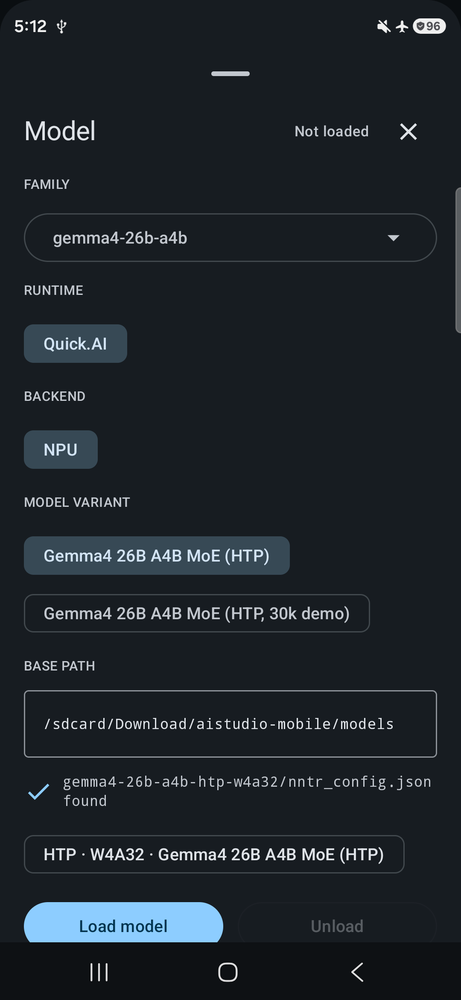
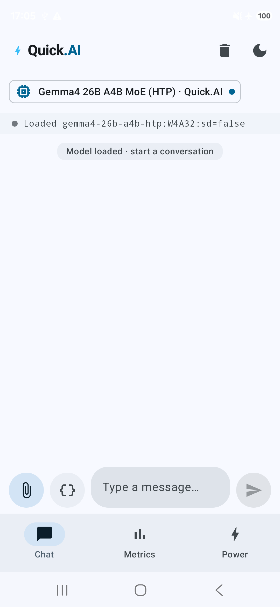
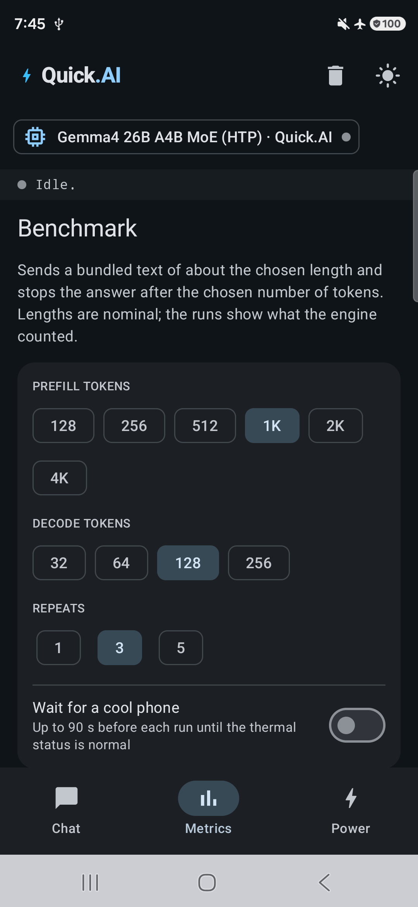

# Run Gemma4-MoE on the Hexagon NPU

This guide takes you from a Linux PC and an Android phone to a first Gemma4
26B-A4B response, using either the command line or the Quick.AI Android app.
It covers installing the toolchains, building nntrainer, installing the runtime,
copying a model pack, and checking that the NPU actually runs the model.

**Source baseline:** [PR #4480](https://github.com/nntrainer/nntrainer/pull/4480),
commit [`67d2903a279a3f5604074f001bbf8f814dfb9f82`](https://github.com/nntrainer/nntrainer/tree/67d2903a279a3f5604074f001bbf8f814dfb9f82),
reviewed on 2026-11-05. Commands below target that revision, including the
SDK/HexKL 6.4.0.1 pairing, the updated Metrics benchmark and the 2,304-position
Gemma4 chat preset. Screenshot and benchmark dates are recorded separately
below. A different checkout may have different commands or features.

> You need a separately supplied, ready-to-run **Gemma4 HTP model pack**.
> Neither this repository nor the APK includes the weights. No public download
> URL for the delivered pack is documented in this PR. Obtain the pack and its
> matching configuration from your model provider before attempting inference.
> Downloading an ordinary Hugging Face checkpoint is not a replacement for this
> step.

All `bash` blocks run in **Bash on the Linux PC**, including commands beginning
with `adb`. Blocks marked `sh` run inside **`adb shell` on the phone**. Replace
example paths with your own absolute paths. Continue in the same host terminal
so that exported environment variables remain available. Stop and resolve an
error before moving to the next step.

## 1. Check the requirements

| Component | Version or requirement used by this guide |
| --- | --- |
| Build PC | Ubuntu 24.04, x86-64; reserve about 60 GB for tools and builds, plus space for the model pack and archives |
| Phone | Galaxy S26 Ultra, Snapdragon SM8850, Hexagon **v81**, Android 16 with **4 KB** memory pages, as documented by the PR |
| NPU compatibility | `HEX_ARCH=v81` is required. A Qualcomm NPU alone does not establish compatibility; other DSP generations and 16 KB-page devices are outside the validated baseline |
| Minimum Android version | App installation requires API **33 (Android 13)** or newer. The NPU validation baseline is the phone environment above |
| Hexagon SDK | **6.4.0.1**, including **Hexagon Tools 19.0.04** |
| Hexagon Kernel Library (HexKL) | **1.0 beta2**, using its **`lib/6.4.0.1`** libraries |
| Android NDK | **r30**, package revision **30.0.16248370** |
| Android app tools | **JDK 17**, SDK platform **36**, build-tools **36.0.0**, SDK CMake **3.22.1**, platform-tools |
| Native build tools | GCC/G++, Meson, Ninja, CMake, Python 3, Rust/Cargo, Git |
| Model | A complete Gemma4 26B-A4B HTP pack, with weights and configuration from the same delivery |
| Phone storage | The benchmarked TL2 weights occupy **6.60 GB** (6,604,561,848 bytes); palette weights occupy **7.54 GB** (7,540,724,856 bytes). Reserve additional space for the rest of the chosen pack and runtime caches |
| Working memory (RAM) | Separate from storage; usage depends on context length and expert cache settings. Use the provider's phone-tested settings for the first run and close other memory-heavy apps |

### What the components do

- **Android NDK:** compiles the ARM64 code that runs on the phone's CPU.
- **Hexagon SDK and Tools:** compile and connect to the DSP/NPU code through FastRPC.
- **HexKL:** supplies kernels used by the Hexagon backend, called **HTP** in nntrainer.
- **`libnntr_hvx_skel.so`:** nntrainer's DSP program, built from this PR. It must match the ARM-side libraries from the same build.
- **QuickDotAI / Quick.AI:** the reusable Android library (AAR) and sample application (APK), respectively.

This guide uses `--htp`; a QNN SDK installation is not required. The latest
script also supports `--qnn --htp` for a combined package, which additionally
requires the QNN dependencies. OpenCL is enabled by default; use
`--disable-opencl` consistently across build/install commands if you want a
package without the OpenCL/GPU backend.

## 2. Install the Linux and Android tools

### Linux build dependencies

```bash
sudo apt update
sudo apt install -y \
  build-essential git curl wget unzip zip file pkg-config \
  python3 python3-pip python3-venv meson ninja-build cmake \
  openjdk-17-jdk autoconf automake libtool

export JAVA_HOME=/usr/lib/jvm/java-17-openjdk-amd64
export PATH="$JAVA_HOME/bin:$PATH"
java -version
python3 --version
meson --version
ninja --version
cmake --version
```

`java -version` should report Java 17. These commands install host build tools;
the NDK supplies the Android compilers. Do not install a host nntrainer package
as a substitute for the Android build below.

Install Rust using the [official rustup installer](https://rustup.rs/), accepting
the default installation when prompted:

```bash
curl --proto '=https' --tlsv1.2 -sSf https://sh.rustup.rs -o /tmp/nntr-rustup-init.sh
sh /tmp/nntr-rustup-init.sh
source "$HOME/.cargo/env"
rustup target add aarch64-linux-android
rustc --version
cargo --version
```

Rust builds the repository's tokenizer library. The build script manages the
Android C/C++ compiler settings for that library; no separate tokenizer checkout
or `cargo-ndk` installation is needed.

### Android SDK and NDK

Download **Command line tools only → Linux** from the
[Android Studio downloads page](https://developer.android.com/studio#command-tools).
Extract the archive into a temporary directory. Place its contents so that the
SDK manager is at `$HOME/Android/Sdk/cmdline-tools/latest/bin/sdkmanager`, as in
Google's [SDK manager instructions](https://developer.android.com/tools/sdkmanager).
For example, replacing the archive name with the one you downloaded:

```bash
export ANDROID_HOME="$HOME/Android/Sdk"
export NNTR_ANDROID_TOOLS_ZIP="$HOME/Downloads/commandlinetools-linux-REPLACE_ME_latest.zip"
NNTR_ANDROID_TOOLS_TMP=$(mktemp -d)
unzip "$NNTR_ANDROID_TOOLS_ZIP" -d "$NNTR_ANDROID_TOOLS_TMP"
mkdir -p "$ANDROID_HOME/cmdline-tools/latest"
cp -a "$NNTR_ANDROID_TOOLS_TMP/cmdline-tools/." "$ANDROID_HOME/cmdline-tools/latest/"
export PATH="$ANDROID_HOME/cmdline-tools/latest/bin:$ANDROID_HOME/platform-tools:$PATH"
sdkmanager --version
```

If Android Studio already installed the SDK, use its SDK location instead and
install **Android SDK Command-line Tools** from its SDK Manager. Keep
`ANDROID_HOME` and any existing `ANDROID_SDK_ROOT` pointed at the same directory.
The commands here use the SDK manager shipped in the command-line tools package.

Install the pinned packages, review and accept the Android licenses:

```bash
sdkmanager --sdk_root="$ANDROID_HOME" --licenses
sdkmanager --sdk_root="$ANDROID_HOME" \
  "platform-tools" "platforms;android-36" "build-tools;36.0.0" \
  "cmake;3.22.1" "ndk;30.0.16248370"

export ANDROID_NDK="$ANDROID_HOME/ndk/30.0.16248370"
cat "$ANDROID_NDK/source.properties"
"$ANDROID_NDK/toolchains/llvm/prebuilt/linux-x86_64/bin/clang" --version
adb version
```

The NDK revision should be `30.0.16248370`, corresponding to
[NDK r30](https://developer.android.com/ndk/downloads). If using the standalone
`android-ndk-r30-linux.zip` instead, extract it and set `ANDROID_NDK` to the
resulting `android-ndk-r30` directory. The app build uses the same NDK path as the
native build. The repository provides its Gradle wrapper; do not install a
separate system Gradle.

## 3. Install Hexagon SDK and HexKL beta2

### Get the Qualcomm packages

Use the official [Qualcomm Software Center Hexagon SDK catalog](https://softwarecenter.qualcomm.com/catalog/item/Hexagon_SDK)
and [Qualcomm Package Manager](https://qpm.qualcomm.com/) entry points.
Sign in with your Qualcomm account when requested. Select **Hexagon SDK
6.4.0.1** for Linux and install its **Hexagon Tools 19.0.04** component. Use the
installer's reported destination; the examples below use
`$HOME/Qualcomm/Hexagon_SDK/6.4.0.1`.

If the portal requires the Linux Package Manager application, download its
Debian package, install that downloaded file, then open the application and
sign in:

```bash
# Replace the filename with the package you actually downloaded.
sudo apt install "$HOME/Downloads/QualcommPackageManager3.3.0.133.0.Linux-x86.deb"
```

In the Qualcomm catalog, also locate **Hexagon Kernel Library (HexKL)** and
select **1.0 beta2**. It is distributed separately from the SDK. The
[Qualcomm AI Stack catalog](https://softwarecenter.qualcomm.com/catalog/catalog-suite/Qualcomm%C2%AE%20AI%20Stack)
is another entry point to this package. Portal screens and version availability
depend on your account. If the required version is unavailable, request access
from Qualcomm or your package provider; do not silently replace it with another
release. There is no anonymous package-download URL assumed by this guide.

Extract the supplied beta2 ZIP. This example uses the archive name
`hexkl-1.0-beta.2.zip`, whose top-level directory is `hexkl_addon`:

```bash
mkdir -p "$HOME/Qualcomm/HexKL/1.0-beta2"
unzip "$HOME/Downloads/hexkl-1.0-beta.2.zip" -d "$HOME/Qualcomm/HexKL/1.0-beta2"
export HEXKL_ROOT="$HOME/Qualcomm/HexKL/1.0-beta2/hexkl_addon"
head -n 8 "$HEXKL_ROOT/README.md"
```

The README should identify **1.0 Beta.2**. If your download has an additional
outer archive, extract it first and point `HEXKL_ROOT` at the directory that
actually contains `include/` and `lib/`.

### Set the environment

On the **host**, source the installed SDK's environment script first, then set
the Android and HexKL paths explicitly:

```bash
source "$HOME/Qualcomm/Hexagon_SDK/6.4.0.1/setup_sdk_env.source"

export HEXKL_ROOT="$HOME/Qualcomm/HexKL/1.0-beta2/hexkl_addon"
export HEXKL_SDK_VER=6.4.0.1
export HEXKL_TOOLS_VARIANT=toolv19
export HEXKL_ARCH=armv8_android26
export HEX_ARCH=v81
export ANDROID_HOME="$HOME/Android/Sdk"
export ANDROID_NDK="$ANDROID_HOME/ndk/30.0.16248370"
export JAVA_HOME=/usr/lib/jvm/java-17-openjdk-amd64
export PATH="$JAVA_HOME/bin:$HOME/.cargo/bin:$ANDROID_HOME/cmdline-tools/latest/bin:$ANDROID_HOME/platform-tools:$PATH"
```

`setup_sdk_env.source` supplies `HEXAGON_SDK_ROOT` and
`DEFAULT_HEXAGON_TOOLS_ROOT`. If you installed the SDK elsewhere, change the
`source` path. Re-run this block whenever you start a fresh terminal, or save
these commands in a shell file outside the source checkout and source it.

> **Use 6.4.0.1 for both the Hexagon SDK and the HexKL library selection.**
> HexKL's `lib/<version>` directory names the SDK version the libraries target.
> `HEXKL_SDK_VER=6.4.0.1` selects `lib/6.4.0.1`: the Android runtime is
> `armv8_android26/libsdkl.so`, and the DSP build links
> `hexagon_toolv19_v81/libhexkl_micro.a` below it. Both build scripts default
> to this version. The DSP script no longer selects the newest available
> directory automatically. Check that the matching directory exists; do not
> rename a different version's directory to make the path check pass.

Check the paths before building:

```bash
printf 'SDK: %s\nTools: %s\nHexKL: %s\n' \
  "$HEXAGON_SDK_ROOT" "$DEFAULT_HEXAGON_TOOLS_ROOT" "$HEXKL_ROOT"

ls "$HEXAGON_SDK_ROOT/setup_sdk_env.source" \
   "$HEXAGON_SDK_ROOT/rtos/qurt/computev81/include/qurt" \
   "$HEXKL_ROOT/include/hexkl_micro.h" \
   "$HEXKL_ROOT/lib/$HEXKL_SDK_VER/armv8_android26/libsdkl.so" \
   "$HEXKL_ROOT/lib/$HEXKL_SDK_VER/hexagon_toolv19_v81/libhexkl_micro.a"

"$DEFAULT_HEXAGON_TOOLS_ROOT/Tools/bin/hexagon-clang" --version
```

Every path must exist, and the compiler must be the Tools 19.0.04 installation.
`DEFAULT_HEXAGON_TOOLS_ROOT` names the directory **above `Tools/`**, not `Tools/bin`.
HexKL provides prebuilt libraries: building all of its examples is not required
for nntrainer. Its generic `libhexkl_skel.so` is not a substitute for nntrainer's
`libnntr_hvx_skel.so`.

## 4. Get the PR source and connect the phone

### Use a separate checkout

On the **host**, use a new directory so an existing project is not overwritten:

```bash
mkdir -p "$HOME/workspace"
cd "$HOME/workspace"
git clone https://github.com/nntrainer/nntrainer.git nntrainer-gemma4-pr4480
cd nntrainer-gemma4-pr4480
git fetch origin pull/4480/head
git switch --detach 67d2903a279a3f5604074f001bbf8f814dfb9f82
git submodule sync --recursive
git submodule update --init --recursive --depth 1
export NNTR_ROOT="$PWD"
git rev-parse HEAD
```

The hash should match the source baseline at the top of this guide. This pins
instructions to a known revision even if the PR later changes. Submodules are
required for the build; initializing them is different from editing their
vendored source. Downloads also occur during the first tokenizer and Gradle
builds, so keep internet access available.

### Authorize ADB

On the **phone**, enable Developer options by tapping **Build number** seven
times (on Samsung: Settings → About phone → Software information). Enable
**USB debugging** in Developer options, connect a data-capable USB cable, and
accept the debugging authorization prompt on the unlocked phone.

On the **host**:

```bash
adb devices -l
```

The device must be listed as `device`, not `unauthorized` or `offline`. When more
than one device or emulator is connected, set the serial shown in that output:

```bash
# Replace this value with the serial from adb devices -l.
export ANDROID_SERIAL=REPLACE_WITH_DEVICE_SERIAL
adb get-state
adb shell getprop ro.product.model
adb shell getprop ro.soc.model
adb shell getprop ro.build.version.release
adb shell getconf PAGE_SIZE
adb shell df -h /sdcard
```

If only one device is attached, `ANDROID_SERIAL` can remain unset. Expected
baseline: S26 Ultra / SM8850, Android 16, page size **4096**. Build and runtime
compatibility still depend on the device's firmware and FastRPC support; these
properties alone do not prove NPU execution. No `adb root` step is required by
this workflow.

## 5. Build and install the native runtime

### Build first

On the **host**:

```bash
cd "$NNTR_ROOT/Applications/CausalLM"
set -o pipefail
./build_android.sh --htp 2>&1 | tee "$NNTR_ROOT/gemma4-htp-build.log"
```

The script generates the FastRPC stub, builds the v81 DSP image, builds the
Android engine and tokenizer, and then builds the CausalLM tools. The DSP build
checks its symbols and architecture; successful output includes `ARCH OK (V81)`.
The final message should be `Done (native htp build)` with the artifact directory.
A failed command piped through `tee` still fails because `pipefail` is enabled.

| Output | Location relative to `NNTR_ROOT` | Purpose |
| --- | --- | --- |
| `nntr_causallm` | `builddir_app/htp/` | Direct model-pack CLI |
| `quick_dot_ai_test` | `builddir_app/htp/` | C API runner and optional lifecycle test |
| `libcausallm.so`, `libquick_dot_ai_api.so` | `builddir_app/htp/` | Model runtime and public API |
| `libnntrainer.so`, `libccapi-nntrainer.so` | `builddir/android_build_result/lib/arm64-v8a/` | nntrainer engine |
| `libnntr_hvx_skel.so` | `nntrainer/tensor/htp_backend/dsp/build/` | v81 DSP program |
| `nntr_quantize`, `nntr_safetensors_info` | `builddir_app/htp/` | Additional tools; the quantizer does not create this HTP pack |

Check the two essential executables and the DSP image:

```bash
cd "$NNTR_ROOT"
ls -lh builddir_app/htp/nntr_causallm \
  builddir_app/htp/quick_dot_ai_test \
  nntrainer/tensor/htp_backend/dsp/build/libnntr_hvx_skel.so
file builddir_app/htp/nntr_causallm
```

The CLI is an **ARM aarch64** executable. Run it on the phone, not directly on
the x86-64 PC.

### Install on the phone

On the **host**, with the authorized phone connected:

```bash
cd "$NNTR_ROOT/Applications/CausalLM"
./build_android.sh --htp --cache --install
adb shell ls -lh /data/local/tmp/Quick.AI
```

`--cache` reuses a compatible engine build; the script still performs the
remaining build steps. `--install` deploys executables and runtime libraries to
`/data/local/tmp/Quick.AI`, replacing its managed runtime files, and creates
`run_causallm.sh` and `run_test.sh` wrappers. It **does not copy the model pack**.

The runtime includes `libsdkl.so` from HexKL and `libc++_shared.so` from the NDK.
The phone supplies `libcdsprpc.so` from its vendor partition. Rebuild and deploy
the ARM libraries, stub and DSP image together; copying only an old DSP image
into a new build can break their shared protocol.

`--clean` recreates the selected CausalLM native build directory; it is not a
promise to remove every engine or Gradle cache. The default HTP CPU thread count
is 8; leave it unchanged for the first run.

The latest script also accepts `--stage` to assemble the public native files
under `builddir_app_stage/public/htp/` with a sibling `.manifest.json` report.
`--stage=DIR` selects a dedicated directory that the script recreates on each
run. This is useful for library integration; the app build handles its own
staging. `--cache` also checks the OpenCL setting before reusing an engine.

## 6. Prepare and copy the model pack

Ask your model provider for a **chat-ready Gemma4 26B-A4B HTP pack compatible
with this PR**. Keep the delivered weights, rotations, tokenizer and config
files together. This guide does not create or quantize weights.

The latest catalog has three Gemma4 HTP entries. The commands in this guide
use the first row; choose another only with its matching supplied pack.

| Catalog ID | App FAMILY / MODEL VARIANT | Directory below BASE PATH |
| --- | --- | --- |
| `gemma4-26b-a4b-htp` | `gemma4-26b-a4b` / `Gemma4 26B A4B MoE (HTP)` | `gemma4-26b-a4b-htp-w4a32/` |
| `gemma4-26b-a4b-htp-long` | `gemma4-26b-a4b` / `Gemma4 26B A4B MoE (HTP, 30k demo)` | `gemma4-26b-a4b-htp-long-w4a32/` |
| `gemma4-26b-a4b-htp-2bit-4bit` | `gemma4-26b-a4b-2bit-4bit` / `Gemma4 26B A4B MoE (HTP, rotated 2/4-bit)` | `gemma4-26b-a4b-2bit-4bit/` |

Selecting the 30k demo does not expand an ordinary pack's context or establish
that the phone has enough RAM. Keep the provider's matching settings.

The app expects this layout on the phone:

```text
/sdcard/Download/aistudio-mobile/models/       ← model base path
└── gemma4-26b-a4b-htp-w4a32/                 ← model pack directory
    ├── nntr_config.json
    ├── config.json
    ├── tokenizer.json
    ├── chat_template.jinja
    ├── generation_config.json
    ├── <weight file named by model_file_name>
    └── <any sidecars named in nntr_config.json>
```

`config.json` must be the flat text-model configuration, not a wrapper containing
only `text_config`. The provider's `nntr_config.json` selects `htp_fused` /
`htp_fused_v1`, the engine assignments and the actual weight formats.

Two Gemma4 pack families exist in this PR:

| Pack | Expert format | Projections / head |
| --- | --- | --- |
| Delivered palette pack | `QS2CX_WH` | `QS4CX` projections, tied `Q4_0` head on CPU |
| Native ternary pack | `TL2CX_WH`, possibly mixed affine expert layers | `QS4CX_WH_AFFINE` projections and untied HTP head |

The app's `W4A32` label is a catalog selection, not a statement that every tensor
has four-bit weights. Do not change dtype names to match that label. In
particular, do not overwrite a TL2 pack's `nntr_config.json` with the palette
preset from `Applications/CausalLM/res/gemma4/htp_chat/`. For a palette pack
requiring a chat preset, confirm its weights match that preset with the provider
before replacing config files. The PR's
[model-pack contract](https://github.com/nntrainer/nntrainer/blob/67d2903a279a3f5604074f001bbf8f814dfb9f82/docs/quickai/model-packs.md)
describes the formats and optional sidecars in detail.

When updating an older pack for this revision, follow the
[removed-switch migration notes](https://github.com/nntrainer/nntrainer/blob/67d2903a279a3f5604074f001bbf8f814dfb9f82/docs/quickai/configuration.md#removed-comparison-switches).
Retired nested `htp` / `moe` keys are rejected at load. Remove the listed keys
from a compatible copy of the pack configuration; do not replace TL2 settings
with a palette preset. The retired `moe.hadamard=both_scalar` value becomes
`both` when that same rotation is required by the checkpoint.

On the **host**, set the directory of the supplied pack and check the main files:

```bash
export NNTR_MODEL_PACK="$HOME/models/gemma4-26b-a4b-htp-w4a32"
python3 - <<'PY'
import json
import os
from pathlib import Path

pack = Path(os.environ["NNTR_MODEL_PACK"])
for name in ("nntr_config.json", "config.json", "tokenizer.json",
             "chat_template.jinja", "generation_config.json"):
    path = pack / name
    if not path.is_file():
        raise SystemExit(f"Missing chat-pack file: {path}")
cfg = json.loads((pack / "nntr_config.json").read_text())
weights = pack / cfg["model_file_name"]
if not weights.is_file() or weights.stat().st_size == 0:
    raise SystemExit(f"Missing or empty weights: {weights}")
print("Weight file:", weights.name)
print("Weight bytes:", weights.stat().st_size)
print("Expert format:", cfg.get("moe_layer_dtype"))
print("Execution profile:", cfg.get("gemma4_execution_profile"))
for key in ("moe_engine", "attention_engine", "attn_proj_engine", "dense_ffn_engine"):
    if cfg.get(key) != "htp":
        raise SystemExit(f"Expected {key}=htp; ask the pack provider")
print("Main files present. Also verify all sidecars from the provider's manifest.")
PY

du -sh "$NNTR_MODEL_PACK"
```

This is a presence check, not a validator for weight contents. Check any supplied
checksums and sidecar manifest as well. The recommended chat files avoid template
fallback and benchmark-only generation settings.

Copy the directory's contents, including sidecars, to the exact app directory:

```bash
adb shell mkdir -p /sdcard/Download/aistudio-mobile/models/gemma4-26b-a4b-htp-w4a32
adb push "$NNTR_MODEL_PACK/." /sdcard/Download/aistudio-mobile/models/gemma4-26b-a4b-htp-w4a32/
adb shell ls -lh /sdcard/Download/aistudio-mobile/models/gemma4-26b-a4b-htp-w4a32
```

Check that `nntr_config.json` is directly in that directory, not inside another
nested pack directory. The multi-gigabyte transfer may take a while. Use
`/sdcard/Download` so both the shell and the app can read the pack;
`/data/local/tmp` is suitable for CLI binaries but is not an app-readable model
location on a production phone.

## 7. Run Gemma4 from the command line

### First run with the pack's default prompt

On the **host**:

```bash
cd "$NNTR_ROOT"
set -o pipefail
adb shell sh /data/local/tmp/Quick.AI/run_causallm.sh \
  /sdcard/Download/aistudio-mobile/models/gemma4-26b-a4b-htp-w4a32 \
  2>&1 | tee gemma4-cli.log
```

The wrapper sets the runtime library paths, enters `/data/local/tmp/Quick.AI`,
and invokes `nntr_causallm`. With no second argument, the CLI uses `chat_input`
through the pack's template if present, otherwise the raw `sample_input`.
The supplied palette chat preset contains a summarization prompt.

A successful run produces an answer and timing output, including
`[e2e time]: ... ms` and `Max Resident Set Size: ... KB`. Exact answer text and
speed depend on the pack and device state. The first load can create tokenizer
or weight-layout caches and take longer than later loads.

### Give the CLI a short prompt

The interface is `nntr_causallm <model_path> [input_prompt]`. There are no
`--model`, `--prompt` or `--npu` flags. The second argument is **raw model input**;
the CLI does not apply a chat template to it.

To avoid host/ADB quoting mistakes, open a phone shell from the **host**:

```bash
adb shell
```

Then run this block **inside the phone shell**. The quoted text is one argument;
its literal newlines and Gemma turn markers are intentional:

```sh
sh /data/local/tmp/Quick.AI/run_causallm.sh \
  /sdcard/Download/aistudio-mobile/models/gemma4-26b-a4b-htp-w4a32 \
  '<bos><|turn>user
Explain what a neural network is in two sentences.<turn|>
<|turn>model
<|channel>thought
<channel|>'
exit
```

For this preset, the empty thought channel requests a direct answer. Use the
provider's matching template if your pack differs. Generation length is read
from `num_to_generate` in `nntr_config.json`, not a CLI flag. The palette chat
preset sets `init_seq_len=2048`, `max_seq_len=2304` and `num_to_generate=256`:
up to 2,048 prompt tokens with a 256-token answer budget. Supplied TL2 packs
can use different settings. These defaults are separate from the fixed-output
CLI configurations in the archived benchmark section.

### Check NPU execution

A generated answer alone does **not** prove that the NPU ran. In this revision,
a failed DSP open can log a warning and let the CLI fall back to the CPU.
Capture device logs as well. In a second **host terminal**, select the same
`ANDROID_SERIAL` if necessary and start logging before the next inference:

```bash
cd "$HOME/workspace/nntrainer-gemma4-pr4480"
adb logcat -v threadtime > gemma4-device.log
```

After the inference completes, press **Ctrl+C in the logging terminal**. Search
both logs on the host:

```bash
grep -Ei 'HTP|nntr_hvx|FastRPC|adsprpc|cdsprpc|falling back|CPU fallback' \
  gemma4-cli.log gemma4-device.log
```

Treat `nntr_hvx_open failed`, `HTP backend disabled, falling back to CPU`, or
operation-level `CPU fallback` messages as a failed NPU check. Resolve missing
skel/library or device-session errors before comparing performance. HTP arena
mapping and graph activity are useful supporting evidence, but an isolated
`HTP` label is not proof of successful offload. Some CPU work is intentional;
for example, the palette pack's tied language-model head uses the CPU.

For a stronger check using the **app's C API**, run this from the **host** after
the CLI finishes:

```bash
adb shell 'sh /data/local/tmp/Quick.AI/run_test.sh \
  gemma4-26b-a4b-htp "Explain neural networks in two sentences." \
  true W4A32 1 /sdcard/Download/aistudio-mobile/models'
```

Here `true` enables chat-template application to the plain-text prompt.
The latest `run_test.sh` sets `QUICKAI_NATIVE_LIB_DIR` and `ADSP_LIBRARY_PATH`
to `/data/local/tmp/Quick.AI` with no trailing colon. It also sets the native
library path and the configured thread count. After updating the source,
repeat the build/install step to replace the old wrapper on the phone.

For the optional lifecycle test, run:

```bash
adb shell 'QDA_HTP_LIFECYCLE=1 sh /data/local/tmp/Quick.AI/run_test.sh \
  gemma4-26b-a4b-htp "Explain neural networks in two sentences." \
  true W4A32 1 /sdcard/Download/aistudio-mobile/models'
```

It checks repeated generation, cancellation, unload/reload and invalid packs.
Successful checks print `[HTP-API-TEST] PASS ...`; retain logs and check the
exit status. Unload the model in the app before running CLI/API tests.

## 8. Build and install the Quick.AI app

The instructions follow the updated app at the source revision above. The
model-selection and chat examples are real **Quick.AI 2.0** captures from
November 4, 2026 (Galaxy S26 Ultra SM-S948N / SM-S948U, Android 16, 4 KB pages).
The Metrics image was refreshed on November 5 on SM-S948U and shows the
benchmark setup. The installed APKs' source commits were not established;
the captures illustrate the controls, while the pinned source defines their
behaviour. Click an image to open its full-resolution capture.

### Build and install the APK

On the **host**, reuse the same environment and source revision:

```bash
cd "$NNTR_ROOT/Applications/CausalLM"
set -o pipefail
./build_android.sh --htp --cache --app 2>&1 | tee "$NNTR_ROOT/gemma4-app-build.log"
```

This stages the native libraries, builds the library AAR and sample APK, and
runs `verify_native_package.py`. That verification checks required libraries,
the unmodified v81 DSP image and native library dependencies. It also rejects
unwanted QNN or vendor `libcdsprpc.so` libraries in the HTP package.

| Artifact | Location relative to `NNTR_ROOT` |
| --- | --- |
| AAR for application developers | `Applications/CausalLM/Android/QuickDotAI/build/outputs/aar/QuickDotAI-debug.aar` |
| Installable APK | `Applications/CausalLM/Android/QuickDotAIAPP/build/outputs/apk/debug/QuickDotAIAPP-debug.apk` |
| Native package verification report | The APK path followed by `.native-manifest.json` |

The **APK** installs on the phone. The **AAR** is a library for building other
apps and cannot be installed with `adb install`.

Install the completed APK from the **host**:

```bash
cd "$NNTR_ROOT"
adb install -r -t Applications/CausalLM/Android/QuickDotAIAPP/build/outputs/apk/debug/QuickDotAIAPP-debug.apk
adb shell appops set com.example.quickdotaiapp MANAGE_EXTERNAL_STORAGE allow
adb shell pm path com.example.quickdotaiapp
```

`adb install` should end with `Success`; `pm path` should return the installed
APK location. The permission command allows reading the pack under `/sdcard`.
You can instead grant **All files access** when the app opens the Android
permission screen, or through Settings → Apps → Special access → All files
access → Quick.AI (wording may vary).

As an alternative to separate build/install commands,
`./build_android.sh --htp --cache --app --install` builds the AAR/APK, installs
the APK and also deploys the CLI runtime. Neither approach copies model weights;
complete step 6 separately.

### Load the model and send a message

Follow **model selection → load confirmation → send a message**. The model
selection capture uses the default base path. The load and chat
captures use a TL2 pack already available on the other phone under
`/sdcard/Download/aistudio-mobile/models_1022`. If you copied your pack as in
step 6, use `/sdcard/Download/aistudio-mobile/models` from the table below.

### 1. Select Gemma4 NPU and the model path

Tap the **model chip** below the top bar to open **Model**.

| Control | Select or check |
| --- | --- |
| **FAMILY** | `gemma4-26b-a4b` |
| **RUNTIME** | `Quick.AI` |
| **BACKEND** | `NPU` |
| **MODEL VARIANT** | `Gemma4 26B A4B MoE (HTP)` for this guide. This row appears when the selected family/runtime/backend offers multiple packs. |
| **BASE PATH** | `/sdcard/Download/aistudio-mobile/models` — the parent containing `gemma4-26b-a4b-htp-w4a32` |
| Config status | `gemma4-26b-a4b-htp-w4a32/nntr_config.json found` |
| Model badge | `HTP · W4A32 · Gemma4 26B A4B MoE (HTP)` |



The `found` indicator only confirms a config file exists; the load can still
fail if weights or sidecars are missing. If Gemma4 NPU is absent from the model
list, check that the installed APK came from the `--htp` build.

### 2. Confirm the model has loaded

Tap **Load model** and wait. Once the **Model** sheet says **Loaded**, close
it with **×** at the top right. The chat status should read
`Loaded gemma4-26b-a4b-htp ...`, and the conversation area should say
**Model loaded · start a conversation**. Load time depends on the pack and
the phone's state.



Resolve **Load failed** before sending a question. Check **BASE PATH** and
permissions first; if the config is **found**, check pack compatibility with
the installed app and the presence of all required files.

### 3. Send a question and stop generation

Enter `Explain neural networks in two sentences.` in **Type a message…**
and tap the **Send** arrow on the right. The answer streams into the chat;
the status becomes **Done.** when it finishes. Use Android's Back action to
hide the keyboard if it covers the answer.

, generation speed and output token count.")

During generation, **Stop** replaces Send. Cancelling marks the turn
**stopped**. The top-bar trash icon, **Clear conversation**, clears the visible
chat. To release the model, use **Unload** in the model sheet.

At this revision the HTP app sends **only the newest user message**. Earlier
chat bubbles are not conversation memory for this model. Keep initial prompts
short: prompts beyond the configured context can be truncated without an
error. The palette chat preset has 2,304 positions, a 2,048-token prompt limit
and a 256-token answer budget; supplied TL2 packs can have different limits.
Updating the app does not rewrite a previously copied pack's configuration.
Increasing context can materially increase RAM use.
These Gemma4 HTP packs are text-only; the app's image controls for other models
do not make this path multimodal.

### 4. Check Metrics and unload

Open **Metrics** to run a speed benchmark with bundled text. Load the model,
choose the lengths and repetitions below, then scroll down and tap **Run**.
The initial choices are **1K / 128 / 3**, with the thermal wait off.



| Control | Choices and behaviour |
| --- | --- |
| **PREFILL TOKENS** | 128, 256, 512, 1K, 2K or 4K nominal tokens of bundled text. |
| **DECODE TOKENS** | 32, 64, 128 or 256; the app stops the answer at the selected length. |
| **REPEATS** | 1, 3 or 5 runs. |
| **Wait for a cool phone** | Optional wait of up to 90 seconds before each run; off by default. |
| **Run / Stop** | Run requires a loaded, idle model and lengths that fit its pack. Stop ends the measurement. |

The benchmark uses its own prompt, sized at roughly four characters per token,
and asks for a detailed retelling. The per-run table reports the actual token
counts. Each repeat clears the visible chat before sending that prompt; save
any conversation text you need first.

For native models the app reads `max_seq_len - num_to_generate` as the prompt
budget and `num_to_generate` as the answer budget, disabling choices above
them. The current palette preset therefore disables 4K prefill. An engine's
prefill limit can further shorten the actual prompt; inspect the reported
counts. Changing a choice does not change the pack's context configuration.

Results show the median **TIME TO FIRST TOKEN** (send to first token in the
app), **PREFILL** throughput from engine timing, and **DECODE** throughput
from first to last token using wall time. Each row gives prompt/answer counts
and timings. Early answers, skipped runs and decode windows shorter than one
second are marked; eligible runs contribute to the displayed medians. The
first run after loading can include warm-up and is not automatically excluded.

With all-files access, the CSV is appended to
`/sdcard/Download/QuickAI/power/bench.csv`; otherwise the app uses its own
external-files directory. Check the displayed **Saved to** path. The former
last-chat metrics, peak-memory tile and raw-output history have been removed.
Per-answer chat statistics remain under the answers. The chat stream omits
turn markers such as `<turn|>`; use the native token trace for Gemma4 end-of-turn
ID `106`.

### 5. Measure power

The **Power** tab measures whole-phone battery-gauge energy per output token.
After loading a model, choose **PROMPT**, **WINDOW TOKENS**, **REPEATS** and
**BASELINE**, then tap **Measure** and unplug the cable when prompted. The run
waits for a cool phone, records idle power, generates the answer and cools down.
Keep **Measure while plugged** off for power measurements; it is a debug option.

Power results include baseline-adjusted `mJ/token`, power and per-run records.
With all-files access, `runs.csv` and session JSON files go under
`/sdcard/Download/QuickAI/power/`. Metrics can run with USB attached and has no
power baseline or cool-down. Finish one measurement before starting the other.

When finished, or before running the CLI, open the top model chip and tap
**Unload**. Use **Load model** to start again, or **Reload model** to replace
an already loaded instance. The latest app runs native inference in a private
worker and waits for it to exit before loading the next model. Load one NPU
model at a time.

## 9. Benchmark results

Measured on November 4, 2026 with the **deployed rotated TL2 pack**, using the
CLI runtime whose native libraries match the installed Quick.AI app. Input
lengths are **1,024 / 2,048 / 4,096 / 8,192 tokens**, with **128 output tokens**
in every run. These are archived measurements of the runtime deployed that
day, not a rerun of the updated SDK/HexKL recipe or the app's Metrics workflow.

The [LFM2 benchmark appendix](#appendix-a-lfm2-benchmark-results) records a
separate sweep with the same input/output lengths, device and runtime.

### Deployed model and test conditions

| Item | Measured configuration |
| --- | --- |
| Device | Galaxy S26 Ultra **SM-S948U**, Snapdragon **SM8850**, Hexagon **v81**, Android **16**, 4 KB pages. |
| Model pack | `models/gemma4-26b-a4b-htp-w4a32` under `/sdcard/Download/aistudio-mobile/`. |
| Quantization | Rotated **TL2** experts (`moe_layer_dtype=TL2CX_WH`); affine 4-bit projections and LM head (`QS4CX_WH_AFFINE`); embedding `Q4_0`. The entire model is not uniformly TL2. |
| Weight file | `nntr_gemma4_26b_a4b_tl2_rotated.bin`, **6,604,561,848 bytes** (6.60 GB). The complete SHA-256 is in the measurement manifest. |
| Runtime | All seven native `.so` files match the installed Quick.AI app by SHA-256. The CLI executable hash is also recorded. The binary's source commit was not established, so these are measurements of that deployed build. |
| Inference | HTP fused execution, batch 1, greedy decoding, eight CPU threads; attention, projections, dense FFN, MoE and LM head use HTP. The resident NPU graph was confirmed in every run. |
| Context and cache | Deployed defaults: `init_seq_len=2048`, `max_seq_len=8704`, attention KV `q8`, `moe_cache_experts=16`, `moe_decode_prefetch=true`. All 8,192 input tokens were processed without truncation. |
| Prompt | A synthetic English report with repeated paragraphs, followed by a summary request. Exact lengths include chat-template tokens and a short padding suffix. Identical input is reused for each repeat of a given length. |
| Repetitions | One excluded 1K warm-up; **three fresh CLI processes per input length**, 12 measured runs. Length order changes between passes; normal OS caches are retained. |
| Temperature | USB connected; at least 15 seconds between runs. Start only at thermal status 0, AP ≤34 °C and skin ≤35.5 °C. Before/after readings are saved for each trial. |

### 1K / 2K / 4K / 8K results

Each cell shows the **median of three runs**; parentheses give the minimum
and maximum. Every row generates **128 total output tokens**.

| Input tokens | Prefill (tok/s) | Decode (tok/s) | TTFT (s) | Peak memory (GiB) |
| --- | --- | --- | --- | --- |
| 1K (1,024) | **599.9** (573.0–627.5) | **18.43** (18.23–18.94) | **1.71** (1.64–1.79) | **3.716** (3.715–3.716) |
| 2K (2,048) | **665.4** (655.1–670.2) | **18.07** (18.04–18.79) | **3.08** (3.06–3.13) | **3.811** (3.811–3.811) |
| 4K (4,096) | **615.5** (615.4–620.7) | **17.38** (17.26–17.81) | **6.66** (6.60–6.66) | **3.978** (3.978–3.978) |
| 8K (8,192) | **560.5** (558.8–564.1) | **15.90** (15.62–15.96) | **14.63** (14.53–14.67) | **4.310** (4.310–4.310) |

The output token IDs also matched across all three repeats for each input
length. This checks repeatability on these prompts; the repeated synthetic
report is a throughput workload, not a model-accuracy evaluation. These short
runs with cooldown do not measure sustained performance on a hot phone.

### Token counts and measurement boundaries

- **128 output tokens = one token selected during prefill + 127 decode steps.**
  For this CLI, `num_to_generate=127` produces that total; its `generation:`
  log line therefore says `127 tokens`. Native token traces confirmed all
  128 output IDs and the exact input IDs in every run.
- **Prefill** is the CLI's input-processing throughput. **Decode** is
  `127 / generation_seconds`, including the first decode step. It is not
  calculated from the reciprocal of the steady-token median.
- **TTFT** comes from the CLI's `[PERF-SPLIT] ttft_ms`: inference start to
  first token delivery. Model loading and process startup are excluded, so
  this is not app launch-to-answer latency.
- **Peak memory** is the runtime's sampled `RssAnon + accelerator` peak,
  converted from KiB to GiB. It excludes file-backed page cache and is not
  total phone RAM usage or the weight-file storage requirement.

Only isolated benchmark copies of the configuration were changed: the prompt,
output limit, greedy setting, trace path and EOS suppression
(`bad_word_ids=[1,50,106]`). EOS suppression keeps all outputs at the requested
length; normal chat should retain the provider's stopping settings. The
deployed pack and app configuration were left unchanged.

### Logs and reproduction

Download the [summary JSON](gemma4-moe-npu-guide/assets/benchmarks/gemma4-tl2-20261104-summary.json),
[individual runs CSV](gemma4-moe-npu-guide/assets/benchmarks/gemma4-tl2-20261104-runs.csv),
or [complete measurement records ZIP](gemma4-moe-npu-guide/assets/benchmarks/gemma4-tl2-20261104-records.zip).
The archive contains raw CLI logs, exact prompts and expected token IDs,
native token traces, per-run configurations, thermal readings, binary/weight
checksums and the measurement scripts. Model weights and runtime binaries
are not included.

Extract the ZIP to obtain the `gemma4_npu_final_pack_20261104/` directory.
Follow its included `README.md` to repeat the measurement with a matching pack and
runtime. Unload the [app's model](#8-build-and-install-the-quickai-app) before
running CLI trials on the same phone. Keep token counts, output length,
temperature limits, cache settings and thread count fixed when comparing
results.


## 10. Troubleshooting

| Symptom | Check and corrective action |
| --- | --- |
| `adb` lists `unauthorized` | Unlock the phone and accept USB debugging authorization. Reconnect the cable if the prompt is missing. |
| `adb` reports no permissions on Ubuntu | Install `android-sdk-platform-tools-common` for USB rules, reconnect the device and follow the distro's `plugdev` group setup if needed. |
| `more than one device/emulator` | Set `ANDROID_SERIAL` to the intended serial in each host terminal. |
| `--htp requires ...` | Source the Hexagon SDK environment and re-export HexKL/Android variables in this terminal. |
| Missing `libsdkl.so` or `libhexkl_micro.a` | Check the extraction root and the exact `6.4.0.1`, `armv8_android26`, `hexagon_toolv19_v81` subdirectories. Do not point at the ZIP or its parent. |
| Build rejects `HEX_ARCH` | This Android workflow requires `v81`; selecting another value does not enable a different phone. |
| `cargo` or Android tokenizer archive missing | Verify Rust/Cargo are on `PATH`, the `aarch64-linux-android` target is installed and `ANDROID_NDK` is correct; rerun the build. |
| Gradle cannot find the SDK or licenses | Check `ANDROID_HOME`, installed platform 36/build-tools/CMake and `sdkmanager --licenses`. A stale `local.properties` can point Gradle at another SDK. |
| Gradle Java or NDK mismatch | Check `java -version`, `JAVA_HOME`, and `ANDROID_NDK/source.properties`; use the canonical build script, which passes `-PnntrainerNdkPath`. |
| `--htp and --qnn select separate native variants` | This comes from an older script. The pinned revision supports `--qnn --htp`; this guide needs only `--htp`. Check the checkout before retrying. |
| `CANNOT LINK EXECUTABLE` / missing `.so` | Use `run_causallm.sh`; redeploy the complete runtime and check `LD_LIBRARY_PATH`. |
| Very slow CLI / DSP open failure / CPU fallback | Check `ADSP_LIBRARY_PATH`, the v81 skel, vendor FastRPC availability and device compatibility. Review both terminal output and logcat. |
| `HTP_GRAPH_E_UNSUPPORTED` | ARM and DSP artifacts may be from different builds. Rebuild and deploy the complete matching set. |
| API reports conflicting `ADSP_LIBRARY_PATH` | Rebuild/install the latest `run_test.sh`. The path must have no trailing colon and must equal `QUICKAI_NATIVE_LIB_DIR`. |
| Second generation fails with `rows [...] do not fit a KV cache` | Update and redeploy the matching runtime libraries and DSP image. The runtime now resets the attention cache base at each new prompt; verify repeat generation with the lifecycle command in step 7. |
| App reports `Unload failed` | The native worker has not been released successfully. Resolve the reported error and retry Unload before loading another model. |
| App reports pack not found | Check base path, exact directory name, all-files permission and accidental extra nesting after `adb push`. |
| App finds config but fails to load | Check the weight filename, nonempty weights, flat model config, all referenced sidecars and provider checksums. Keep config and weights from the same pack. |
| `INSTALL_FAILED_UPDATE_INCOMPATIBLE` | An installed APK uses a different signing key. Prefer the same signing key. If replacing it, back up needed app data before uninstalling: uninstall removes private app data. Then install the new APK. |
| App warns about 16 KB memory pages | This baseline uses 4 KB pages. A warning does not establish compatibility with a 16 KB-page phone; confirm `getconf PAGE_SIZE` is 4096. |
| Answer starts with thought-channel markup | Review logcat for `Chat template apply failed`; restore the matching chat template from the provider/preset. Do not replace weight-format settings with a different preset. |
| Answer never stops or has a fixed length | The pack may be configured for benchmarks. Ask for a chat preset with EOS stopping enabled; the palette preset has EOS IDs `[1, 106, 50]` and empty `bad_word_ids`. |
| Answer ignores earlier messages or the end of a long prompt | HTP app calls are independent; long prompts can be truncated. Test a short, self-contained question. |
| App is killed while loading or generating | Reduce context/cache use with the provider's settings and close other large apps. Do not start CLI and app inference together. |

When reporting a problem, include the pinned source hash, SDK/HexKL/NDK versions,
phone model/OS/page size, the failing command, pack format, and relevant build
or runtime logs. Logs may contain your prompts and answers; review them before
sharing.

## 11. Open and maintain the HTML guide

The documentation site at `gemma4-moe-npu-guide/index.html` splits this guide
into an overview, eleven section pages and an LFM2 benchmark appendix. It has grouped sidebar navigation,
page-local contents, previous/next links, full-text search, code-copy buttons,
and light/dark themes. On small screens, open the navigation with the menu
button. Search also opens with **Ctrl+K** (or **Command+K** on macOS).

Use **한국어 / English** to switch languages while keeping the current section
and subsection. Korean pages start at `gemma4-moe-npu-guide/ko/index.html` (or
`http://localhost:8765/ko/` on the server). Navigation and search use the selected
language. The command below opens English; replace `index.html` with
`ko/index.html` to open Korean directly.

The navigation layout follows the documentation pattern used by
[XGrammar's documentation](https://xgrammar.mlc.ai/docs/latest/). All styles,
scripts and the search index are local files; no CDN or online search service
is required.

From the checkout containing this documentation, on a Linux desktop:

```bash
xdg-open docs/gemma4-moe-npu-guide/index.html
```

To serve the pages on localhost, run this from the repository root of the
checkout containing the guide and leave the terminal running. Serving the
committed HTML requires only Python 3; no packages or rendering step are needed:

```bash
python3 tools/serve_gemma4_npu_guide.py
```

Open `http://localhost:8765/` for English or `http://localhost:8765/ko/` for Korean.
The server prints both addresses and listens on `127.0.0.1` by default. It serves
this documentation, its assets, Markdown sources and single-page views.
Use `--port 9000` to select another port. To access the guide from another device,
add `--bind 0.0.0.0` and open `http://<host-ip>:8765/` on that device.
Press **Ctrl+C** to stop it; run the same command to restart it. If the port is
already in use, stop the earlier guide server or choose another port. Reload
the browser after regenerating the pages.

The original `gemma4-moe-npu-guide.html` remains available as a standalone
file. It contains the entire guide with an inline stylesheet. Keep the adjacent
`gemma4-moe-npu-guide/assets/` directory for screenshots and benchmark downloads
when copying it for offline reading. For the paginated
site, copy the whole `gemma4-moe-npu-guide/` directory and the adjacent English
and Korean `.html` and `.md` files (`gemma4-moe-npu-guide.*` and
`gemma4-moe-npu-guide.ko.*`). Browser **Print → Save as PDF** uses
the included print layout; choose the single-page view to print the full guide.
External reference links naturally need internet access.

The English `gemma4-moe-npu-guide.md` and Korean `gemma4-moe-npu-guide.ko.md`
files are the content sources. After editing them, regenerate HTML from the
same checkout (the renderer is part of this documentation addition, not the
pinned PR source):

```bash
python3 -m venv /tmp/nntr-guide-venv
/tmp/nntr-guide-venv/bin/python -m pip install markdown-it-py==3.0.0
/tmp/nntr-guide-venv/bin/python tools/render_gemma4_npu_guide.py
/tmp/nntr-guide-venv/bin/python tools/render_gemma4_npu_guide.py --check
```

The renderer updates both languages' single-page HTML, thirteen site pages per
language, and search indexes together. Keep the same heading structure and order
in both Markdown files, and update command blocks in both when changing them.
Edit each language's Markdown for content, or `assets/site.css` and
`assets/site.js` inside the site directory for presentation and interactions.
Generated HTML and `assets/search-index.js` should not be edited by hand.

### Validation boundaries and references

These instructions were checked against the pinned PR's scripts, CLI parser,
app controls, benchmark runner and pack-limit parser on November 5. Both build
scripts select HexKL `6.4.0.1`; the app's Metrics controls were also inspected
on SM-S948U and captured again. **No fresh SDK installation, Android build or
model benchmark was performed for this documentation update.** The November 4
chat examples used an existing Quick.AI 2.0 installation and supplied TL2 pack.
The installed APKs' source commits were not established. The captures and the
PR's own build/device records are not a fresh end-to-end run of this guide.

The November 4 benchmark section was separately measured on the deployed TL2 pack on
SM-S948U: three CLI trials each at 1K, 2K, 4K and 8K input, all with 128 output
tokens. Runtime libraries were verified against the installed app by SHA-256;
raw logs, token traces, configurations and binary hashes accompany the results.
Those records remain unchanged. They do not measure the updated SDK/HexKL
recipe or the current app's Metrics workflow.

Use these pinned sources when resolving a discrepancy:

- [Android build script](https://github.com/nntrainer/nntrainer/blob/67d2903a279a3f5604074f001bbf8f814dfb9f82/Applications/CausalLM/build_android.sh): accepted options, prerequisites, outputs and deployment.
- [DSP build script](https://github.com/nntrainer/nntrainer/blob/67d2903a279a3f5604074f001bbf8f814dfb9f82/nntrainer/tensor/htp_backend/dsp/build.sh): HexKL selection and DSP checks.
- [CLI implementation](https://github.com/nntrainer/nntrainer/blob/67d2903a279a3f5604074f001bbf8f814dfb9f82/Applications/CausalLM/main.cpp): positional arguments and prompt handling.
- [Quick.AI build documentation](https://github.com/nntrainer/nntrainer/blob/67d2903a279a3f5604074f001bbf8f814dfb9f82/docs/quickai/build.md): recorded environment and build procedure.
- [CLI and C API test documentation](https://github.com/nntrainer/nntrainer/blob/67d2903a279a3f5604074f001bbf8f814dfb9f82/docs/quickai/cli.md): runtime commands and lifecycle tests.
- [App usage](https://github.com/nntrainer/nntrainer/blob/67d2903a279a3f5604074f001bbf8f814dfb9f82/docs/quickai/app.md) and [known limitations](https://github.com/nntrainer/nntrainer/blob/67d2903a279a3f5604074f001bbf8f814dfb9f82/docs/quickai/troubleshooting.md): controls, permissions and failure modes.
- [Metrics screen](https://github.com/nntrainer/nntrainer/blob/67d2903a279a3f5604074f001bbf8f814dfb9f82/Applications/CausalLM/Android/QuickDotAIAPP/src/main/java/com/example/quickdotaiapp/ui/MetricsScreen.kt) and [prompt/pack limits](https://github.com/nntrainer/nntrainer/blob/67d2903a279a3f5604074f001bbf8f814dfb9f82/Applications/CausalLM/Android/QuickDotAIAPP/src/main/java/com/example/quickdotaiapp/power/PowerPrompts.kt): selectable lengths, results and disabled choices.
- [Measurement runner](https://github.com/nntrainer/nntrainer/blob/67d2903a279a3f5604074f001bbf8f814dfb9f82/Applications/CausalLM/Android/QuickDotAIAPP/src/main/java/com/example/quickdotaiapp/power/PowerRunner.kt) and [result files](https://github.com/nntrainer/nntrainer/blob/67d2903a279a3f5604074f001bbf8f814dfb9f82/Applications/CausalLM/Android/QuickDotAIAPP/src/main/java/com/example/quickdotaiapp/power/PowerFiles.kt): thermal waits, chat clearing and CSV destinations.

## Appendix A. LFM2 benchmark results

The deployed **LFM2 24B-A2B SR15 pack (TL2/INT4)** was measured on November 4,
2026, on the same phone and runtime as the [Gemma4 benchmark](#9-benchmark-results).
Inputs are **1,024 / 2,048 / 4,096 / 8,192 tokens**, with **128 output tokens**
per run. This appendix preserves those measurements.

### LFM2 results

Each value is the **median of three runs**, with minimum–maximum in parentheses.
The 1K warm-up is excluded; there are **12 measured runs**.

| Input tokens | Prefill (tok/s) | Decode (tok/s) | TTFT (s) | Peak memory (GiB) |
| --- | --- | --- | --- | --- |
| 1K (1,024) | **799.4** (761.9–826.5) | **18.60** (18.34–19.31) | **1.30** (1.26–1.37) | **2.146** (2.145–2.146) |
| 2K (2,048) | **1083.0** (1083.0–1084.8) | **18.19** (18.04–18.33) | **1.91** (1.91–1.91) | **2.213** (2.213–2.229) |
| 4K (4,096) | **768.8** (766.0–769.5) | **17.16** (17.11–17.16) | **5.35** (5.34–5.37) | **2.263** (2.263–2.267) |
| 8K (8,192) | **571.5** (566.6–574.4) | **15.26** (15.19–15.29) | **14.36** (14.29–14.48) | **2.264** (2.264–2.266) |

Native token traces confirmed the exact input IDs and 128 output IDs in every
run, including the full 8,192-token input. Output IDs were identical across all
three repeats at each length. Logs confirmed the resident NPU graph, including
convolution, attention, MoE and LM head.

### LFM2 model and conditions

| Item | Measured configuration |
| --- | --- |
| Device | Galaxy S26 Ultra **SM-S948U**, Snapdragon **SM8850**, Hexagon **v81**, Android **16**, 4 KB pages; the same phone used for Gemma4. |
| Runtime | The CLI executable and all seven native libraries match the Gemma4 measurement by SHA-256. The libraries also match the installed Quick.AI app. Binary source commit is unverified; the archive identifies the measured artifacts by hash. |
| Model pack | `/sdcard/Download/aistudio-mobile/models/lfm2-24ba2b-htp-w4a32`; `lfm2_weight_format=sr15_v2`, `lfm2_execution_profile=htp_fused`. |
| Weight file | `LFM2-24B-A2B-Ternary-INT4.bin`, **5,433,850,513 bytes** (5.43 GB). The full checksum is in `manifest.json` inside the archive. |
| Quantization | Rotated TL2 experts (`TL2CX_WH`), affine INT4 projections/router/LM head (`QS4CX_WH_AFFINE`), `Q4_0` embeddings and `DW3_INT4` short convolutions. |
| Shared settings | Batch 1, greedy decoding, eight CPU threads, `moe_cache_experts=16`, `init_seq_len=2048`, `max_seq_len=8704`. |
| LFM-specific settings | LFM tokenizer/chat template, attention KV `q8_row`, EOS ID `7` and the automatic SR15 CLI preset are retained. |
| Prompt | The same original report paragraphs and summary request as Gemma4, tokenized with LFM's tokenizer and padded to each exact length. Different tokenizers mean different text lengths at the same token count. |
| Repetition and cache | One excluded 1K warm-up, then three fresh CLI processes per length. Pass order: 1K→2K→4K→8K; 8K→4K→2K→1K; 1K→4K→2K→8K. OS caches are retained. |
| Temperature | USB connected; at least 15 seconds between runs. Start only at thermal status 0, AP ≤34 °C and skin ≤35.5 °C, matching the Gemma4 procedure. Recorded starting ranges: AP 29.4–32.8 °C, skin 29.4–32.0 °C. |

The deployed pack's `init_seq_len` was 64. Only isolated benchmark copies raised
it to 2,048, removed `chat_input` so the exact `sample_input` was used, and set
`num_to_generate=127`, `bad_word_ids=[7]`, greedy decoding and a token-trace path.
The original model pack and app settings were unchanged. EOS suppression is
for fixed-length measurement; retain the provider's stopping behavior for chat.

### Reading the LFM2 measurements

- **Output count:** one token selected during prefill plus 127 decode steps
  gives 128 total output IDs. The CLI's `generation:` line reports 127 tokens.
- **Speed:** Prefill is input tokens divided by prefill time; Decode is
  `127 / generation_seconds`, including the first decode step.
- **TTFT:** native `[PERF-SPLIT] ttft_ms`, excluding process startup and model
  loading. It is not app launch-to-answer latency.
- **Peak memory:** sampled `RssAnon + accelerator`, converted from KiB to GiB.
  File-backed page cache is excluded; this is not total phone RAM usage or
  weight-file storage size.

The workload measures throughput on synthetic report prompts. It does not
measure model accuracy or sustained performance on a hot phone. Gemma4 and
LFM2 differ in architecture, active parameter count, tokenization, KV format
and execution preset, even though the measurement procedure is aligned.

### LFM2 measurement records

Download the [LFM2 summary JSON](gemma4-moe-npu-guide/assets/benchmarks/lfm2-sr15-20261104-summary.json),
[individual runs CSV](gemma4-moe-npu-guide/assets/benchmarks/lfm2-sr15-20261104-runs.csv),
or [complete measurement records ZIP](gemma4-moe-npu-guide/assets/benchmarks/lfm2-sr15-20261104-records.zip).

The ZIP preserves the November 4 records: raw CLI logs, exact prompts and
expected IDs, native token traces, per-run configurations, thermal readings,
binary/weight checksums and measurement scripts. It includes the excluded
warm-up, marked separately in `results.json` and the CSV. Model weights and
runtime binaries are not included. `summary.json` aggregates only the 12
measured runs.
