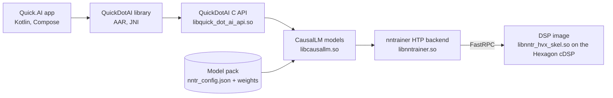

# Quick.AI on the Hexagon NPU

Quick.AI runs large mixture-of-experts language models on the NPU of a
Snapdragon phone with nntrainer. The decoder runs on the Hexagon Tensor
Processor (HTP) through a DSP image that nntrainer ships; the CPU keeps the
tokenizer, the embedding lookup and the sampling loop. Four pieces make up
the product, and this documentation set covers all of them:

| Piece | What it is | Page |
|---|---|---|
| **Quick.AI** (QuickDotAIAPP) | The Android app: Chat, Metrics and Power screens | [Using the app](app.md) |
| **QuickDotAI** library | The Kotlin AAR an app embeds: one interface over the native engine and LiteRT-LM | [QuickDotAI Android library](../../Applications/CausalLM/Android/QuickDotAI/README.md) |
| **QuickDotAI C API** | The handle-based C ABI under the library (`quick_dot_ai_api.h`) | [QuickDotAI C API](../../Applications/CausalLM/api/README.md) |
| **nntrainer HTP backend** | The engine: the ARM-side `ComputeOps` table, the FastRPC session and the HVX/HMX kernels in `libnntr_hvx_skel.so` | [HTP backend architecture](../backend_guide/HTP_ARCHITECTURE.md) |

## Supported models and devices

| Model | Parameters | Weights on the NPU | Pack size | Measured decode |
|---|---|---|---|---|
| Gemma4 26B-A4B (instruction tuned) | 26 B total, about 4 B active, 128 experts per layer, 30 layers | 2-bit palette or native ternary experts, int4 projections, int8 KV cache | 7.5 GB (palette pack) | 12 to 19 tokens/s depending on pack and prompt |
| LFM2 24B-A2B (SR15) | 24 B total, about 2 B active, hybrid convolution and attention | native ternary experts, affine int4 projections, int4 convolution taps, int8 KV cache | 5.4 GB | about 17 tokens/s at 2,048 input tokens |

Device: a Snapdragon with a Hexagon **v81** DSP, which today means the
Galaxy S26 Ultra (SM8850, Android 16, 4 KB pages). The build enforces
v81. Exact figures and their conditions are in [Performance](performance.md).

## Who should read what

| You want to | Read |
|---|---|
| Install the app and talk to a model on your phone | [Using the app](app.md), then [Model packs](model-packs.md#where-a-pack-lives) for staging the weights |
| Put the engine in your own Android app | [QuickDotAI Android library](../../Applications/CausalLM/Android/QuickDotAI/README.md) |
| Call the engine from C or C++ | [QuickDotAI C API](../../Applications/CausalLM/api/README.md) |
| Build the libraries, the DSP image, the AAR and the APK from source | [Build from source](build.md) |
| Produce or inspect a model pack | [Model packs](model-packs.md) |
| Run a pack from a shell, benchmark it, compare token IDs | [Command line](cli.md) |
| Tune or diagnose the runtime | [Configuration](configuration.md), the reference for every `htp` and `moe` key |
| Know what speed and memory to expect | [Performance](performance.md) |
| Fix an error message | [Troubleshooting and known limits](troubleshooting.md) |
| Read, debug or extend the backend | [HTP backend architecture](../backend_guide/HTP_ARCHITECTURE.md) |

A first reading, in order: app → model packs → build → command line. The
library and C API pages stand alone.

## Read the HTML guide on localhost

To read the separate Gemma4 walkthrough in English or Korean, run this from
the repository root:

```bash
python3 tools/serve_gemma4_npu_guide.py
```

Open <http://localhost:8765/> for English or <http://localhost:8765/ko/> for Korean.
Only Python 3 is required to serve the committed pages. Use `--port 9000` for
another port and **Ctrl+C** to stop the server. The guide states the source
revision used for its command examples.

## How it fits together



A **model pack** is a directory with the weights in the layout the DSP reads
and a `nntr_config.json` that selects the model and its runtime policy. The
same pack is read by the app, the C API and the command-line tool
`nntr_causallm`, so a setting changed in the pack applies everywhere.
Nothing is tuned through environment variables.

## Validated configurations

| Configuration | Status |
|---|---|
| Gemma4 26B-A4B, 2-bit palette pack, chat preset (2,304 positions), app and command line, S26 Ultra | Validated: identical token IDs across the command line, the C API test and the app; lifecycle tests pass |
| Gemma4 26B-A4B, native ternary pack (rotated checkpoint), app lifecycle test, S26 Ultra | Validated: seven identical runs of the summary prompt |
| LFM2 24B-A2B SR15 pack, command line with the automatic preset, 2,048-token prompt, S26 Ultra | Validated: three runs, identical IDs |
| Hexagon v79 (Galaxy S25 Ultra) | Not supported by the current build |
| 16 KB-page devices | Not validated |
| Accuracy or perplexity on either model | Not measured; validation is run-to-run and CPU-reference token parity |

## Names

- **Quick.AI**: the app, and the label of the native runtime in its model
  sheet.
- **QuickDotAI**: the Kotlin library and the C API (`quick_dot_ai_api.h`).
- **HTP**: Hexagon Tensor Processor, Qualcomm's NPU; **HVX** and **HMX** are
  its vector and matrix units; **cDSP** the compute DSP that hosts the
  image; **FastRPC** the remote-call transport; **HexKL** Qualcomm's kernel
  library that the DSP image links.
- **Pack**: a model directory as described in [Model packs](model-packs.md).
- **WH**: the weight tile layout the HMX reads; `QS4CX_WH`, `QS2CX_WH`,
  `TL2CX_WH` and `QS4CX_WH_AFFINE` are the pack formats built on it.
