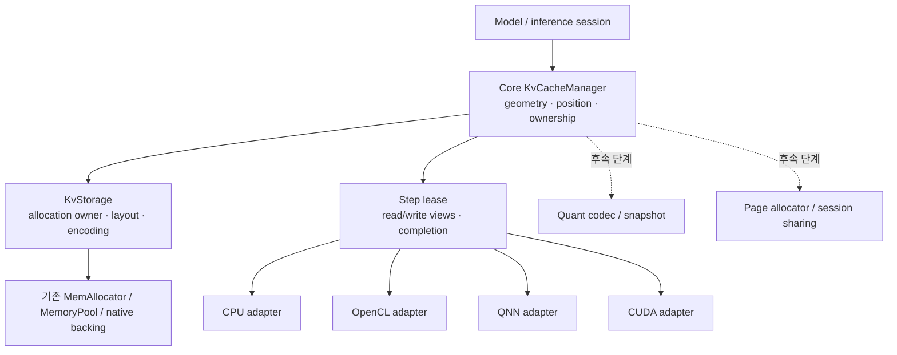

# CPU/GPU/NPU 공용 KV cache manager 구현 계획

> Linux 실행 기록: [환경 검토와 단계별 검증](linux-cpu-execution.md).
> Android 실행 기록: [빌드와 단위 검증](android-build-checks.md),
> [Qwen3 실기기 검증과 동일 CPU allocation 접근 범위](android-cpu-validation.md).
> 리뷰 후속: [안전장치·CI 보강](review-followup.md), [성능 측정](cpu-performance.md),
> [다음 backend 조사](next-backend-review.md).
> 일반 환경 재현 절차는 [CPU KV 검증 안내](../docs/kv-cache-cpu-validation.md)를 참고한다.
> 현재 사용자 확정 순서는 **Linux CPU → Android Arm CPU → 이후 추후 결정**이다.
> 아래 Windows 분석 당시 로드맵과 실제 실행 결과를 구분한다.

이 계획은 기존 CausalLM KV manager를 core의 backend 독립 모듈로 발전시키고,
각 backend의 attention이 manager 소유 cache를 직접 읽고 쓰도록 만드는 작업이다.
**최우선 완료 기준은 요구 1의 직접 접근이며, 양자화·저장·session 공유는 순서대로 확장한다.**

- 기준: upstream main `141871a58ff439e3caeac40c1632ff8ac3543d20`, 2026-10-28 분석
- 최초 범위: Linux/Android, batch=1, active session=1, inference
- 현재 구현 순서: 공통 계약 → Linux CPU → Android Arm CPU → 이후 추후 결정.
  OpenCL/QNN/CUDA 절은 후속 후보 설계이며 현재 CPU 단계의 완료를 대체하지 않는다.
- 최초 작성 범위: 설계·개발 계획. 이후 제품 구현과 실제 Linux 검증 결과는
  [실행 기록](linux-cpu-execution.md), [Qwen3 기준 모델 검증](qwen3-cpu-validation.md)에 남긴다.
- 읽는 순서: 이 문서 → [현재 소스 분석](repository-analysis.md) → [Linux 개발·검증](linux-development.md)

## 1. 요구 1의 완료 의미

### 1.1 검증 수준을 구분한다

| 수준 | 의미 | 완료 판단 |
|---|---|---|
| A. 직접 읽기 | attention이 manager의 기존 K/V allocation을 그대로 읽음 | layer별 독립 full-history cache나 upload가 없음 |
| B. 직접 쓰기 | 최종 K/V producer가 manager write view에 결과를 씀 | 별도 new-K/V output에서 cache로 옮기는 순수 copy가 없음 |
| C. backend 간 공유 | 동일 세션의 cache allocation을 CPU/GPU/NPU가 전환해 사용 | 같은 backing identity, 호환 layout/encoding, 올바른 fence; 재배치·repack 없음 |

**요구 1의 기본 목표는 지원한다고 선언한 각 backend/profile에서 A+B를 만족하는 것이다.**
C는 하나의 물리 allocation을 여러 장치가 읽는 추가로 강한 조건이다.
공용 API가 있다고 C를 달성한 것은 아니다. 대상 기기 확정 후 C의 지원 조합도 명시한다.
CPU만 완료했을 때 전체 요구 1을 완료로 표시하지 않는다.

RoPE/quantization 같은 필요한 연산이 결과를 최종 cache에 쓰는 것은 직접 쓰기다.
반면 단순 memcpy, scalar-multiply-by-1 copy kernel, 전체 prefix transpose,
mirror 동기화를 이름만 바꾸어 직접 쓰기로 집계하지 않는다.
packed kernel 내부의 작은 tile/register scratch는 persistent KV 복제와 구분한다.

`zero application copy`와 `zero physical migration`도 별도로 보고한다.
OpenCL/CUDA의 같은 주소만으로 driver 내부 복사·page migration이 없다고 증명할 수 없다.
관련 규격과 한계는 [소스 분석 §8](repository-analysis.md#8-외부-규격-확인과-남은-실험)에 정리했다.

### 1.2 최초 범위와 호환성

- 일반 causal attention, GQA/MQA, multi-token prefill, token decode, multi-turn을 포함한다.
- FP16 native 및 현행 UINT16 half-bit 표현을 구분해서 보존한다.
  core manager 자체는 FP32도 지원하고 기존 FP32 단위 테스트를 유지한다.
- layer별 head 수/차원, capacity, window, KV source alias를 표현한다.
- 처음에는 contiguous storage가 기본이다. 기존 ring 및 Gemma4 alias는
  regression으로 유지하고, 지원 불가 profile은 실행 전에 명시적으로 거절한다.
- 새 backend의 strict 모드는 unsupported를 반환한다. 기존 실행을 유지하는
  compatibility 모드는 copy 종류와 byte 수를 보고한다.
- 비공개 QNN 모델, 다른 vendor NPU, training의 external mutable cache,
  dynamic batch, session 간 공유는 최초 구현 범위 밖이다.
- 기존 CPU/GPU model 경로, 저장 파일, public API를 한 번에 제거하지 않는다.

## 2. 권고 구조



manager는 token 위치와 cache 수명을 관리한다. backend adapter는 allocation의
접근 가능성, kernel/graph binding, 동기화를 담당한다. attention 연산과 모델별
RoPE 정책은 기존 layer/model에 남긴다. model이 geometry를 전달하므로 core가
CausalLM 모델 이름이나 graph tensor 이름을 파싱하지 않는다.

### 2.1 새 모듈과 기존 기반

권고 위치는 `nntrainer/kv_cache/`, namespace는 `nntrainer::kv`다.
기존 `Applications/CausalLM/kv_cache_manager.h`와 include 충돌을 막기 위해
core header는 `<kv_cache/kv_cache_manager.h>`처럼 명시한다.

| 새 구성요소(제안) | 책임 | 재사용/연결 대상 |
|---|---|---|
| `kv_cache_spec.h` | layer geometry, layout, encoding, capability | TensorDim과 명시적 변환 |
| `kv_storage.h/.cpp` | allocation owner, byte 범위, native handle, owner identity | MemAllocator, MemoryPool, TensorBacking |
| `kv_cache_manager.h/.cpp` | session 상태, position, step 발행/commit/reset | 기존 CausalLM manager의 유효한 정책 |
| `kv_tensor_binding.h/.cpp` | Tensor alias와 producer/consumer binding | TensorPool::fillPlaceholder/syncDependents |
| `kv_backend.h` | backend 기능 조회, view/binding, completion 계약 | Engine/Context |
| CPU adapter | aligned host storage, synchronous completion | 기본 MemAllocator |
| OpenCL adapter | SVM 또는 cl_mem 직접 binding, map/event | ClSVMAllocator, ClBufferPool, TensorBacking |
| QNN adapter | RPC ownership, fd+offset 등록, context 수명 | qnn plugin 내부; SDK type 노출 금지 |
| CUDA adapter | device/managed allocation, stream/event | CudaMemAllocator, StreamManager |

모든 backend header를 공통 public header에 include하지 않는다.
QNN 구현은 `nntrainer/qnn/` plugin 쪽에 두고 core와 역방향 link를 만들지 않는다.
초기 core API는 내부용으로 두고 외부 설치/ABI 확대는 별도 검토한다.
기존 설치 API인 `ResidencyClass`의 값을 재번호화하지 않는다.

기존 allocator/residency planner를 대체하는 두 번째 전역 메모리 시스템을 만들지 않는다.
필요한 확장은 **allocation별 실제 결과**와 **owner 유지**다.
CUDA/UVM, OpenCL SVM, QNN RPC를 하나의 `isSVM` bool로 표현하지 않는다.

## 3. 데이터 및 소유권 계약

### 3.1 geometry와 표현

논리 차원은 `[batch, token, kv_head, head_dim]`이다.
물리 차원은 K/V 각각 다를 수 있으며 다음 정보를 가진다.

| 필드 | 의미 |
|---|---|
| layer_id / owner_layer_id | attention layer 식별자와 공유 source |
| num_kv_heads / head_dim | 단순 width보다 풍부한 geometry; GQA 확대 저장 금지 |
| max_logical_tokens / physical_capacity | context 한계와 실제 row 수 분리 |
| layout_id / strides / padding | token-major, head-major, QNN K/V, packed image 등 |
| encoding / storage_type | FP16, FP32, INT8 등의 수학적 표현과 UINT16 등 저장 타입 분리 |
| quant_desc | scale dtype/axis/group, zero point/offset convention, packing, version |
| memory_kind / device / context | 실제 allocation의 접근 영역과 runtime identity |
| buffer_id / generation / offset_bytes / size_bytes | 수명·범위·stale view 검증 |

byte 수는 checked multiply/add로 계산한다. 음수·0 크기·overflow·bounds를
allocation 전에 거절한다. packed 4-bit에 일반 element stride를 적용하지 않고
codec/layout별 block 크기와 offset 변환을 사용한다.

같은 논리 shape만으로 alias하지 않는다. encoding, stride, scale, head 순서,
RoPE 적용 상태/position, 모델 identity까지 해당 목적에 맞게 일치해야 한다.

### 3.2 allocation owner와 view

- `KvStorage`가 실제 allocation 또는 pool을 강하게 소유한다.
- view와 비동기 작업은 `KvStorage` 및 필요한 context의 lease를 유지한다.
- native handle은 storage/view의 접근 수단이다. 외부로 준 Tensor가 오래 살아도
  underlying pool이 먼저 해제되지 않도록 해야 한다.
- 기존 `MemoryData` wrapper를 공유하는 것만으로 충분하다고 가정하지 않는다.
  한 구현 후보는 storage owner를 유지하는 aliasing shared_ptr로 MemoryData를
  내보내는 것이다. owner→view→owner cycle이 생기지 않게 설계한다.
- raw pointer가 필요한 기존 API에는 실행 범위로 제한한 adapter를 제공한다.
  `float *` reinterpret_cast를 새 핵심 API의 계약으로 사용하지 않는다.
- reset/reallocate/rebind 시 generation을 올리고 이전 write lease는 사용 불가로 한다.
- context 종료 순서는 실행 완료 → binding 해제/등록 해제 → native view 해제 →
  allocation 해제 → context 파괴다. plugin unload도 lease가 끝난 뒤 허용한다.
- 초기 capacity는 고정한다. 실행 중 realloc으로 포인터를 옮기지 않는다.
  확장은 새로운 storage로의 명시적 operation이며 strict steady-state 경로 밖이다.

### 3.3 제안 API 모양

아래는 C++17 수준의 **설계 의사 코드**다. 현재 repository API가 아니며
이 파일만 복사해 컴파일할 수 있는 구현 skeleton은 아니다.

```cpp
struct CacheSpec;       // vector<LayerSpec>, alias map, policy
struct BackendPlan;     // validated allocation/layout/producer/consumer plan
struct KvView;          // storage lease + byte range + layout + encoding
struct Completion;      // CPU done / CL event / CUDA event / QNN completion
struct StepLease;       // move-only; generation + absolute [from, to)

class KvCacheManager {
public:
  void initialize(const CacheSpec &, const BackendPlan &);
  StepLease beginStep(uint64_t token_count);
  KvView writeKey(StepLease &, uint32_t layer);
  KvView writeValue(StepLease &, uint32_t layer);
  KvView readKey(const StepLease &, uint32_t layer);
  KvView readValue(const StepLease &, uint32_t layer);
  void commit(StepLease &&, Completion);
  void abort(StepLease &&);
  void reset();                 // wait/reject while in flight
  uint64_t committedLength() const;
  CacheStats stats() const;
};
```

초기 버전의 view는 contiguous segment 하나 또는 ring 경계의 두 segment를 표현한다.
consumer가 두 segment를 못 받으면 caller가 step을 경계에서 나누거나 initialization이
실패한다. 이를 연속 buffer로 몰래 gather하지 않는다.

나중에 block table을 받는 `PagedKvView`를 추가할 수 있도록 storage와 logical
address를 분리한다. 지금부터 page allocator나 scheduler를 구현하지는 않는다.

## 4. 실행 및 상태 계약

1. model initialize 시 layer spec과 producer/consumer capability를 대조한다.
2. allocation을 만들고 모든 read/write binding을 compile/init 단계에 연결한다.
3. `beginStep(n)`은 committed position에서 쓰기 범위를 예약한다.
   최초에는 동시에 한 step만 허용한다.
4. K의 최종 RoPE/변환, V의 최종 projection/norm/변환이 write view에 결과를 쓴다.
5. attention은 committed prefix와 현재 step의 준비된 K/V를 같은 storage에서 읽는다.
   layer별 write 완료 의존성을 유지한다.
6. 모든 owner layer와 graph 실행 성공 후 commit한다. 최초 구현은 완료를 기다리고
   position을 한 번만 전진시킨다. 비동기 pipelining은 이후 event 의존성으로 확장한다.
7. 실패/cancel 시 새 범위를 publish하지 않는다. 결과가 완료되기 전에 view를 재사용하지 않는다.

linear append가 미완성이라면 committed prefix를 보존하고 새 tail을 버릴 수 있다.
ring에서 기존 유효 row를 이미 덮어썼다면 position rollback만으로 복구되지 않는다.
초기 정책은 해당 session을 invalid로 만들고 reset/rebuild하는 것이다.
진정한 rollback은 별도 undo/COW 설계가 준비된 후에만 제공한다.

mask, read interval, valid length, absolute RoPE position은 하나의 step에서 파생한다.
MHA의 독립 `cache_index`는 migration adapter를 거친 뒤 제거/읽기 전용으로 바꾼다.
manager position과 layer position이 따로 전진하는 상태를 남기지 않는다.

ring은 기존 `kv_ring.h`의 capacity/chunk 규칙을 우선 보존한다.
chunk 경계와 ring seam을 나누고, shared layer는 owner가 쓴 후 읽기만 한다.
새 session의 fill 정책은 encoding에 따른다. QNN fixed-point에서 byte 0이 실수 0이라는
가정을 하지 않고 quant metadata와 graph의 padding/mask 계약을 사용한다.

## 5. backend별 구현 경로

### 5.1 CPU

첫 실제 모델은 tiny Qwen2 계열의 일반 causal attention으로 삼고
Gemma4 variable geometry/alias와 LFM2 hybrid block은 곧바로 회귀 범위에 추가한다.

1. 기존 manager를 thin compatibility facade로 만들고 core storage에 위임한다.
2. 기존 input placeholder 방식으로 direct read를 유지한다.
   이 단계에서 graph 입력을 제거하는 구조 개편은 불필요하다.
3. node/layer별 binding을 initialize 때 확정한다. 매 토큰 tensor 이름/포인터를
   검색하는 방식은 초기 compatibility 구현 후 정리한다.
4. K RoPE 출력의 기존 cache slice 직접 쓰기를 새 write lease로 연결한다.
5. V의 **마지막 실제 producer**를 찾고 출력 Tensor를 write view에 연결한다.
   모델에 V norm이 있으면 FC보다 norm의 최종 출력을 대상으로 한다.
6. FP32→half 변환이 필요하면 그 변환의 최종 destination을 manager로 한다.
   기존 half 출력의 단순 copy를 변환으로 위장하지 않는다.
7. TensorPool에 명시적 external mutable output binding을 추가한다.
   alias를 임시 activation pool이 다시 할당하거나 in-place 최적화로 덮지 않게 한다.

동적 write offset은 stable base + step offset으로 표현한다. 실행 중 tensor 차원을
임의로 바꿔 graph planner의 수명 정보를 깨는 접근은 피한다.
producer가 다른 consumer에도 값을 제공하면 소비 시점과 representation을 검증한다.
다른 표현이 필요한 graph는 별도 supported profile이 준비될 때까지 compatibility로 둔다.

core `MultiHeadAttentionLayer`와 LLaMA custom layer는 후속 작은 변경으로 연결한다.
core MHA의 full-history transpose는 strided read/kernel 수정 없이는 없앨 수 있으므로
이 경로에 A+B 완료 표시를 먼저 붙이지 않는다.

### 5.2 OpenCL

첫 검증 profile은 FP16 buffer/SVM attention이다. image 경로까지 한 번에 바꾸지 않는다.

- allocation 결과별 SVM 지원, host addressability, context를 기록한다.
- coarse/fine grain 구분에 맞춰 host map/unmap과 device event를 adapter에서 처리한다.
- kernel 인자에 native backing + offset을 연결해 전체 prefix upload를 없앤다.
- V producer 출력도 같은 backing에 직접 쓰도록 한다.
- GPU copy kernel, lower/raise, fallback, mirror fill의 byte 수를 모두 계측한다.
- unsupported layout에서 strict 요청을 조용히 host-copy 경로로 바꾸지 않는다.

그다음 OHWI/image 경로의 authoritative storage를 manager로 옮긴다.
동일 bytes를 buffer와 image view로 볼 수 있으면 기존 TensorBacking을 재사용한다.
실제 transpose가 필요하면 producer/kernel layout을 바꾼다.
서로 다른 layout의 slab+mirror 두 개를 유지하면서 B/C를 완료했다고 하지 않는다.

CPU decode와 GPU prefill을 번갈아 쓸 경우 양쪽 kernel이 동일 layout을 읽는지 확인한다.
호환 layout이 없다면 해당 전환은 explicit conversion 비용을 가진 compatibility 기능이다.
recordable queue/capture는 stable handle와 scalar offset을 유지하고 generation 변화 시 재생을 무효화한다.

### 5.3 QNN: 초기에 feasibility부터 검증

QNN의 경우 host manager만 변경해서 해결될 것이라는 전제를 두지 않는다.

**먼저 작은 graph로 다음을 검증한다.**

- manager가 소유한 RPC buffer를 input과 output에 등록할 수 있는가.
- 선택 SDK에서 fd+offset shared-buffer 등록과 필요한 alignment를 지원하는가.
- prefill/decode graph가 같은 K/V shape, stride, quant encoding을 공유하는가.
- output의 final layout이 cache와 일치하는가.
- 서로 다른 view 또는 input/output의 memory overlap이 backend에서 허용되는가.
- history를 입력으로 읽으면서 append 영역에 쓸 때 graph dependency가 올바른가.

K output의 channel stride가 capacity와 다르면 offset binding만으로 불가능하다.
우선순위는 다음과 같다.

1. exporter/graph를 수정해 manager layout에 final K/V를 직접 생성한다.
   graph가 destination stride/update를 지원하도록 하고 실제 memory effect를 검증한다.
2. 필요하면 cache-aware attention/update custom op를 연구한다.
   host append를 device append로 이동한 것과 최종 producer 직접 쓰기를 구분한다.
3. graph/runtime 제약으로 불가능하면 QNN을 `RequiresCopy`로 명시한다.
   strict QNN 완료는 보류하고 graph 수정 항목을 요구 1의 미완료 의존성으로 남긴다.

input/output 포인터를 임의로 겹치게 하거나, full-cache output을 ping-pong하면서
zero-copy 완료라고 판정하지 않는다. full-cache rewrite도 별도 비용이다.

등록 cache key는 raw pointer 하나가 아니라
`context generation + buffer id + offset + extent + tensor metadata`를 포함해야 한다.
QNN context별 handle을 관리하고 반복 decode에서 등록 수가 무한 증가하지 않게 한다.
initial prototype은 tensor별 RPC allocation으로 시작할 수 있다.
multi-tensor arena는 fd+offset 지원을 증명한 뒤 도입한다.

공개 Gemma4 QNN의 자체 cache 배열을 실제로 연결하고, 별도 QnnKvCacheManager helper는
공용 facade로 전환한다. 양쪽에 서로 다른 position/append 정책을 남기지 않는다.
기존 fresh_kvs/prefill_kvs의 메모리 중복도 제거 대상이다.

### 5.4 CUDA와 장치 간 공유

CUDA backend가 이미 있으므로 core header/build 변경에서 회귀를 막는다.
device-only storage를 CPU가 역참조하지 않도록 native binding을 제공하고,
K RoPE와 V 최종 producer를 device destination에 연결한다.
UVM은 migration이 있을 수 있어 별도 통계를 낸다.

Android CPU/OpenCL/QNN 동시 공유는 별도 target probe의 통과가 필요하다.
공통 allocator 후보와 GPU import, QNN 등록을 하나의 작은 read/write round trip으로
검증한다. RPC/ION/dma-buf/AHardwareBuffer를 동일한 handle로 취급하지 않는다.
지원되지 않으면 backend별 storage를 사용하되 backend 전환 복사를 숨기지 않는다.

## 6. 구현 단계와 종료 조건

기간은 전담 개발자 1명, 모델·SDK·실기기 확보를 가정한 작업량 추정이다.
성능이나 QNN graph feasibility를 보장하는 일정은 아니다. P0는 CPU 구현 전에 수행한다.

| 단계 | 작업 | 종료 조건 | 예상 |
|---|---|---|---|
| P0 | baseline 고정, copy/ownership 지도, GPU/QNN capability probe, QNN export 가능성 | 지원 profile 및 graph 변경 범위 결정; 실험 로그와 불가능 사유 기록 | 3–5일 |
| P1 | core spec/storage/lease, checked sizing, owner 수명, CPU allocator, fake backend | bounds·수명·실패 테스트 통과; application/SDK 없는 core build | 4–6일 |
| P2a | CausalLM facade, 기존 graph read binding, 위치 단일화 | 기존 manager/model/ring 회귀 통과; prefix read copy 0 | 3–5일 |
| P2b | CPU K/V 최종 producer 직접 쓰기, external output binding | CPU A+B, append copy 0, 여러 turn 동일 결과 | 5–8일 |
| P3a | OpenCL SVM/buffer adapter, capability와 fence, fallback reporting | 실기기 A+B, pointer/backing 검증, copy trace 0 | 5–8일 |
| P3b | image/OHWI storage 소유권과 layout 통합, CUDA adapter | 선택 profile A+B; snapshot/latest-plane 및 capture 회귀 | 5–10일 |
| P4a | QNN RPC ownership/registration, 실제 Gemma4 연결 | input direct read 및 등록 수명 통과; append 비용 정확히 보고 | 4–6일 |
| P4b | QNN graph/export 변경, direct output, prefill/decode 공통 storage | QNN A+B; graph/kernel trace로 숨은 history rewrite까지 확인 | 5–15일 이상 |
| P5 | backend 전환 공유 probe, 장시간·오류·기존 API 회귀, 문서 | 지원 행렬별 요구 1 결과 승인 가능 상태 | 3–5일 |

CPU의 usable milestone은 P2b다. 전체 요구 1은 선택한 GPU/NPU profile까지 완료해야 한다.
P0에서 QNN 불가능이 드러나면 해당 제약을 해소할 graph/vendor 작업을 먼저 계획에 반영한다.
기기 미확정 때문에 P1/P2를 멈출 필요는 없지만 P3/P4의 실행 완료를 선언할 수는 없다.

### 6.1 변경 파일 지도

| 변경 영역 | 예정 파일 / 작업 |
|---|---|
| core | 새 `nntrainer/kv_cache/`, `nntrainer/meson.build` 및 하위 meson |
| storage/Tensor | `memory_data.h`, `memory_pool.*`, `tensor_pool.*`, `tensor.*`: 필요한 최소 owner/binding 확장 |
| graph | `network_graph.*`, layer context 및 producer output binding: persistent mutable 메모리를 activation reuse에서 분리 |
| CausalLM | `kv_cache_manager.*` facade, `models/causal_lm.*`, `transformer.*`, `layers/mha_core.*` |
| 모델별 | Gemma4 source/geometry hook, LFM2 hybrid binding, SentenceTransformer의 별도 manager 경로 |
| producer | FC/QKV 및 모델별 V norm/변환 layer; 마지막 writer별로 적용 |
| OpenCL | `cl_svm_allocator.*`, `tensor/cl_operations/attention_*`, `cl_tensor_view.*`, `cl_buffer_pool.*` |
| QNN | `qnn_rpc_manager.*`, `QNNGraph.*`, `Applications/CausalLM/qnn/generate_qnn_utils.*`, 공개 Gemma4 QNN |
| CUDA | `cuda_mem_allocator.*`, `nntrainer/cuda/` attention/RoPE/stream 및 producer 출력 |
| 기타 layer | core `multi_head_attention_layer.*`, LLaMA custom layer는 별도 adapter 변경 |
| build | core Meson 외 `Applications/CausalLM/meson.build`, `app_build/meson.build`, Android source 목록 |
| 테스트 | 기존 manager/ring/model 테스트 + 새 `test/unittest/kv_cache/` 및 각 backend 테스트 |

core로 이동한 구현을 `libnntrainer`와 `libcausallm`에 중복 compile하지 않는다.
core는 transformer/app 비활성에서도 build 가능해야 한다.
`subprojects/` 및 vendored source를 변경할 계획은 없다.

### 6.2 PR 분할 권고

각 항목은 독립 review가 가능한 한 topic이다. 필요한 회귀 테스트는 같은 PR에 둔다.

1. `[kv_cache] Add cache specifications and owned storage leases`
2. `[CausalLM] Bind existing cache inputs through the shared manager`
3. `[kv_cache] Add persistent producer output bindings`
4. `[CausalLM] Write CPU K and V directly to cache views`
5. `[opencl] Bind cache storage with explicit access synchronization`
6. `[opencl] Unify image cache storage and direct producers`
7. `[qnn] Own and register cache buffers through the shared manager`
8. `[qnn] Integrate cache-aware graph outputs` — graph artifact/exporter 변경을 포함하는 의존 PR 필요
9. `[cuda] Adapt device cache storage to the shared manager`
10. `[kv_cache] Document supported direct-access profiles`

실제 commit은 `git commit -s`와 agent `Co-authored-by:` trailer를 포함한다.
변경 C/C++는 clang-format 14를 적용한다. PR body는 repository template에 맞춰
commit별 details, Self evaluation, Signed-off-by와 Summary를 작성한다.
테스트 수 변경은 check_count 관련 기준도 함께 확인한다.

## 7. 요구 1 검증 계획

### 7.1 핵심 테스트

| 범주 | 테스트와 기대 결과 |
|---|---|
| geometry/bounds | 서로 다른 layer width/capacity, 0/음수/overflow, 마지막 token, capacity+1, 잘못된 alias를 allocation 전에 거절 |
| alias | read/write view가 같은 buffer id와 정확한 offset을 가짐; write가 실제 attention 입력에 즉시 반영 |
| 수명 | manager 파괴 후 살아 있는 Tensor/view, delayed GPU event, QNN context teardown에서 use-after-free/double-free 없음 |
| 위치 | prefill→decode→다음 turn에서 모든 owner layer가 같은 committed length; 중간 layer 실패 시 성공으로 전진하지 않음 |
| ring | W/C 주변, 비정렬 resume, wrap 전후, chunk seam, 실패 후 invalid 처리; 현재 full-cache baseline과 수치 비교 |
| layer sharing | Gemma4 alias source만 allocation/write; 공유 layer가 source를 다시 zero/write하지 않음 |
| input plumbing | graph input 이름 순서가 layer1/layer10/layer2로 달라도 typed binding 정확; SVM 속성 보존 |
| producer | V FC/norm/변환의 최종 destination이 manager view; 단순 copy/identity copy kernel 0 |
| backend | 실제 allocation capability, 잘못된 context, host fallback, unsupported layout을 감지 |
| QNN 등록 | 같은 view 재사용, 두 context, offset view, 등록 실패 중간 정리, 반복 load/unload; handle 수 안정 |
| 정합성 | tiny model logits/greedy tokens, multi-turn, 저장/복원, CPU/GPU reference 비교 |
| 비지원 경로 | strict 모드에서 실행 전 명확한 오류; compatibility의 copy와 conversion 통계 누락 없음 |

같은 backend의 alias-only 변경은 같은 seed/config에서 가능하면 bitwise 비교한다.
연산 순서나 kernel이 바뀌면 기존 test tolerance를 우선 적용하고,
새 tolerance는 baseline 분포와 이유를 함께 기록한다.
다른 backend 간 수치 오차와 greedy token 변화는 별도로 검사한다.
출력 문장이 그럴듯한 것만으로 통과시키지 않는다.

### 7.2 copy와 memory 측정

다음 counter를 initialization / prefill / decode / turn transition / snapshot별로 수집한다.

- `kv_append_copy_bytes`: 이미 생성된 K/V를 다른 cache 위치로 단순 이동
- `kv_history_copy_bytes`: 기존 prefix 복사 및 window shift
- `kv_layout_conversion_bytes`: transpose, pack/unpack, mirror scatter/gather
- `kv_h2d_bytes / kv_d2h_bytes / kv_d2d_bytes`: 명시적 전송; 위 counter와 중복될 수 있음
- `kv_transform_output_bytes`: RoPE/quantization 등 필요한 연산의 final write
- `kv_allocated_bytes / kv_unique_backing_bytes / kv_mirror_bytes`
- native registration/import 수, peak live handle 수, sync 시간, migration/page fault(관측 가능할 때)

카운터는 목적별 통계와 전송 방향별 통계를 구분하며 중복 집계한 합을 전체 copy량으로
제시하지 않는다. wrapper counter 밖의 memcpy, driver call, identity kernel도 trace로 교차 확인한다.
계측을 끈 release benchmark도 별도로 실행한다.

dense FP cache의 기준 storage byte 수는 다음이다.

```text
sum over unique owner layers:
  batch * physical_capacity[layer] * kv_heads[layer] * head_dim[layer]
  * (K bytes/element + V bytes/element)
```

quant scale/padding/registration alignment는 별도로 더한다.
예를 들어 B=1, 32 owner layers, T=4096, Hkv=8, D=128, FP16 K/V면
512 MiB다. GQA query head 수를 사용하거나 alias layer를 중복 더하지 않는다.

측정 workload는 prompt 1/128/1024와 target 최대 길이 주변, generation 1/128,
turn 1/10, ring wrap을 포함한다. cold setup과 steady-state를 분리하고,
최소 5회 warm 반복의 median/p95, TTFT, inter-token latency, tokens/s,
host/device peak memory를 남긴다. thermal·thread·driver·model hash·flags를 고정한다.

성능 gate의 초기 제안은 같은 kernel/profile 대비 median latency 5% 초과 회귀 시
원인을 분석하고 merge 전에 허용 여부를 결정하는 것이다. 이는 측정 결과나 약속이 아니다.
zero-copy가 확인되어도 필요한 동기화 때문에 성능이 나빠질 수 있으므로 둘 다 평가한다.

### 7.3 요구 1 완료 체크리스트

- [ ] core가 CPU-only 및 transformer 비활성 build에서 독립적으로 컴파일됨
- [ ] 기존 manager/ring/model 회귀가 실행되었으며 fixture SKIP을 성공으로 세지 않음
- [ ] 각 지원 backend에서 manager 소유 storage의 direct read/write가 확인됨
- [ ] steady-state KV append/history copy와 별도 full-history mirror가 0
- [ ] backend/profile/SoC별 unsupported 사유 및 compatibility 비용이 표시됨
- [ ] allocation owner, async completion, registration teardown 테스트 통과
- [ ] prefill/decode/turn 전환, 실패/cancel/reset, window와 alias 정합성 확인
- [ ] CPU/OpenCL/QNN 물리 공유를 주장하는 조합은 실제 target probe 통과
- [ ] Windows/Android/Tizen/Yocto 관련 compile/CI 회귀 확인
- [ ] 재현 가능한 benchmark 결과와 residual copy 목록 첨부

## 8. 이후 요구 2·3·4 확장

### 8.1 다양한 양자화

우선 기존 MHA의 INT8 + token/head별 FP16 scale을 manager 소유 storage로 옮긴다.
다음으로 QNN UFIXED8/16 encoding을 표현한다. FP8/INT4는 attention consumer와
producer codec이 준비된 조합만 활성화한다. weight quantization 포맷을 그대로
KV 지원으로 간주하지 않는다.

`QuantDescriptor`에는 signedness, bits, grouping axis, group size, scale type,
zero-point/offset 수식, packing order와 version이 필요하다.
K와 V는 다른 quant 설정을 허용한다. payload와 scale/zero-point의 수명·write step·
persistence 범위를 함께 관리한다.

최종 quantize/RoPE producer가 compressed payload와 metadata에 직접 쓰게 한다.
전체 prefix를 FP16으로 풀어서 attention하는 fallback은 비용을 드러내며,
quantized cache의 메모리 효율이나 요구 1을 충족했다고 주장하지 않는다.
정확도는 logits뿐 아니라 task 수준 지표를 별도 데이터셋에서 평가한다.

### 8.2 양자화 상태의 storage load/store

기존 CausalLM v1과 QNN v1 reader를 migration adapter로 유지하고 새 version을 정의한다.

새 형식은 명시적 endian과 고정 폭 필드, section 길이, checksum, model/weight
fingerprint, RoPE/config identity, token-prefix identity, logical length,
layer geometry/layout/encoding/scale와 alias owner map을 포함한다.
handle·pointer·fd는 저장하지 않는다. alias는 한 payload와 참조로 기록한다.

payload는 compressed bytes 그대로 저장한다. device-only storage의 명시적 staging은
snapshot 비용으로 기록한다. disk I/O를 steady-state zero-copy 조건에 섞지 않는다.
load는 metadata/size/checksum 검증 후 새 storage를 채우고 성공 시 publish한다.
save는 device 완료 및 authoritative plane 확보 후 임시 파일에 쓰고 atomic rename한다.
v1에 정보가 부족하면 제한된 compatible profile에서만 읽고 추측해 변환하지 않는다.

KV만으로 LFM2 같은 hybrid model의 convolution/recurrent state, sampler RNG,
다음 token 결정에 필요한 state가 모두 복원되는 것은 아니다.
“KV snapshot”과 “완전한 session snapshot” API를 분리하고 후자는 필요한 상태를 추가한다.

### 8.3 batch/session 공유

요구 1–3이 안정화되면 contiguous storage 뒤에 page allocator를 추가한다.
session별 logical block table, unique owner refcount, immutable prefix,
partial-tail copy-on-write, admission/memory budget, eviction/pinning과 scheduler가 필요하다.
attention kernel도 block table을 직접 읽어야 하며, 매 호출 dense로 모으면 목적을 잃는다.

prefix key에는 token prefix만 아니라 model/weight/adapter, RoPE, encoding/layout,
multimodal input identity 및 격리 범위를 포함한다.
공유 page는 모든 reader의 completion이 끝나기 전에 재사용하지 않는다.

block 기반 KV와 prefix hashing은
[vLLM의 Automatic Prefix Caching 설계](https://docs.vllm.ai/en/v0.9.1/design/automatic_prefix_caching.html)를
후속 참고자료로 삼는다. 이를 현재 single-session manager의 요구 사항으로 한꺼번에
끌어오지는 않는다. SGLang식 prefix 관리도 같은 확장 단계에서 비교 설계한다.

## 9. Linux 착수 시 먼저 결정할 사항

개발 시작에 필요한 기본값은 이 문서에 정했다. 아래 항목은 P0에서 기록한다.

| 항목 | 기본 방향 | 결정 시점 |
|---|---|---|
| host | Ubuntu 24.04 x86_64, GCC 13, 별도 FP16/비FP16 build | 시작 즉시 |
| 최초 device | Android arm64, QNN 접근 가능한 Qualcomm SoC 권고 | GPU/NPU probe 전 |
| 최초 모델 | CPU tiny Qwen2, 회귀 Gemma4/LFM2; QNN 공개 Gemma4 + 작은 검증 graph | baseline 수립 |
| 보장 범위 | backend별 A+B, C는 검증된 target 조합에 한정 | P0 |
| QNN graph 변경 | exporter/source/SDK 확보 후 direct output feasibility | P0의 필수 gate |
| 기존 성능 profile | 현행 설정을 baseline에 기록하고 compatibility 보존 | 변경 전 |
| 외부 API | 내부 core API로 검증 후 안정된 facade 공개 | P2 이후 |

실행 명령과 결과 기록 양식은 [Linux 개발·검증 문서](linux-development.md)에 있다.
